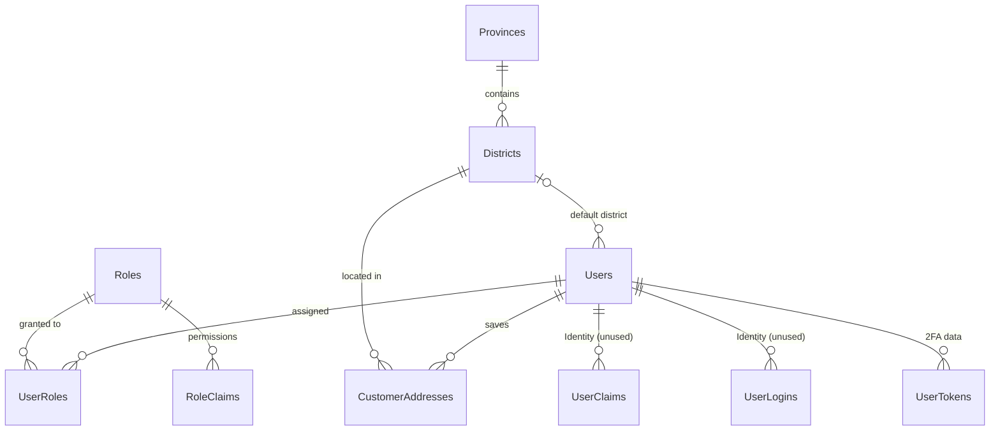
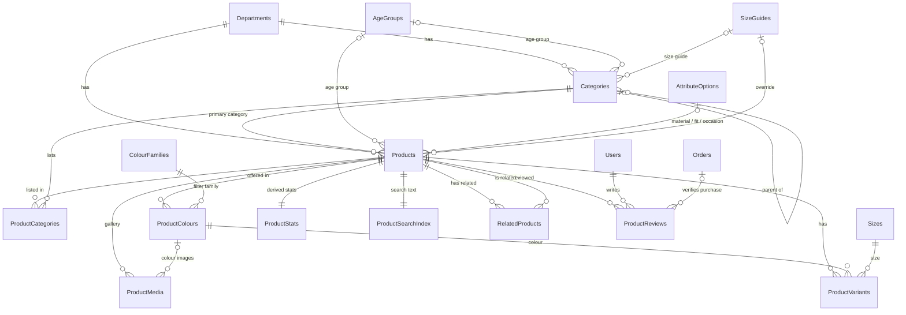
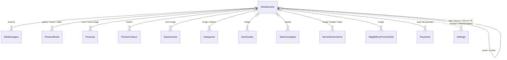
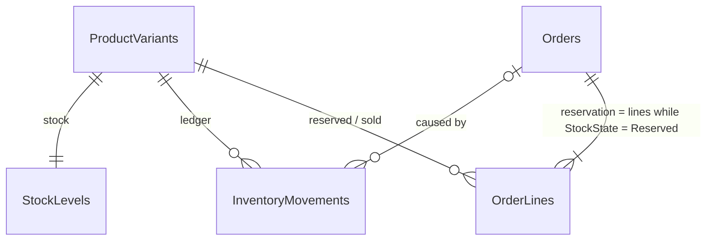
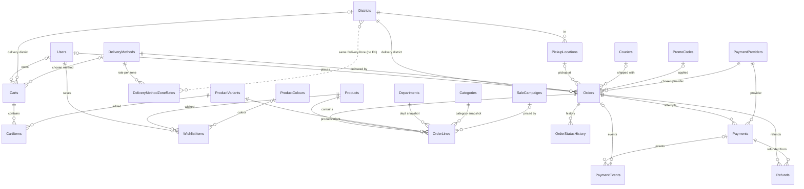
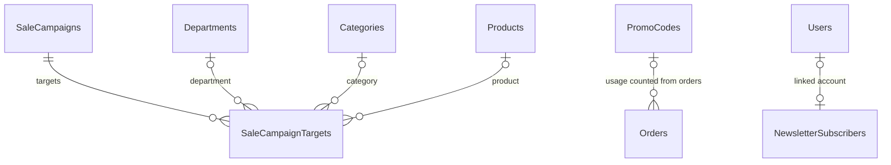
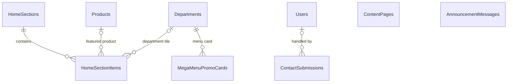
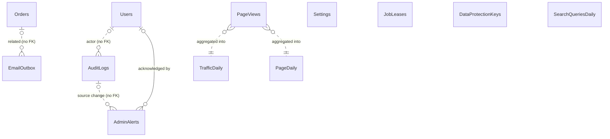
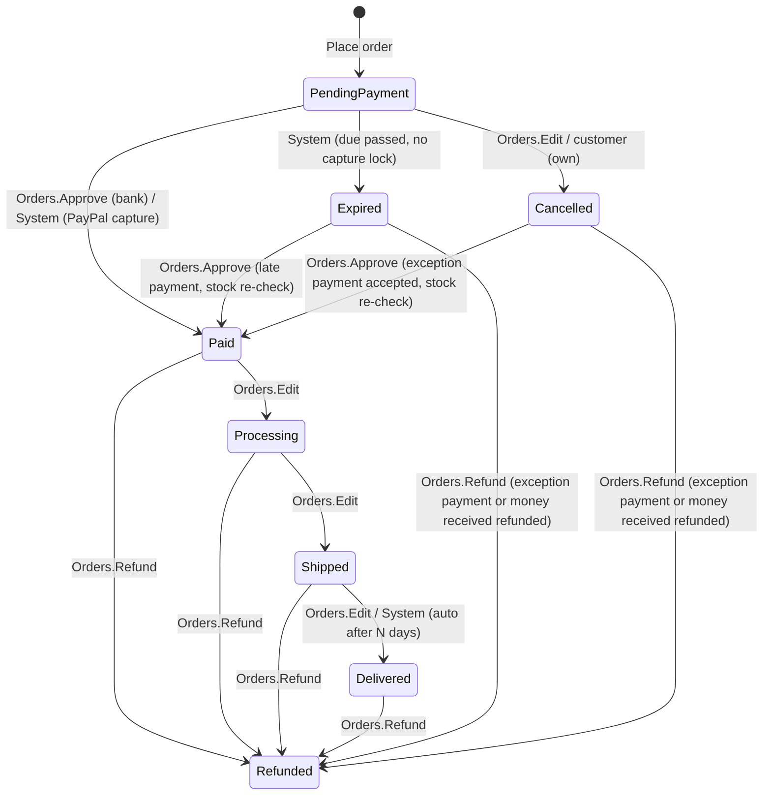

# 08 — Database Design

Last updated: 2026-09-22 · Status: **Revision 5.** Review rounds 1 (DB1–DB30, simplifications, traceability), 2 (N1–N17) and 3 (R1–R12; R11 is fixed in docs 02/03) applied. · Inputs: [01](01-project-understanding.md), [02](02-scope-baseline.md), [03](03-architecture-and-tech-stack.md), demo catalogue/filters (`../tuasl-fashion/js/products.js`, `filters.js`).

Design only. No application code. SQL fragments illustrate intent and are not final DDL. Items marked **(verify)** are unconfirmed and are checked in the week-0 spike. Items deferred from v1 are listed in **Appendix A**.

**Revision history**
- **Revision 5 — 2026-09-22.** Review-driven changes from the business-process review ([11](11-business-processes.md)), resolving gaps G-03, G-06, G-09, G-11, G-13, G-17b, G-18, G-23 and G-30: the System can no longer cancel an order (§4.1); `sales.Refunds.CreatedByUserId` is nullable so a provider webhook can create a refund (§3.5); money received on a bank transfer for an Expired or Cancelled order can now be refunded (§4.1, §4.3); auto-deliver skips PICKUP orders (§4.1); PDPA anonymisation is keyed by `EmailNormalized` and blocked by open orders (§3.1); `EmailConfirmation` added to the outbox templates with immediate body deletion (§3.8); PayPal-dashboard refunds have a defined effect on the order (§4.3); the promo discount is clamped so the grand total never falls below Rs. 1.00 (§6); `content.ContactSubmissions` permissions named (§3.7); `DashboardRefund` and `EmailDeliveryFailed` added to `ops.AdminAlerts` (§3.8).
- **Revision 4 — 2026-09-15.** Review round 3 (R1–R12) applied; build-time notes in **Appendix B**.

## 1. Overview and principles

### 1.1 Engine, edition limits, scale
- **Hosting:** one SQL Server 2025 **Express** instance (Linux container) hosts both the `SpencerDenim_Prod` and `SpencerDenim_Staging` databases. The move next year is to Azure SQL Database.
- **Express 2025 limits** (design inputs):

  | Limit | Value | How the design handles it |
  |---|---|---|
  | Database size | 50 GB max per database | Design stays ≈ 2–3 GB (§8.4) |
  | Buffer pool | 1,410 MB per instance, **shared by prod and staging** | Doc 03 budgets ~2 GB for SQL |
  | CPU | Lesser of 1 socket or 4 cores | Fine on the 2-vCPU VPS |
  | SQL Server Agent | None | All jobs are .NET `BackgroundService` with `ops.JobLeases`; backups run from a cron sidecar |
  | Backup compression | None | Backups are gzipped before the off-server copy |
  | Full-text | Included in Express 2025, but needs the `mssql-server-fts` package on Linux (a custom image) | Not used in v1 (§7.6) |

- **Planning scale:** ≤ 5,000 products, ≤ 50,000 variants, ≤ 30,000 orders/year, ≤ 20,000 page views/day. At this scale, live SQL over well-indexed tables serves listings and the dashboard. There is no search engine, cache server or summary tables for sales (the traffic daily tables are kept, §8).
- **Database options:**
  - `READ_COMMITTED_SNAPSHOT ON` (the Azure SQL default). Set by `tools/db/provision-database.sql` since issue #163 — before that nothing set it, and every database had it off. Every integration-test database is created by the same script, so the suite runs with it on. It changes plain `READ COMMITTED` reads only: they take the last committed version of a row instead of waiting for its writer. `UPDATE`/`DELETE` still lock the rows they change and re-check their predicate after waiting, so §5.2's conditional writes are unaffected; a read that *decides* a later write and relied on waiting needs `WITH (READCOMMITTEDLOCK)` (the campaign recompute, §7.4; `BankTransferProofStore.OpenPaymentAsync`).
  - Query Store ON.
  - Recovery model **FULL on production** with 15-minute log backups shipped off-server; **SIMPLE on staging** (§8.4).
- **Collation `Latin1_General_100_CI_AS_SC`** (DB23; a **week-0 decision**, set at database creation and costly to change later):
  - Version-100 sort weights plus supplementary-character awareness give correct `nvarchar` handling beyond the legacy `SQL_Latin1_General_CP1_CI_AS`.
  - Azure SQL Database accepts this collation at creation, and bacpac import keeps it.
  - Sinhala and Tamil sort, compare and `LIKE` behaviour is **verify-in-spike**: insert sample names, then sort and search them.

### 1.2 Schemas (65 tables)

| Schema | Module | Tables | # |
|---|---|---|---|
| `ref` | Shared reference data | Provinces, Districts | 2 |
| `identity` | ASP.NET Core Identity, RBAC, customer addresses | Users, Roles, UserRoles, RoleClaims (permissions), UserClaims, UserLogins, UserTokens, CustomerAddresses | 8 |
| `catalog` | Departments, categories, products, variants, attributes, reviews, size guides | Departments, Categories, AgeGroups, AttributeOptions, ColourFamilies, Sizes, Products, ProductStats, ProductSearchIndex, ProductCategories, ProductColours, ProductVariants, ProductMedia, RelatedProducts, SizeGuides, ProductReviews | 16 |
| `media` | Media library (public and private files) | MediaAssets, MediaUsages | 2 |
| `inventory` | Stock levels and ledger | StockLevels, InventoryMovements | 2 |
| `sales` | Cart, wishlist, delivery (zone rates), payment providers, orders (incl. invoice), payments | Carts, CartItems, WishlistItems, DeliveryMethods, DeliveryMethodZoneRates, PickupLocations, Couriers, PaymentProviders, NumberSeries, Orders, OrderLines, OrderStatusHistory, Payments, PaymentEvents, Refunds | 15 |
| `marketing` | Promo codes, sale campaigns, newsletter | PromoCodes, SaleCampaigns, SaleCampaignTargets, NewsletterSubscribers | 4 |
| `content` | CMS | HomeSections, HomeSectionItems, AnnouncementMessages, MegaMenuPromoCards, ContentPages, ContactSubmissions | 6 |
| `ops` | Settings, audit, admin alerts, email outbox, job leases, Data Protection keys | Settings, DataProtectionKeys, AuditLogs, AdminAlerts, EmailOutbox, JobLeases | 6 |
| `analytics` | Raw traffic and daily traffic/search aggregates | PageViews, TrafficDaily, PageDaily, SearchQueriesDaily | 4 |

- **Unused by design:** UserClaims and UserLogins exist for Identity compatibility and stay empty. UserTokens stores staff 2FA authenticator data.
- **Removed in revision 2** (Appendix A): PromoRedemptions, MediaRenditions, CustomerProfiles, StockReservations (derived), Invoices (folded into Orders), SizeScales (merged into Sizes), RolePermissions (replaced by RoleClaims), and all sales summary tables. Deferred: ProductTags, UrlRedirects.
- **Added in revision 3:** `sales.DeliveryMethodZoneRates` (N4; a light zone model instead of the deferred per-district rates) and `ops.AdminAlerts` (N2; persistent dashboard alerts that must be acknowledged).

### 1.3 Key strategy
- **`int IDENTITY`** is the default PK. It is 4 bytes in every FK and index, the clustered index is append-only, IDs are readable for admin and support, and it behaves the same on Azure SQL. No requirement calls for GUID keys.
- **`bigint IDENTITY`** is used for append-only, high-volume tables: PageViews, AuditLogs, EmailOutbox, InventoryMovements, PaymentEvents, OrderStatusHistory, MediaUsages.
- **`uniqueidentifier` is never a clustered key.** It is used only as an unguessable public token with a unique index: `Carts.Token`, `Orders.PublicId`, `Orders.CheckoutIdempotencyKey`, `MediaAssets.PublicId`, `NewsletterSubscribers.UnsubscribeToken`.
- **Natural keys** are unique alternate keys, never PKs: `Products.Slug`, `Products.ProductCode`, `ProductVariants.Sku`, `Orders.OrderNumber`, `Orders.InvoiceNumber`, `PromoCodes.Code`, `PaymentProviders.Code`.
- Identity uses `IdentityUser<int>` / `IdentityRole<int>`.

### 1.4 Naming and types
- Tables are PascalCase plural; the PK is `Id`; an FK is `{Role}{Entity}Id`. A 1:1 side table uses the parent key as its PK.
- Constraint prefixes: `PK_`, `FK_`, `IX_`, `UX_` (unique), `CK_`, `DF_`.
- **Money:** `decimal(18,2)`, LKR. `Currency char(3)` appears only on Orders, Payments and Refunds (CK `LKR`). The USD amount for PayPal lives in `Payments.Provider*` (§3.5, D1).
- **Percent:** `decimal(5,2)`. **Rating average:** `decimal(3,2)`. **Exchange rate:** `decimal(18,6)`.
- **Time:** `datetime2(3)` in UTC, with `…Utc` column names. The one exception is Identity's `LockoutEnd datetimeoffset`. Reporting dates are Colombo `date` values: Sri Lanka is a fixed UTC+05:30 with no DST, so conversion is `DATEADD(minute, 330, x)`.
- **Enums:** `tinyint` plus a CK, mapped to C# `enum : byte`. **Open-ended codes** (payment provider, delivery method, email template) are `varchar(30)`.
- **JSON (DB15):** always `nvarchar(max)` with `CK ISJSON(col) = 1`, mapped with an explicit `HasColumnType("nvarchar(max)")`. The native `json` type is deliberately **not** adopted in v1: explicit mapping stops EF from silently choosing `json` on SQL Server 2025 / Azure SQL targets, and keeps Express, bacpac and tooling parity. A later switch is a column-type migration.
- **Strings:** always sized. `nvarchar(max)` only for HTML, JSON and payloads. Codes, SKUs, storage keys and slugs are `varchar`.
- **Booleans:** `bit NOT NULL` with a default.

### 1.5 Standard columns
| Group | Columns | Applied to |
|---|---|---|
| Audit | `CreatedAtUtc` (DF `sysutcdatetime()`), `CreatedByUserId`, `UpdatedAtUtc`, `UpdatedByUserId` | Tables marked **[A]**. Set by an EF `SaveChanges` interceptor. **No FK** on the user columns (users are never hard-deleted), so there are no cascade-path issues |
| Soft delete | `IsDeleted bit DF 0`, `DeletedAtUtc`, `DeletedByUserId` | Marked **[SD]**: Products, Categories, MediaAssets, PromoCodes, SaleCampaigns, SizeGuides, ContentPages. Soft delete happens **only through an explicit `SoftDelete()` domain method**; `Remove()` on these entities throws (DB5, §10.2). Unique indexes are filtered `WHERE IsDeleted = 0` |
| Concurrency | `RowVersion rowversion` | Marked **[RV]**: admin-edited aggregates. Exchanged with the admin API as an ETag. Not used on hot rows (StockLevels, Carts) |

### 1.6 Integrity rules
- **Never deleted:** Users (anonymised instead), Orders, OrderLines, Payments, Refunds, PaymentEvents, InventoryMovements, AuditLogs.
- **FK delete rule:** `ON DELETE NO ACTION` by default. **CASCADE** only for pure child rows: CartItems, UserRoles, RoleClaims, UserClaims/Logins/Tokens, ProductCategories, ProductColours, ProductStats, ProductSearchIndex, RelatedProducts, ProductMedia, SaleCampaignTargets, HomeSectionItems, DeliveryMethodZoneRates. ProductStats and ProductSearchIndex are 1:1 side tables that exist only to serve their product's listing and search rows, and ProductColours has no meaning apart from its product, so all three die with it; the catalogue's own deletes are soft anyway (§1.5), so the cascade only runs on a purge. A unit test asserts the model cascades nothing outside this list. **Hard deletes** (carts, PDPA removals, purges) use set-based `ExecuteDelete`, never tracked `Remove()` (N12, §10.2).
- **FK-index policy (DB7):** every FK column is the **leading key of at least one index**. EF Core creates FK indexes by convention; a model unit test asserts that no FK lacks one (including media FKs, which the delete guard relies on). The index bullets in §3 list only the non-trivial indexes, but the convention indexes exist on every FK.
- **Concurrency invariants are enforced in the database:** CK constraints, (filtered) unique indexes, conditional UPDATEs with row-count checks, and `sp_getapplock` where a count must be serialised.
- **Checkout's hot path writes only `inventory.StockLevels`, `marketing.PromoCodes.UsageCount` and new rows.** Derived catalogue data (`ProductStats`, `ProductSearchIndex`) is never touched by checkout (DB6).
- **Filtered indexes** are only matched when the query predicate is a literal. Repository guideline: §10.2 (DB28).

### 1.7 Client-side only (no tables)
- **Recently viewed (PDP-07):** `localStorage` holds product IDs. **No table.**
- **Guest wishlist (WISH-01):** `localStorage`, merged into `sales.WishlistItems` on login.
- **Recent searches (SRCH-01):** `localStorage`. Popular searches come from `analytics.SearchQueriesDaily`.

## 2. ER diagrams

Entity names only. Solid lines are enforced FKs; dotted lines are logical links with no FK. Cross-module entities appear where a relationship crosses a module.

### 2.1 Identity, RBAC, customers


### 2.2 Catalog


### 2.3 Media (every FK to MediaAssets)


### 2.4 Inventory


### 2.5 Sales


### 2.6 Marketing


### 2.7 Content


### 2.8 Ops and analytics


## 3. Table definitions

Legend: **[A]** audit columns · **[SD]** soft delete · **[RV]** rowversion (§1.5; not repeated in column lists). "PK" = `int IDENTITY` unless stated. FK indexes exist by policy (§1.6).

### 3.1 `ref` and `identity`: reference data, users, RBAC, addresses

**Identity store decision (D7): one store with `UserType`** (1 Customer, 2 Staff) and one `AppUser : IdentityUser<int>`. Two stores would double the Identity plumbing (managers, token providers, reset flows, migrations) with no security gain. The consequence is that an email is unique across the store, so a staff member who shops uses another address.

**Scoping rules (DB10):**
- **Customer flows** (register, login, forgot/reset password, confirm email, change email) find users through use-case queries filtered `UserType = Customer` *before* calling `UserManager`. Staff accounts are invisible to them.
- **Responses are generic** whether the email is unknown, a customer or staff. For example: "If an account exists for this email, we've sent a link." Only a customer match triggers an email; a staff match sends nothing.
- **Register with an existing email** (either type) gives the same generic response. A customer match receives an "account already exists, sign in or reset" email.
- **Staff password reset** goes only through the admin app (`/admin/forgot-password`, filtered `UserType = Staff`) or a reset issued by a Super Admin. The customer reset endpoint can never reset a staff account.
- **Cookie schemes:** the customer scheme rejects Staff principals and the admin scheme rejects Customers, both at sign-in and on security-stamp revalidation (interval 1 min for admin).
- **Staff lockout and 2FA (N14)** are enforced in the **admin login use case** from `Security.*` settings. Identity's global lockout options are the customer baseline.
  - **Automatic lockout always applies and is time-boxed** (default 5 failures → 15 min), **including for the last Super Admin**. It expires by itself, so it can't permanently lock out the store.
  - **2FA is mandatory for GrantsAll holders.** Until enrolled, such a user can reach only the 2FA enrolment page.
  - **Recommendation:** at least **two** Super Admin accounts (client owner + vendor), created at handover (§9).
  - **Break-glass recovery:** a CLI command (`spencerdenim admin recover --email …`) run from the server shell with the **`sd_migrator`** login. It can re-enable or unlock a GrantsAll user, reset their 2FA and force a password change. It writes AuditLogs `BreakGlass`, raises an `AdminAlerts` row and emails all GrantsAll holders (`BreakGlassUsed`). The web app has no equivalent path.
    - **R8:** the `sd_migrator` password is **not stored in `.env`** or anywhere on the server. It is entered interactively when the CLI runs and held by the client / project owner. CI keeps its own copy in the pipeline secret store for the migration bundle.

#### `ref.Provinces` (GLB-06, CHK-01)
| Column | Type | Null | Notes |
|---|---|---|---|
| Id | int | N | PK (seeded 1–9, no identity) |
| Code | varchar(6) | N | UX. ISO 3166-2 `LK-1` |
| Name | nvarchar(60) | N | |

#### `ref.Districts` (GLB-06, CHK-01, ADM-08)
| Column | Type | Null | Notes |
|---|---|---|---|
| Id | int | N | PK (seeded 1–25, no identity) |
| ProvinceId | int | N | FK Provinces |
| Code | varchar(6) | N | UX. `LK-11` |
| Name | nvarchar(60) | N | UX |
| DeliveryZone | tinyint | N | 1 Colombo, 2 Western, 3 IslandWide. CK. **Admin-editable assignment** (`Settings.Edit`) that drives delivery rates (§3.5, N4). Adding a new zone value is a code change |
| SortOrder | smallint | N | |
| IsActive | bit | N | DF 1 |

#### `identity.Users` (ACC-01/02, ADM-01/02, ADM-15) [A]
| Column | Type | Null | Notes |
|---|---|---|---|
| Id | int | N | PK |
| UserType | tinyint | N | 1 Customer, 2 Staff. CK |
| UserName / NormalizedUserName | nvarchar(256) | Y | Identity (= email) |
| Email / NormalizedEmail | nvarchar(256) | Y | Identity |
| EmailConfirmed | bit | N | |
| PasswordHash, SecurityStamp, ConcurrencyStamp | nvarchar(max) | Y | Identity. **Never audited** (§3.8 redaction list) |
| PhoneNumber | varchar(20) | Y | E.164 |
| PhoneNumberConfirmed, TwoFactorEnabled, LockoutEnabled | bit | N | |
| LockoutEnd | datetimeoffset | Y | Identity |
| AccessFailedCount | int | N | |
| FirstName | nvarchar(80) | N | |
| LastName | nvarchar(80) | Y | |
| DefaultDistrictId | int | Y | FK Districts. Header district selector default (was CustomerProfiles) |
| IsActive | bit | N | DF 1 |
| MustChangePassword | bit | N | DF 0 |
| LastLoginAtUtc | datetime2(3) | Y | |
| CreatedAtUtc / UpdatedAtUtc | datetime2(3) | N/Y | |
| AnonymisedAtUtc | datetime2(3) | Y | PDPA |
- `UX_Users_NormalizedEmail` and `UX_Users_NormalizedUserName` (filtered NOT NULL).
- `IX_Users_UserType_CreatedAtUtc`.
- **Audit (N9):** Users is **[A]**. Staff-context changes are logged using the §3.8 redaction list (hash, stamps and tokens are never logged). Security events are also written as explicit actions: `StaffDeactivated` / `StaffReactivated`, `EmailChanged` (old and new address), `AdminPasswordReset`, `TwoFactorReset`, `RoleAssigned` / `RoleUnassigned`, `Lockout`, `BreakGlass`.
  - **Exception:** PDPA anonymisation writes no Users diff (R3).
  - **Old-address notice (R10):** when a GrantsAll holder's email changes, `StaffEmailChanged` is sent to both the old and the new address.
- **Customer statistics** (order count, lifetime spend, last order) are **computed live** from `sales.Orders` for the rows on screen (`IX_Orders_Customer_Placed`). No counters are stored (simplification 4).
- **Guest order linking (D5):** only after email confirmation, `UPDATE sales.Orders SET CustomerUserId = @u WHERE EmailNormalized = @e AND CustomerUserId IS NULL`. The linked order IDs are written to AuditLogs (Action `LinkGuestOrders`).

#### `identity.Roles` (ADM-02)
| Column | Type | Null | Notes |
|---|---|---|---|
| Id | int | N | PK |
| Name / NormalizedName | nvarchar(256) | N | UX NormalizedName |
| ConcurrencyStamp | nvarchar(max) | Y | Identity optimistic concurrency |
| Description | nvarchar(300) | Y | |
| IsSystem | bit | N | Seeded default roles; cannot be deleted |
| GrantsAllPermissions | bit | N | DF 0. **Seed-only, immutable** |
| CreatedAtUtc / UpdatedAtUtc | datetime2(3) | N/Y | |
- `UX_Roles_GrantsAll` (GrantsAllPermissions) `WHERE GrantsAllPermissions = 1`: **at most one** all-permissions role.
- The app login `sd_app` has `DENY UPDATE ON identity.Roles(GrantsAllPermissions)`, so only the migration login can set the flag.

#### `identity.UserRoles` (ADM-02)
| Column | Type | Null | Notes |
|---|---|---|---|
| UserId | int | N | PK part, FK Users (cascade) |
| RoleId | int | N | PK part, FK Roles (cascade). IX RoleId |
- CK-by-app: only `UserType = Staff` users receive roles.

#### `identity.RoleClaims`: permissions (ADM-02; simplification 7)
| Column | Type | Null | Notes |
|---|---|---|---|
| Id | int | N | PK (Identity) |
| RoleId | int | N | FK Roles (cascade) |
| ClaimType | nvarchar(50) | N | Always `perm` |
| ClaimValue | nvarchar(64) | N | `Module.Action`, e.g. `Orders.Approve` |
- `UX_RoleClaims_Role_Type_Value`.
- Managed through `RoleManager.AddClaimAsync` / `RemoveClaimAsync`. Code constants are the catalogue of valid values; a startup check logs unknown values.
- **Authorisation source (R4):** the permission handler computes effective permissions **only** from the `RoleClaims` of the user's roles plus the `GrantsAllPermissions` flag, read from the database and cached per SecurityStamp. It never trusts `perm` claims on the principal or in the cookie.
- **Modules:** Dashboard, Orders, Products, Categories, Inventory, Customers, Reviews, Promotions, Content, Media, Reports, Traffic, Newsletter, Users, Settings, AuditLog. **Actions:** View, Create, Edit, Delete, Approve, Export.
- **Special permissions:**
  - `Orders.Refund` (DB9; not granted to Order Staff);
  - `Settings.Payments` (DB2; bank details, payment providers, PayPal and FX);
  - **`Settings.Security`** (N2; **GrantsAll-only**): `Email.Smtp.*`, `Security.*`, `Privacy.RetainInvoiceBillTo` (R12) and any future authentication, security or privacy-retention setting. `CK_RoleClaims_NoSecurity` (`ClaimValue <> 'Settings.Security'`) stops it from ever being granted to a role, so only the GrantsAll role holds it;
  - `Users.Manage`.

**RBAC safety rules (DB4).** All of these are enforced in use cases, and every change is written to AuditLogs as `PermissionChange` with before/after lists:
1. **Only a user holding the GrantsAll role** may create, edit or delete roles, change role permissions, or assign or unassign the GrantsAll role.
2. **Subset rule (N3).** A `Users.Manage` holder without GrantsAll:
   - may assign or unassign a role **only if every permission of that role is in the actor's own effective set**;
   - may modify, reset the password or 2FA of, deactivate, reactivate or change the roles of a staff user **only if the target's effective permissions, before and after the change, are a subset of the actor's own**. GrantsAll holders are never a subset, so they are protected;
   - **cannot change any staff user's email**: that requires GrantsAll, because the email is the password-reset channel;
   - may create staff users only with roles that pass the first check.
3. Nobody can edit their own role assignments.
4. **Last Super Admin guard.** Any operation that could reduce active GrantsAll holders (unassign, deactivate, manual lock, delete; the automatic time-boxed lockout is exempt, N14) runs in one transaction:
   1. `sp_getapplock @Resource = 'rbac:grants-all', @LockMode = 'Exclusive', @LockOwner = 'Transaction'`;
   2. count active holders, excluding the target;
   3. require ≥ 1, apply the change, and commit.
5. A role or permission change bumps `SecurityStamp` for the affected users, which invalidates the cached permissions within the 1-min revalidation interval.

#### `identity.UserClaims`, `UserLogins`, `UserTokens`
Identity standard tables, renamed into `identity`. UserClaims and UserLogins stay empty; `CK_UserClaims_NoPerm` (`ClaimType <> 'perm'`) keeps permissions out of user claims (R4). UserTokens holds the staff authenticator key and recovery codes. These are never audited. Encrypting them at rest (Identity personal-data protection) is **optional**; see Appendix A.

#### `identity.CustomerAddresses` (CHK-01, ACC-02) [A]
| Column | Type | Null | Notes |
|---|---|---|---|
| Id | int | N | PK |
| UserId | int | N | FK Users |
| Label | nvarchar(40) | Y | |
| RecipientName | nvarchar(120) | N | |
| Phone | varchar(20) | N | |
| Line1 / Line2 | nvarchar(150) | N/Y | |
| City | nvarchar(80) | N | |
| DistrictId | int | N | FK Districts |
| PostalCode | varchar(10) | Y | |
| Landmark | nvarchar(150) | Y | |
| IsDefault | bit | N | |
- `UX_CustomerAddresses_UserId_Default` (UserId) `WHERE IsDefault = 1`.
- App cap: 10 addresses per customer.

#### PDPA anonymisation (G10; permission `Customers.Delete`)
One transaction, after staff verify the request.

**Keyed by `EmailNormalized`, not by user (G-17b).** The routine takes the normalised email address as its input, so a **guest** who never created an account — and therefore has no `identity.Users` row — can still be anonymised: steps 2–6 match on `EmailNormalized` (and on `CustomerUserId` as well when a `Users` row exists). Step 1 is skipped when there is no user row.

**Precondition — an open order blocks anonymisation (G-30).** The request is **refused** while the email has any order in `Status IN (0 PendingPayment, 1 Paid, 2 Processing, 3 Shipped)`: those orders are still being fulfilled and need the real name, phone and address. The error names the blocking order numbers, e.g. *"Cannot anonymise: orders SD-2026-000431, SD-2026-000512 are still open. Complete, cancel or let them expire first."* **`4 Delivered` does not block** (the order is finished; the invoice bill-to is preserved separately by `Privacy.RetainInvoiceBillTo`), and neither do `5 Cancelled`, `6 Expired` or `7 Refunded`.

**Audit suppression (R3):** every PII change below is a set-based `ExecuteUpdate` / `ExecuteDelete`. These bypass the `SaveChanges` audit interceptor, so **no Users or Orders before/after diff** holding the real email, phone or name is written, and no `EmailChanged` event is raised. The only new audit row is step 7.
1. **Users:** Email and UserName become `anon-{Id}@anonymised.invalid` (normalised columns too). PhoneNumber, LastName, PasswordHash and DefaultDistrictId are set to NULL, FirstName to `Anonymised`, and SecurityStamp is regenerated. `IsActive = 0`, `LockoutEnd = max`, and `AnonymisedAtUtc` is set.
2. **Deleted** (set-based `ExecuteDelete`, N12): CustomerAddresses, UserLogins/Tokens/Claims, the Cart and its items, WishlistItems, the NewsletterSubscribers row, ContactSubmissions and EmailOutbox rows for the email, and ProductReviews (then ProductStats rating is recomputed).
3. **Orders** (by CustomerUserId or EmailNormalized):
   - **Scrubbing writes placeholders, never NULLs, into NOT NULL or CK-guarded columns (N5).** This keeps `CK_Orders_ShipAddress` strict and the complex-type mapping unchanged.
     - Placeholders: `Anonymised` for FirstName, Ship_RecipientName, Ship_Line1 and Ship_City; `+94000000000` for Ship_Phone; `anon-o{OrderId}@anonymised.invalid` for Email (and EmailNormalized).
     - Nullable extras become NULL: LastName, Phone, Ship_Line2, Ship_Landmark, Ship_PostalCode.
   - **Always scrubbed:** Email (placeholder), Phone, CustomerNote, PlacedIpAddress.
   - **Unpaid orders** (never invoiced): the name and address snapshot is replaced with placeholders too.
   - **Invoiced orders** (DB27): the bill-to name and address are **kept while `Privacy.RetainInvoiceBillTo = true`** (default true, **pending the accountant's advice**, D2/D9) and scrubbed otherwise.
   - **Kept:** amounts, lines, SKUs, `DeliveryDistrictId`, status history, payments, refunds.
4. **Bank slip files** (`Payments.ProofAssetId`): deleted for unpaid orders; kept for paid orders under the same retention rule as invoices.
5. **PaymentEvents:** payer name and email in `PayloadJson` scrubbed with `JSON_MODIFY`.
6. **AuditLogs** for `EntityType IN ('User','Order','CustomerAddress')` and this user's IDs: personal fields in before/after JSON scrubbed. This runs **after** steps 1–5 in the same transaction, so it also covers rows written earlier (e.g. the customer's own profile edits).
7. **One AuditLogs row** `Anonymise`, holding only the UserId.
8. **Test (R3):** anonymise a customer who has orders (paid and unpaid), a review, an address, a newsletter row, queued emails, PayPal payment events and earlier audit rows. Then search **every table**, including `ops.AuditLogs`, `ops.EmailOutbox`, `ops.AdminAlerts` and `sales.PaymentEvents` payloads, for the original email, phone and name. Nothing may remain except the invoice bill-to name and address kept by `Privacy.RetainInvoiceBillTo`.

### 3.2 `catalog`: departments, categories, products, variants, reviews

#### `catalog.Departments` (GLB-05, HOME-02, DEPT-01) [A] [RV]
| Column | Type | Null | Notes |
|---|---|---|---|
| Id | int | N | PK (seeded 1 Women, 2 Men, 3 Kids) |
| Name | nvarchar(60) | N | UX |
| Slug | varchar(60) | N | UX |
| Description | nvarchar(1000) | Y | |
| HeroImageAssetId | int | Y | FK MediaAssets |
| SortOrder | smallint | N | |
| IsActive | bit | N | |
| SeoTitle / SeoDescription | nvarchar(160) / nvarchar(320) | Y | |
- The nav is fixed (Q5): there is no admin create or delete; admins edit only.

#### `catalog.Categories` (GLB-05, PLP-01, ADM-11, PDP-04) [A] [SD] [RV]
| Column | Type | Null | Notes |
|---|---|---|---|
| Id | int | N | PK |
| DepartmentId | int | N | FK Departments |
| ParentCategoryId | int | Y | FK Categories (self) |
| Path | varchar(200) | N | Materialised ID path `/12/34/`, maintained by the move use case |
| Depth | tinyint | N | CK ≤ 3 |
| Name | nvarchar(80) | N | |
| Slug | varchar(100) | N | |
| Description | nvarchar(2000) | Y | |
| ImageAssetId / BannerAssetId | int | Y | FK MediaAssets |
| BannerLinkUrl | nvarchar(500) | Y | |
| AgeGroupId | int | Y | FK AgeGroups |
| SizeGuideId | int | Y | FK SizeGuides. Inherited from the nearest ancestor when NULL |
| SortOrder | int | N | Sibling order |
| ShowInMegaMenu | bit | N | |
| MegaMenuColumn | tinyint | Y | 1–4 |
| IsActive | bit | N | |
| SeoTitle / SeoDescription | nvarchar(160) / nvarchar(320) | Y | |
- `UX_Categories_Dept_Parent_Slug` `WHERE IsDeleted = 0`.
- `IX_Categories_Path`.
- `IX_Categories_Dept_Parent_Sort` INCLUDE (Name, Slug, IsActive, ShowInMegaMenu).
- The tree (about 200 rows) is cached per instance and invalidated on change.
- Soft delete is blocked while the category has active products or child categories.

#### `catalog.AgeGroups` (PLP-02, DEPT-01) [A]
| Column | Type | Null | Notes |
|---|---|---|---|
| Id | int | N | PK |
| Name | nvarchar(40) | N | UX |
| Slug | varchar(40) | N | UX |
| MinMonths / MaxMonths | smallint | Y | |
| SortOrder | smallint | N | |
| IsActive | bit | N | |

#### `catalog.AttributeOptions` (PLP-02, PDP-05, ADM-10) [A]
| Column | Type | Null | Notes |
|---|---|---|---|
| Id | int | N | PK |
| AttributeType | tinyint | N | 1 Material, 2 Fit, 3 Occasion. CK. (Style is deferred, Appendix A) |
| Name | nvarchar(60) | N | |
| Slug | varchar(60) | N | |
| SortOrder | smallint | N | |
| IsActive | bit | N | |
- `UX_AttributeOptions_Type_Slug`.

#### `catalog.ColourFamilies` (PLP-02, CARD-01)
| Column | Type | Null | Notes |
|---|---|---|---|
| Id | int | N | PK |
| Name | nvarchar(30) | N | UX |
| Slug | varchar(30) | N | UX |
| HexCode | char(7) | N | |
| SortOrder | smallint | N | |

#### `catalog.Sizes` (PLP-02, PDP-03; simplification 6)
| Column | Type | Null | Notes |
|---|---|---|---|
| Id | int | N | PK |
| ScaleName | nvarchar(40) | N | "Alpha", "Women waist", "Kids age", "Baby months", "Footwear EU", "One size". The admin picks an existing name or types a new one |
| Label | nvarchar(20) | N | "M", "32", "4–5Y" |
| SortOrder | smallint | N | Order within the scale |
- `UX_Sizes_Scale_Label` (ScaleName, Label).
- `IX_Sizes_Scale_Sort` (ScaleName, SortOrder).

#### `catalog.Products` (ADM-10, CARD-01, PDP-02/05, GLB-11, DEPT-02) [A] [SD] [RV]
| Column | Type | Null | Notes |
|---|---|---|---|
| Id | int | N | PK |
| ProductCode | varchar(40) | N | |
| Name | nvarchar(200) | N | |
| Slug | varchar(220) | N | `/p/{slug}`. Redirects are deferred (Appendix A), so after first publish the admin must confirm a slug change with a "breaks existing links" warning |
| DepartmentId | int | N | FK Departments |
| PrimaryCategoryId | int | N | FK Categories (same department, app check) |
| AgeGroupId | int | Y | FK AgeGroups. Required for Kids (app) |
| ShortDescription | nvarchar(500) | Y | |
| Description | nvarchar(max) | Y | Sanitised HTML |
| CareInstructions | nvarchar(1000) | Y | |
| MaterialId / FitId / OccasionId | int | Y | FK AttributeOptions (type-checked in app) |
| BasePrice | decimal(18,2) | N | CK > 0 |
| CompareAtPrice | decimal(18,2) | Y | Original price. CK NULL or > BasePrice |
| BadgeOverride | tinyint | Y | **Admin-assigned badge** (ADM-10; the demo's `badge`): 1 New, 2 Sale, 3 Online Exclusive, 4 Best Seller. CK |
| NewUntilUtc | datetime2(3) | Y | Computed "New" badge and New Arrivals. Defaulted on first publish to publish date + `Catalog.NewArrivalDays` |
| RecommendedRank | int | Y | Global merchandising pin (§7.3) |
| SizeGuideId | int | Y | FK SizeGuides |
| CardImageAssetId / HoverImageAssetId | int | Y | FK MediaAssets. Denormalised from ProductMedia on save |
| IsPublished | bit | N | DF 0 |
| FirstPublishedAtUtc | datetime2(3) | Y | Set once |
| SeoTitle / SeoDescription | nvarchar(160) / nvarchar(320) | Y | |
- `UX_Products_Slug`, `UX_Products_ProductCode` `WHERE IsDeleted = 0`.
- `IX_Products_Listing` (DepartmentId, PrimaryCategoryId) INCLUDE (AgeGroupId, MaterialId, FitId, OccasionId, FirstPublishedAtUtc, RecommendedRank, NewUntilUtc, BadgeOverride, Name, Slug, CardImageAssetId, HoverImageAssetId) `WHERE IsPublished = 1 AND IsDeleted = 0`.
- `IX_Products_NewUntilUtc` `WHERE IsPublished = 1 AND IsDeleted = 0`.
- **Card badge (one shown):** `BadgeOverride` if set; otherwise the computed badges in this order:
  1. **Sale** (`ProductStats.HasDiscount`);
  2. **Low Stock** (read-time: `0 < Σ Available ≤ Σ COALESCE(variant LowStockThreshold, Inventory.DefaultLowStockThreshold)` over active variants, i.e. per-variant thresholds, N11);
  3. **Best Seller** (read-time: top `Catalog.BestSellerTopN` by `SoldQty30d` in the department; not stored);
  4. **New** (`NewUntilUtc > now`).

#### `catalog.ProductStats` (PLP-02/04, CARD-01, PDP-08) 1:1 derived data, no rowversion
| Column | Type | Null | Notes |
|---|---|---|---|
| ProductId | int | N | PK, FK Products |
| MinListPrice / MaxListPrice | decimal(18,2) | N | Over active variants |
| MinSalePrice / MaxSalePrice | decimal(18,2) | N | After the best active campaign (§6) |
| MaxOriginalPrice | decimal(18,2) | N | `max(original, list)` (§6) |
| MaxDiscountPercent | decimal(5,2) | N | (original − sale) / original, over variants |
| HasDiscount | bit | N | |
| RatingAverage | decimal(3,2) | Y | Approved reviews |
| RatingCount | int | N | |
| SoldQty30d / SoldQtyTotal | int | N | Nightly, from paid OrderLines |
| PricingRefreshedAtUtc / StatsRefreshedAtUtc | datetime2(3) | N | |
- `IX_ProductStats_MinSalePrice` INCLUDE (HasDiscount, MaxDiscountPercent, RatingAverage, SoldQty30d).
- **Stock is not stored here (DB6).** In-stock filtering and the Low Stock badge are computed at read time from `inventory.StockLevels` (§7.2), so checkout never writes this table. Sync rules: §7.4.

#### `catalog.ProductSearchIndex` (SRCH-01/02) 1:1
| Column | Type | Null | Notes |
|---|---|---|---|
| ProductId | int | N | PK, FK Products |
| NameText | nvarchar(200) | N | Lower-cased name |
| SearchText | nvarchar(2000) | N | Name, category path names, colour names and families, material, fit, occasion, ProductCode, SKUs (tags deferred) |
| UpdatedAtUtc | datetime2(3) | N | |

#### `catalog.ProductCategories` (PLP-01, HOME-06)
| Column | Type | Null | Notes |
|---|---|---|---|
| CategoryId | int | N | PK part, FK Categories |
| ProductId | int | N | PK part, FK Products (cascade). IX ProductId |
| SortOrder | int | Y | Manual order within this category (§7.3) |
- The primary category is also stored here.

#### `catalog.ProductColours` (PDP-01/03, CARD-01, PLP-02)
| Column | Type | Null | Notes |
|---|---|---|---|
| Id | int | N | PK |
| ProductId | int | N | FK Products (cascade) |
| Name | nvarchar(60) | N | "Floral Blue" |
| ColourFamilyId | int | N | FK ColourFamilies |
| SwatchHex | char(7) | Y | |
| SwatchAssetId | int | Y | FK MediaAssets |
| SortOrder | smallint | N | |
- `UX_ProductColours_Product_Name`.
- `UX_ProductColours_Id_ProductId`, the target of the composite FK from variants.
- `IX_ProductColours_ColourFamily` (ColourFamilyId, ProductId).

#### `catalog.ProductVariants` (ADM-10, PDP-03, CART-01) [A] [RV]
| Column | Type | Null | Notes |
|---|---|---|---|
| Id | int | N | PK |
| ProductId | int | N | FK Products |
| ProductColourId | int | N | Composite FK (ProductColourId, ProductId) → ProductColours (Id, ProductId) |
| SizeId | int | N | FK Sizes |
| Sku | varchar(64) | N | UX |
| Barcode | varchar(32) | Y | Filtered UX |
| PriceOverride | decimal(18,2) | Y | CK NULL or > 0 |
| CompareAtPriceOverride | decimal(18,2) | Y | CK NULL or > 0 |
| IsActive | bit | N | Deactivate once ordered; never delete |
| SortOrder | smallint | N | |
- `CK_ProductVariants_CompareAtGtPrice` (DB17): `CompareAtPriceOverride IS NULL OR PriceOverride IS NULL OR CompareAtPriceOverride > PriceOverride`.
- The cross-table case (a variant override vs the product's BasePrice or CompareAtPrice) can't be a CK. It is validated on save, and pricing uses `original = max(original, list)`, so a discount is never negative.
- `UX_ProductVariants_Colour_Size`.
- `IX_ProductVariants_Size` (SizeId, ProductId) INCLUDE (IsActive).
- `IX_ProductVariants_Product` (ProductId) INCLUDE (IsActive, SizeId).

#### `catalog.ProductMedia` (PDP-01, ADM-10)
| Column | Type | Null | Notes |
|---|---|---|---|
| Id | int | N | PK |
| ProductId | int | N | FK Products (cascade) |
| MediaAssetId | int | N | FK MediaAssets (NO ACTION) |
| ProductColourId | int | Y | FK ProductColours |
| MediaRole | tinyint | N | 1 Gallery, 2 Hover, 3 Video. CK |
| SortOrder | smallint | N | |
| AltTextOverride | nvarchar(250) | Y | |
- `UX_ProductMedia_Product_Asset_Colour`.
- `IX (ProductId, ProductColourId, SortOrder)`.

#### `catalog.RelatedProducts` (PDP-06)
| Column | Type | Null | Notes |
|---|---|---|---|
| ProductId | int | N | PK part, FK (cascade) |
| RelatedProductId | int | N | PK part, FK Products (NO ACTION). CK ≠ ProductId. IX |
| SortOrder | smallint | N | |
- The PDP tops up to 4 with same-category products (query).

#### `catalog.SizeGuides` (PDP-04, ADM-17) [A] [SD] [RV]
| Column | Type | Null | Notes |
|---|---|---|---|
| Id | int | N | PK |
| Name | nvarchar(100) | N | |
| IntroHtml | nvarchar(max) | Y | |
| TableJson | nvarchar(max) | N | CK ISJSON |
| MeasuringTipsHtml | nvarchar(max) | Y | |
| ImageAssetId | int | Y | FK MediaAssets |

#### `catalog.ProductReviews` (PDP-08, ADM-16) [RV]
| Column | Type | Null | Notes |
|---|---|---|---|
| Id | int | N | PK |
| ProductId | int | N | FK Products |
| CustomerUserId | int | N | FK Users |
| OrderId | int | Y | FK Orders: the qualifying **Delivered** order (D4) |
| Rating | tinyint | N | CK 1–5 |
| Title | nvarchar(120) | Y | |
| Body | nvarchar(4000) | Y | |
| DisplayName | nvarchar(60) | N | Snapshot |
| IsVerifiedBuyer | bit | N | 1 when a Delivered order of this customer contains the product |
| Status | tinyint | N | 0 Pending, 1 Approved, 2 Hidden. CK |
| ModeratedByUserId | int | Y | |
| ModeratedAtUtc | datetime2(3) | Y | |
| ModerationNote | nvarchar(500) | Y | |
| CreatedAtUtc / UpdatedAtUtc | datetime2(3) | N/Y | |
- `UX_ProductReviews_Product_Customer` (one review per customer per product).
- `IX_ProductReviews_Product_Status_Created` INCLUDE (Rating).
- `IX_ProductReviews_Status_Created`.

### 3.3 `media`: library (ADM-18, HOME-01, PDP-01, GLB-02, PAY-01)

Files live in `IFileStorage` (local volume now, Azure Blob later). The DB stores metadata and **relative storage keys** only; public URLs are built from config.

**Renditions use a key convention, with no table** (simplification 3): `public/renditions/{PublicId}/{code}.webp`. The codes and target widths are code constants: `thumb` 160, `card` 600, `large` 1200, `zoom` 2000, keeping the aspect ratio. `RenditionSetVersion` records which set was generated; a background job regenerates assets with an older version.

#### `media.MediaAssets` [A] [SD]
| Column | Type | Null | Notes |
|---|---|---|---|
| Id | int | N | PK |
| PublicId | uniqueidentifier | N | UX |
| MediaType | tinyint | N | 1 Image, 2 Video, 3 Document. CK |
| Visibility | tinyint | N | 1 Public (served from `/media` with long cache), 2 **Private** (customer bank slips: stored on the **separate private uploads volume, which is not mounted in Caddy** (doc 03); streamed only by an authorised API with `Orders.View`; excluded from the library UI). CK |
| Status | tinyint | N | 0 Processing, 1 Ready, 2 Failed. CK |
| OriginalFileName | nvarchar(255) | N | |
| StorageKey | varchar(400) | N | UX. `public/originals/…` or `private/…` |
| ContentType | varchar(100) | N | Checked by file signature. PDF only when Visibility = Private |
| SizeBytes | bigint | N | CK: video ≤ 50 MB; private ≤ 5 MB |
| Width / Height | int | Y | |
| DurationSeconds | decimal(9,2) | Y | |
| PosterAssetId | int | Y | FK MediaAssets (self). **CK MediaType = 2 ⇒ NOT NULL** |
| RenditionSetVersion | tinyint | Y | Images only |
| Checksum | binary(32) | N | SHA-256. IX |
| AltText | nvarchar(250) | Y | Required for public images on publish |
| Title | nvarchar(150) | Y | |
| UploadedByUserId | int | Y | NULL for guest bank-slip uploads |
- `IX_MediaAssets_Library` (Visibility, MediaType, CreatedAtUtc DESC) `WHERE IsDeleted = 0`.
- **Guest bank-slip upload (N10):**
  - Only through the order's `PublicId` link, and only while the order is PendingPayment with an open bank-transfer payment.
  - Rate-limited to 5 uploads per hour per order and per IP.
  - Image or PDF, ≤ 5 MB, checked by file signature.
  - **At most one current file per payment:** a new upload replaces `Payments.ProofAssetId`. The previous private asset is soft-deleted, and its file follows the payment retention rule (§8.4).

#### `media.MediaUsages`: "where used" and the delete guard
| Column | Type | Null | Notes |
|---|---|---|---|
| Id | bigint | N | PK |
| MediaAssetId | int | N | FK MediaAssets |
| OwnerType | varchar(40) | N | `Product`, `ProductColour`, `Category`, `Department`, `HomeSectionItem`, `MegaMenuPromoCard`, `SizeGuide`, `SaleCampaign`, `MediaAsset` (poster), `ContentPage` (inline HTML), **`Setting`** (logo, favicon, OG image) |
| OwnerId | varchar(100) | N | Entity ID, or the Setting key |
| UsageRole | varchar(40) | N | |
| CreatedAtUtc | datetime2(3) | N | |
- `UX_MediaUsages_Asset_Owner_Role`.
- `IX_MediaUsages_Owner` (OwnerType, OwnerId).
- Real FKs (NO ACTION) protect structured references. MediaUsages covers references without an FK (Settings, inline HTML) and feeds the "used in…" panel.
- An owner's save rewrites its usage rows in the same transaction. Delete is a soft delete, allowed only with no usages; files are purged after 30 days.

### 3.4 `inventory`: stock and ledger (ADM-12, PDP-02, CHK-01, ADM-08)

**Decision on simplification 1: reservations are derived, not stored.**
- A reservation always covers *all* lines of *one* order and lasts exactly while `Orders.StockState = 0 (Reserved)`. A `StockReservations` table would therefore only duplicate `OrderLines (VariantId, Quantity)` and add per-row statuses that must be kept consistent with the order.
- Deriving it makes every stock transition start with **one conditional UPDATE on the order row** (`… WHERE Id = @id AND StockState = 0 AND Status = @expected`). That single statement is the atomic claim that stops the expiry job, a webhook and a staff member from double-releasing or double-deducting. Only the winner then adjusts `StockLevels` for that order's lines, in VariantId order.
- Reconciliation (DB3) becomes one aggregate: `Σ OrderLines.Quantity` of orders with `StockState = 0`, per variant, compared with `StockLevels.Reserved`.
- Nothing is lost, because expiry is per order (`Orders.PaymentDueAtUtc`), never per line.

#### `inventory.StockLevels` 1:1 with ProductVariants (hot row, no rowversion)
| Column | Type | Null | Notes |
|---|---|---|---|
| VariantId | int | N | PK, FK ProductVariants |
| OnHand | int | N | CK ≥ 0 |
| Reserved | int | N | CK ≥ 0. Held by orders in StockState Reserved |
| Available | AS (OnHand − Reserved) PERSISTED | N | |
| LowStockThreshold | int | Y | NULL → `Inventory.DefaultLowStockThreshold` |
| UpdatedAtUtc | datetime2(3) | N | |
- `CK_StockLevels_ReservedLeOnHand` (Reserved ≤ OnHand).
- `IX_StockLevels_Available` (Available) INCLUDE (LowStockThreshold, OnHand).

#### `inventory.InventoryMovements`: append-only ledger (ADM-12, ADM-19)
| Column | Type | Null | Notes |
|---|---|---|---|
| Id | bigint | N | PK |
| VariantId | int | N | FK ProductVariants |
| MovementType | tinyint | N | 1 Initial, 2 Receive, 3 AdjustIn, 4 AdjustOut, 5 Reserve, 6 Release, 7 Sale, 8 Restock, 9 CountCorrection (manual only). CK |
| OnHandDelta / ReservedDelta | int | N | |
| OnHandAfter / ReservedAfter | int | N | From the UPDATE's `OUTPUT` |
| OrderId | int | Y | FK Orders |
| BatchId | uniqueidentifier | Y | Bulk update |
| Reason | nvarchar(250) | Y | Required for Adjust and CountCorrection |
| CreatedByUserId | int | Y | NULL = system |
| CreatedAtUtc | datetime2(3) | N | |
- `IX_InventoryMovements_Variant_Created` (VariantId, CreatedAtUtc DESC).
- `IX (OrderId) WHERE OrderId IS NOT NULL`.
- `IX (BatchId) WHERE BatchId IS NOT NULL`.
- Kept for the life of the system.

### 3.5 `sales`: cart, wishlist, delivery, payment providers, orders, payments

**Cart decision: server-side for everyone.** Logged-in customers get an account cart; guests get an HttpOnly, Secure, SameSite=Lax cookie holding `Carts.Token` (30-day sliding).

Why server-side:
- SSR renders the bag count and the mini bag (CART-02).
- Price, stock and promo validation live in one place.
- Merge on login is a single server operation.
- The bag works across devices.

Stock is **not** reserved in the cart. The cart row is created on the first Add to Bag, never on a page view.

**Concurrency (DB22):** no rowversion. Carts are edited through **item-level upserts**:
- **Add:** `UPDATE CartItems SET Quantity = IIF(Quantity + @q > 10, 10, Quantity + @q) WHERE CartId = @c AND VariantId = @v`. If 0 rows, INSERT; on a unique violation (2627/2601), retry the UPDATE.
- **Set quantity / remove:** a single UPDATE or DELETE.
- **Header fields** (district, method, promo text): single-column last-writer-wins updates.

#### `sales.Carts` (CART-01/02)
| Column | Type | Null | Notes |
|---|---|---|---|
| Id | int | N | PK |
| Token | uniqueidentifier | N | UX |
| CustomerUserId | int | Y | FK Users |
| PromoCodeText | varchar(40) | Y | Revalidated on every read |
| DistrictId | int | Y | FK Districts |
| DeliveryMethodId | int | Y | FK DeliveryMethods |
| CreatedAtUtc / LastActivityAtUtc | datetime2(3) | N | |
- `UX_Carts_Customer` `WHERE CustomerUserId IS NOT NULL`.
- `IX_Carts_LastActivity` (purge: guest carts after 30 days, customer carts after 180 days).
- **Merge on login:** guest items are upserted into the customer cart (capped at 10 and at Available), then the guest cart is deleted.

#### `sales.CartItems` (CART-01)
| Column | Type | Null | Notes |
|---|---|---|---|
| Id | int | N | PK |
| CartId | int | N | FK Carts (cascade) |
| VariantId | int | N | FK ProductVariants |
| Quantity | smallint | N | CK 1–10 |
| UnitPriceAtAdd | decimal(18,2) | N | Used to show "price changed" |
| AddedAtUtc / UpdatedAtUtc | datetime2(3) | N/Y | |
- `UX_CartItems_Cart_Variant`.

#### `sales.WishlistItems` (WISH-01)
| Column | Type | Null | Notes |
|---|---|---|---|
| Id | int | N | PK |
| CustomerUserId | int | N | FK Users |
| ProductId | int | N | FK Products |
| ProductColourId | int | Y | FK ProductColours |
| AddedAtUtc | datetime2(3) | N | |
- `UX_WishlistItems_Customer_Product`.
- The login merge inserts with `WHERE NOT EXISTS`.

#### `sales.DeliveryMethods` (CHK-02, PDP-05, ADM-22) [A] [RV]
| Column | Type | Null | Notes |
|---|---|---|---|
| Id | int | N | PK |
| Code | varchar(20) | N | UX. `STANDARD`, `EXPRESS`, `PICKUP` |
| Name | nvarchar(60) | N | |
| Description | nvarchar(300) | Y | |
| IsEnabled | bit | N | |
| RequiresAddress | bit | N | 0 for PICKUP |
| SortOrder | smallint | N | |
- Fees, thresholds and estimates live in `DeliveryMethodZoneRates` (N4).

#### `sales.DeliveryMethodZoneRates` (GLB-06, CHK-02, PDP-05; N4) [A] [RV]
| Column | Type | Null | Notes |
|---|---|---|---|
| DeliveryMethodId | int | N | PK part, FK DeliveryMethods (cascade) |
| DeliveryZone | tinyint | N | PK part. 1 Colombo, 2 Western, 3 IslandWide (same CK as `ref.Districts.DeliveryZone`) |
| IsAvailable | bit | N | e.g. Express unavailable island-wide |
| Fee | decimal(18,2) | N | CK ≥ 0 |
| FreeAboveAmount | decimal(18,2) | Y | NULL = never free |
| EstimatedDaysMin / EstimatedDaysMax | tinyint | N | CK Min ≤ Max |
- **Why a table rather than JSON on DeliveryMethods:** rates get CK validation, row-level admin editing and audit, and a direct join from checkout. JSON would move all of that into application code.
- **Lookup:** `District.DeliveryZone` → the row (DeliveryMethodId, DeliveryZone). A method is offered only when `DeliveryMethods.IsEnabled = 1` and that row exists with `IsAvailable = 1`. A missing row means "unavailable", and an admin check warns about gaps.
- **Which district applies (R7):**
  - Delivery uses the address district; **PICKUP uses the pickup location's district zone**.
  - Before a district is chosen, the PDP and cart use `Users.DefaultDistrictId` for signed-in customers. Otherwise they use the setting `Delivery.DefaultZone` (default 3 IslandWide, the most conservative), labelled "estimate for {zone}, change district".
- **Readers:**
  - checkout and cart totals (§6);
  - the PDP delivery estimate (PDP-05);
  - the header district selector (GLB-06). Its district is stored in `Carts.DistrictId` and, at placement, snapshotted to `Orders.DeliveryDistrictId` / `DeliveryZone`.
- Seeded values are **placeholders, client to confirm (D8)** (§9).

#### `sales.PickupLocations` (CHK-02) [A]
| Column | Type | Null | Notes |
|---|---|---|---|
| Id | int | N | PK |
| Name | nvarchar(100) | N | |
| AddressLine | nvarchar(250) | N | |
| City | nvarchar(80) | N | |
| DistrictId | int | N | FK Districts |
| Phone | varchar(20) | Y | |
| OpeningHours | nvarchar(200) | Y | |
| IsActive | bit | N | |
| SortOrder | smallint | N | |

#### `sales.Couriers` (ADM-09, ADM-22, ACC-02) [A]
| Column | Type | Null | Notes |
|---|---|---|---|
| Id | int | N | PK |
| Name | nvarchar(80) | N | UX |
| TrackingUrlTemplate | nvarchar(500) | Y | CK contains `{trackingNumber}` when not NULL |
| Phone | varchar(20) | Y | |
| IsActive | bit | N | |
| SortOrder | smallint | N | |
- Tracking links are rendered from the current template.

#### `sales.PaymentProviders` (PAY-01, PAY-03; permission `Settings.Payments`) [A] [RV]
| Column | Type | Null | Notes |
|---|---|---|---|
| Code | varchar(30) | N | **PK.** `BankTransfer`, `PayPal`, future gateways. A natural key is used deliberately: a tiny, code-matched list referenced by FKs from Orders and Payments |
| DisplayName | nvarchar(60) | N | |
| IsEnabled | bit | N | **Either provider can be switched off**. Checkout lists enabled providers only |
| DisplayOrder | smallint | N | |
| CheckoutDescription | nvarchar(300) | Y | |
- Enabling a provider requires its settings to be valid (e.g. PayPal credentials and a fresh FX rate).
- Changes are audited with values and trigger the Super Admin alert (§3.8, DB2).
- Credentials live in `ops.Settings`, not here.

#### `sales.NumberSeries`: order and invoice numbers
| Column | Type | Null | Notes |
|---|---|---|---|
| SeriesKey | varchar(30) | N | PK. `ORDER-2026`, `INVOICE-2026` |
| Prefix | varchar(10) | N | `SD`, `INV` |
| NextValue | int | N | |
| UpdatedAtUtc | datetime2(3) | N | |

**How numbers are allocated:**
- `UPDATE … SET NextValue = NextValue + 1 OUTPUT deleted.NextValue WHERE SeriesKey = @k`. The row is inserted lazily (retry on a PK violation). The year is the Colombo year.
- **Order numbers** (`SD-2026-000123`) are allocated in a short **separate** transaction before checkout. Gaps are allowed, and checkouts don't serialise on the row.
- **Invoice numbers** (`INV-2026-000045`) are allocated **inside** the Paid transaction, so they are gapless.
- A `SEQUENCE` is not used: it can't reset per year safely and never rolls back.

#### `sales.Orders` (CHK-01..04, ADM-09, ACC-02; invoice folded in) [A] [RV]
| Column | Type | Null | Notes |
|---|---|---|---|
| Id | int | N | PK |
| OrderNumber | varchar(20) | N | UX |
| PublicId | uniqueidentifier | N | UX. Guest order link |
| CheckoutIdempotencyKey | uniqueidentifier | N | UX |
| CustomerUserId | int | Y | FK Users |
| Status | tinyint | N | 0 PendingPayment, 1 Paid, 2 Processing, 3 Shipped, 4 Delivered, 5 Cancelled, 6 Expired, 7 Refunded. CK |
| StockState | tinyint | N | 0 Reserved, 1 Committed, 2 Released, **3 Restocked** (N8: set only inside the conditional transition to Refunded with restock). CK |
| CaptureLockedUntilUtc | datetime2(3) | Y | **DB1/N1:** set to claim time + `Payments.PayPal.CaptureLockHours` (default **3 h**) when a capture is claimed; cleared when the capture resolves. Expiry and cancel skip the order while this is in the future, so an order with a Capturing payment younger than 3 h is never expired |
| PaymentProviderCode | varchar(30) | N | FK PaymentProviders |
| Email / EmailNormalized | nvarchar(256) | N | |
| Phone | varchar(20) | Y | NULL after anonymisation |
| FirstName / LastName | nvarchar(80) | N/Y | Bill-to name |
| DeliveryDistrictId | int | N | **Entity-level FK** Districts: the delivery address district, or the pickup location's district |
| DeliveryDistrictName | nvarchar(60) | N | Snapshot |
| DeliveryZone | tinyint | N | Snapshot of the district's zone at placement (N4) |
| ShipAddress (complex, **required**) | — | — | `AddressSnapshot` with **all inner columns nullable**: `Ship_RecipientName nvarchar(120)`, `Ship_Phone varchar(20)`, `Ship_Line1/Line2 nvarchar(150)`, `Ship_City nvarchar(80)`, `Ship_PostalCode varchar(10)`, `Ship_Landmark nvarchar(150)` |
| DeliveryMethodId | int | N | **Entity-level FK** DeliveryMethods |
| PickupLocationId | int | Y | **Entity-level FK** PickupLocations |
| Delivery (complex, required) | — | — | `DeliverySnapshot`: `DeliveryMethodCode varchar(20) N`, `DeliveryMethodName nvarchar(60) N`, `PickupLocationName nvarchar(100) Y`, `EstimatedDaysMin/Max tinyint N`. No FKs inside |
| Currency | char(3) | N | CK `LKR` |
| ItemsOriginalTotal | decimal(18,2) | N | Σ UnitOriginalPrice × Qty |
| ItemsListTotal | decimal(18,2) | N | Σ UnitListPrice × Qty |
| ItemsSubtotal | decimal(18,2) | N | Σ LineSubtotal (sale prices) |
| MarkdownDiscountTotal | decimal(18,2) | N | Original − List (DB17) |
| CampaignDiscountTotal | decimal(18,2) | N | List − Subtotal (DB17) |
| PromoCodeId | int | Y | FK PromoCodes |
| PromoCodeText | varchar(40) | Y | |
| PromoDiscountAmount | decimal(18,2) | N | DF 0 |
| DeliveryFeeAmount | decimal(18,2) | N | |
| DeliveryDiscountAmount | decimal(18,2) | N | |
| TaxAmount | decimal(18,2) | N | DF 0 (VAT-inclusive, D2) |
| GrandTotal | decimal(18,2) | N | |
| RefundedAmount | decimal(18,2) | N | DF 0. Settlement-payment refunds only |
| PlacedAtUtc | datetime2(3) | N | |
| PaymentDueAtUtc | datetime2(3) | N | Placement + provider expiry. Extended once for a PayPal **PENDING** capture to `PlacedAtUtc + Payments.PayPal.PendingCaptureMaxDays` (default 5; N16, **client choice**). Cut back to `min(due, now + PayPalExpiryMinutes)` if that capture is later DENIED (R2) |
| PaidAtUtc, ShippedAtUtc, DeliveredAtUtc, ClosedAtUtc | datetime2(3) | Y | |
| CourierId | int | Y | FK Couriers |
| CourierName | nvarchar(80) | Y | |
| TrackingNumber | varchar(60) | Y | |
| InvoiceNumber | varchar(20) | Y | Filtered UX NOT NULL. Set at Paid |
| InvoiceIssuedAtUtc | datetime2(3) | Y | |
| InvoiceSellerSnapshotJson | nvarchar(max) | Y | Store legal name, address, BR/VAT no. at issue. CK ISJSON |
| CustomerNote | nvarchar(500) | Y | |
| InternalNote | nvarchar(2000) | Y | |
| CancelReason | nvarchar(500) | Y | |
| PlacedIpAddress | varchar(45) | Y | Purged after 90 days |
| AnonymisedAtUtc | datetime2(3) | Y | |

**Check constraints (DB11 nullability fixed):**
- `CK_Orders_ShipAddress`: `DeliveryMethodCode = 'PICKUP' OR (Ship_RecipientName IS NOT NULL AND Ship_Phone IS NOT NULL AND Ship_Line1 IS NOT NULL AND Ship_City IS NOT NULL)`. It stays strict because PDPA anonymisation writes placeholders (N5, §3.1).
- `CK_Orders_Pickup`: `DeliveryMethodCode <> 'PICKUP' OR PickupLocationId IS NOT NULL`.
- `CK_Orders_Totals`:
  - `ItemsOriginalTotal − ItemsListTotal = MarkdownDiscountTotal`;
  - `ItemsListTotal − ItemsSubtotal = CampaignDiscountTotal`;
  - `GrandTotal = ItemsSubtotal − PromoDiscountAmount + DeliveryFeeAmount − DeliveryDiscountAmount`;
  - `GrandTotal ≥ 0`;
  - `RefundedAmount ≤ GrandTotal`.

**Indexes:**
- `IX_Orders_Customer_Placed` (CustomerUserId, PlacedAtUtc DESC) INCLUDE (GrandTotal, Status, PaidAtUtc) `WHERE CustomerUserId IS NOT NULL`.
- `IX_Orders_Status_Placed` (Status, PlacedAtUtc DESC) INCLUDE (GrandTotal, PaymentProviderCode).
- `IX_Orders_Placed` (PlacedAtUtc DESC) INCLUDE (OrderNumber, Status, GrandTotal, FirstName, LastName).
- `IX_Orders_Pending_Due` (PaymentDueAtUtc) INCLUDE (CaptureLockedUntilUtc) `WHERE Status = 0`.
- `IX_Orders_StockReserved` (Id) `WHERE StockState = 0`, for reconciliation.
- `IX_Orders_Paid` (PaidAtUtc) INCLUDE (GrandTotal, DeliveryDistrictId, PaymentProviderCode, CustomerUserId, EmailNormalized, Status) `WHERE PaidAtUtc IS NOT NULL`, for the live dashboard.
- `IX_Orders_Promo_Email` (PromoCodeId, EmailNormalized) INCLUDE (Status, PaidAtUtc) `WHERE PromoCodeId IS NOT NULL`, for promo limits.
- `IX_Orders_Shipped` (ShippedAtUtc) `WHERE Status = 3`, for auto-Delivered (D4).
- `IX_Orders_EmailNormalized`, `IX_Orders_Phone`.

#### `sales.OrderLines` (CHK-01, ADM-07/09) snapshot, immutable
| Column | Type | Null | Notes |
|---|---|---|---|
| Id | int | N | PK |
| OrderId | int | N | FK Orders |
| LineNumber | smallint | N | |
| ProductId / VariantId | int | N | FKs |
| DepartmentId / CategoryId | int | N | FKs. Snapshot of the primary category |
| ProductName | nvarchar(200) | N | |
| ProductCode | varchar(40) | N | |
| Sku | varchar(64) | N | |
| ColourName | nvarchar(60) | N | |
| SizeLabel | nvarchar(20) | N | |
| ThumbnailStorageKey | varchar(400) | Y | |
| Quantity | smallint | N | CK > 0 |
| UnitOriginalPrice | decimal(18,2) | N | `max(original, list)` |
| UnitListPrice | decimal(18,2) | N | |
| UnitPrice | decimal(18,2) | N | Sale price |
| SaleCampaignId | int | Y | FK SaleCampaigns |
| LineSubtotal | decimal(18,2) | N | CK = UnitPrice × Quantity |
| PromoDiscountAllocated | decimal(18,2) | N | CK ≥ 0 |
| LineTotal | decimal(18,2) | N | CK = LineSubtotal − PromoDiscountAllocated **AND ≥ 0** (DB17) |
| RefundedQuantity | smallint | N | DF 0. CK ≤ Quantity |
- CK `UnitOriginalPrice ≥ UnitListPrice ≥ UnitPrice > 0`.
- `UX_OrderLines_Order_Line` (OrderId, LineNumber) INCLUDE (ProductId, VariantId, DepartmentId, CategoryId, Quantity, LineTotal).
- `IX_OrderLines_Variant` (VariantId) INCLUDE (OrderId, Quantity).
- `IX_OrderLines_Product` (ProductId) INCLUDE (OrderId, Quantity, LineTotal).

#### `sales.OrderStatusHistory` (ADM-09, ACC-02)
| Column | Type | Null | Notes |
|---|---|---|---|
| Id | bigint | N | PK |
| OrderId | int | N | FK Orders |
| FromStatus | tinyint | Y | |
| ToStatus | tinyint | N | |
| Source | tinyint | N | 1 Customer, 2 Staff, 3 System job, 4 Payment provider. CK |
| ChangedByUserId | int | Y | |
| Note | nvarchar(1000) | Y | |
| OccurredAtUtc | datetime2(3) | N | |
- `IX (OrderId, OccurredAtUtc)`.

#### `sales.Payments` (PAY-01..03, ADM-09) [RV]
| Column | Type | Null | Notes |
|---|---|---|---|
| Id | int | N | PK |
| OrderId | int | N | FK Orders |
| ProviderCode | varchar(30) | N | FK PaymentProviders |
| Status | tinyint | N | 0 Initiated, 1 Pending, 2 **Capturing**, 3 Succeeded, 4 Failed, 5 Cancelled, 6 Expired, 7 **CapturedRequiresRefund**, 8 PartiallyRefunded, 9 Refunded. CK |
| IsOrderSettlement | bit | N | DF 0. 1 = the payment that settles the order |
| Amount | decimal(18,2) | N | LKR = GrandTotal |
| Currency | char(3) | N | `LKR` |
| ProviderCurrency | char(3) | Y | `USD` for PayPal (D1) |
| ProviderAmount | decimal(18,2) | Y | `round(Amount / ExchangeRate × (1 + FxBufferPercent/100), 2)`, shown to the customer before redirect |
| ExchangeRate | decimal(18,6) | Y | LKR per 1 USD (admin-set) at initiation |
| FxBufferPercent | decimal(5,2) | Y | Default 3.00 |
| ProviderReference | varchar(100) | Y | PayPal order ID |
| ProviderTransactionId | varchar(100) | Y | PayPal capture ID |
| PayerReference | nvarchar(100) | Y | Bank reference entered by the customer / PayPal payer ID |
| ProofAssetId | int | Y | FK MediaAssets (**private**): optional bank-slip upload (D3). One current file, replaced on re-upload (§3.3) |
| CaptureStartedAtUtc | datetime2(3) | Y | |
| FailureCode | varchar(50) | Y | `REJECTED`, `INSTRUMENT_DECLINED`, `ORDER_NOT_PAYABLE` |
| FailureMessage | nvarchar(500) | Y | |
| ApprovedByUserId | int | Y | Bank review (approve or reject) |
| ApprovedAtUtc | datetime2(3) | Y | |
| ApprovalNote | nvarchar(500) | Y | |
| RefundedAmount | decimal(18,2) | N | DF 0 (LKR) |
| CreatedAtUtc / UpdatedAtUtc / CompletedAtUtc | datetime2(3) | N/Y/Y | |
- `UX_Payments_OneSettlement` (OrderId) `WHERE IsOrderSettlement = 1`. This replaces the old "one succeeded" index: a duplicate or late capture becomes status 7 with `IsOrderSettlement = 0`, **outside** the unique index.
- `UX_Payments_OneOpen` (OrderId) `WHERE Status IN (0,1)`: at most one Initiated or Pending attempt per order.
  - **Capturing (2) is deliberately excluded (N1)**, so this index can never block capture recovery (which updates the existing row) or a customer retry.
  - Double settlement is prevented instead by the order-row claim, the `NOT EXISTS` settlement check and `UX_Payments_OneSettlement` (§4.2).
- `IX_Payments_Capturing` (CaptureStartedAtUtc) `WHERE Status = 2`: used by the capture-recovery job.
- `UX_Payments_Provider_Reference` / `_Txn` (filtered NOT NULL).
- `IX_Payments_Exceptions` (CreatedAtUtc) `WHERE Status = 7`: dashboard alert banner.
- `IX_Payments_BankQueue` (CreatedAtUtc) `WHERE ProviderCode = 'BankTransfer' AND Status = 1`.
- CK `IsOrderSettlement = 0 OR Status IN (3,8,9)`.
- **Bank transfer (DB26):**
  - Rejection closes the row: Status Failed with the reviewer in the Approved\* columns.
  - **Resubmission (N7):** while a bank payment is **Pending**, a new reference or slip **updates that open row** (`PayerReference`, `ProofAssetId`). A **new** Pending row is created only after a rejection (the previous row is Failed). The order stays PendingPayment until approval or expiry.
- **PayPal retry:** an abandoned Initiated row is conditionally set to Cancelled before a new Initiated row is created.

#### `sales.PaymentEvents`: provider event log (PAY-02/03)
| Column | Type | Null | Notes |
|---|---|---|---|
| Id | bigint | N | PK |
| ProviderCode | varchar(30) | N | FK PaymentProviders |
| EventSource | tinyint | N | 1 Webhook (**verified**), 2 API response (create/capture/refund), 3 Return redirect (informational, never acted on). CK |
| ProviderEventId | varchar(100) | Y | |
| EventType | varchar(100) | N | |
| IdempotencyKey | varchar(160) | N | **UX.** `{Provider}:{EventId}` or `{Provider}:{Type}:{ResourceId}` |
| PaymentId / OrderId | int | Y | FKs |
| PayloadJson | nvarchar(max) | N | CK ISJSON |
| ProcessingStatus | tinyint | N | 0 Received, 1 Processed, 2 Ignored, 3 Failed. CK |
| AttemptCount | smallint | N | |
| NextAttemptAtUtc | datetime2(3) | Y | |
| LastError | nvarchar(2000) | Y | |
| ReceivedAtUtc / ProcessedAtUtc | datetime2(3) | N/Y | |
- `IX_PaymentEvents_Retry` (NextAttemptAtUtc) `WHERE ProcessingStatus IN (0,3)`.
- **Webhook flow (DB13):**
  1. **Verify the signature first** (PayPal verification). Nothing is inserted before verification, so an unverified request can never consume an idempotency key.
  2. If verification **errors** (timeout, PayPal 5xx), return **HTTP 503**. PayPal redelivers, and nothing is stored.
  3. If the signature is **invalid**, return 400 and log to Serilog only.
  4. If verified, INSERT the event. A duplicate key means it was already received: return 200. Otherwise process it (§4) and return 200; a processing failure leaves the row Failed for the retry job.

#### `sales.Refunds` (ADM-09; permission `Orders.Refund`)
| Column | Type | Null | Notes |
|---|---|---|---|
| Id | int | N | PK |
| OrderId / PaymentId | int | N | FKs |
| Amount | decimal(18,2) | N | LKR. CK > 0 |
| Currency | char(3) | N | `LKR` |
| ProviderAmount | decimal(18,2) | Y | USD refunded = captured `ProviderAmount` for a full refund (D1) |
| Method | tinyint | N | 1 Provider API, 2 Manual bank transfer, 3 Manual other. CK |
| ProviderRefundId | varchar(100) | Y | Filtered UX |
| Status | tinyint | N | 0 Pending, 1 Completed, 2 Failed. CK |
| Reason | nvarchar(500) | N | |
| RestockItems | bit | N | **Input to the Refunded transition (R6):** read when that transition runs, either immediately or later from the PayPal `PAYMENT.CAPTURE.REFUNDED` webhook. Only whole-order restock is guarded (`StockState 1 → 3`); future partial restocks need their own per-line guard |
| CreatedByUserId | int | **Y** | **NULL = system (provider webhook)**, the same convention as `InventoryMovements.CreatedByUserId`. A refund initiated in the PayPal dashboard reaches us only as `PAYMENT.CAPTURE.REFUNDED`, with no staff user behind it, so the column must be nullable for that row to persist (G-23) |
| CreatedAtUtc / CompletedAtUtc | datetime2(3) | N/Y | |
- `IX (CompletedAtUtc) WHERE Status = 1`.
- **v1 UI refunds the full payment only (D6).** The schema (`OrderLines.RefundedQuantity`, multiple Refund rows) already supports partial refunds.
- Refunding a payment with `IsOrderSettlement = 0` (an exception) does not change `Orders.RefundedAmount`.

### 3.6 `marketing`: promo codes, sale campaigns, newsletter

#### `marketing.PromoCodes` (ADM-13, CART-01) [A] [SD] [RV]
| Column | Type | Null | Notes |
|---|---|---|---|
| Id | int | N | PK |
| Code | varchar(40) | N | Upper-case |
| Description | nvarchar(250) | Y | |
| DiscountType | tinyint | N | 1 Percent, 2 FixedAmount, 3 FreeDelivery. CK |
| DiscountValue | decimal(18,2) | Y | CK: Percent 0 < v ≤ 100; Fixed > 0; FreeDelivery NULL |
| MaxDiscountAmount | decimal(18,2) | Y | Percent cap |
| MinSpendAmount | decimal(18,2) | Y | Compared with ItemsSubtotal (after sale prices) |
| ExcludeSaleItems | bit | N | DF 0 |
| StartsAtUtc / EndsAtUtc | datetime2(3) | N/Y | CK Ends > Starts |
| TotalUsageLimit | int | Y | CK NULL or ≥ 1 |
| PerCustomerLimit | int | Y | CK NULL or ≥ 1 |
| UsageCount | int | N | DF 0. **CK `UsageCount >= 0` only** (DB8): the limit is enforced in the conditional UPDATE, not the CK |
| IsActive | bit | N | |
- `UX_PromoCodes_Code` `WHERE IsDeleted = 0`.
- `IX (IsActive, StartsAtUtc, EndsAtUtc)`.

**Usage model (simplification 2: no redemption table).**
- A use is **held** by any order with `PromoCodeId = @id` and `Status IN (0 PendingPayment, 1 Paid, 2 Processing, 3 Shipped, 4 Delivered)`, or `Status = 7 Refunded AND PaidAtUtc IS NOT NULL`. Expired and Cancelled orders hold nothing.
- `UsageCount` caches the number of held uses:

  | Event | Change to UsageCount |
  |---|---|
  | Placement | +1, conditional: `UPDATE … SET UsageCount = UsageCount + 1 WHERE Id = @id AND (TotalUsageLimit IS NULL OR UsageCount < TotalUsageLimit)`; 0 rows = "code fully used" |
  | Expiry / cancel of a pending order | −1 (`WHERE UsageCount > 0`) |
  | Expired → Paid | **+1 unconditionally** (limit ignored: the customer already paid) |
  | Refund | No change |

- **Per-customer limit:** in the order transaction, `sp_getapplock @Resource = 'promo:' + {Id} + ':' + {hex SHA-256 of EmailNormalized}` (DB18: fixed length, no PII in lock DMVs), then count held uses from `IX_Orders_Promo_Email`, then insert the order.
- **Admin edits (DB19):** limits are validated in the app (per-customer ≤ total when both are set).
  - Lowering `TotalUsageLimit` below `UsageCount` is allowed with a warning. It only blocks **new** uses; pending orders keep their held use until they are paid, expire or are cancelled.
  - Deactivating or ending a code doesn't affect orders already placed.
- The admin report shows uses, discount given and revenue per code, from Orders.

#### `marketing.SaleCampaigns` (ADM-14, DEPT-03, HOME-07) [A] [SD] [RV]
| Column | Type | Null | Notes |
|---|---|---|---|
| Id | int | N | PK |
| Name | nvarchar(100) | N | |
| Description | nvarchar(500) | Y | |
| DiscountType | tinyint | N | 1 Percent, 2 FixedAmount. CK |
| DiscountValue | decimal(18,2) | N | CK Percent ≤ 90; Fixed > 0 |
| StartsAtUtc / EndsAtUtc | datetime2(3) | N | CK Ends > Starts |
| IsActive | bit | N | |
| BannerAssetId | int | Y | FK MediaAssets |
- `IX_SaleCampaigns_Window` `WHERE IsActive = 1 AND IsDeleted = 0`.
- Campaigns don't stack: the lowest resulting price wins (§6).

#### `marketing.SaleCampaignTargets` (ADM-14)
| Column | Type | Null | Notes |
|---|---|---|---|
| Id | int | N | PK |
| SaleCampaignId | int | N | FK (cascade) |
| TargetType | tinyint | N | 1 Department, 2 Category, 3 Product. CK |
| DepartmentId / CategoryId / ProductId | int | Y | FKs. CK: exactly the matching one is NOT NULL |
| IncludeSubcategories | bit | N | DF 1 |
- Filtered UX per target type.

#### `marketing.NewsletterSubscribers` (HOME-10, GLB-07, ADM-21)
| Column | Type | Null | Notes |
|---|---|---|---|
| Id | int | N | PK |
| Email | nvarchar(256) | N | |
| EmailNormalized | nvarchar(256) | N | UX |
| UserId | int | Y | FK Users. No account needed |
| Status | tinyint | N | 1 Subscribed, 2 Unsubscribed. CK |
| Source | varchar(30) | N | |
| ConsentAtUtc | datetime2(3) | N | |
| ConsentIpAddress | varchar(45) | Y | |
| UnsubscribeToken | uniqueidentifier | N | UX |
| UnsubscribedAtUtc | datetime2(3) | Y | |
| CreatedAtUtc | datetime2(3) | N | |
- `IX (Status, CreatedAtUtc)`.

### 3.7 `content`: CMS (ADM-17, HOME-01..10, GLB-03/05/10, PDP-05)

#### `content.HomeSections` [A] [RV]
| Column | Type | Null | Notes |
|---|---|---|---|
| Id | int | N | PK |
| SectionType | tinyint | N | 1 HeroVideo, 2 ShopByDepartment, 3 NewArrivals, 4 TrendingItems, 5 CampaignBanner, 6 ActivewearFeature, 7 SaleSection, 8 SocialGallery, 9 Benefits, 10 Newsletter. CK |
| Title / Subtitle | nvarchar(150) / nvarchar(300) | Y | |
| IsEnabled | bit | N | |
| SortOrder | smallint | N | |
| SettingsJson | nvarchar(max) | Y | Per type (mode auto/manual, count, listingUrl, overlay, CTA). CK ISJSON |
| StartsAtUtc / EndsAtUtc | datetime2(3) | Y | |
- `IX (IsEnabled, SortOrder)`.
- Homepage output cached 5 min, evicted on save, and expired at the next schedule boundary (§7.4, #37).

#### `content.HomeSectionItems` [A]
| Column | Type | Null | Notes |
|---|---|---|---|
| Id | int | N | PK |
| HomeSectionId | int | N | FK (cascade) |
| Title / Subtitle | nvarchar(150) / nvarchar(300) | Y | |
| Body | nvarchar(1000) | Y | |
| ButtonLabel | nvarchar(40) | Y | |
| LinkUrl | nvarchar(500) | Y | Trending items store a filtered listing URL (HOME-04) |
| ImageAssetId / MobileImageAssetId / VideoAssetId | int | Y | FK MediaAssets |
| ProductId | int | Y | FK Products |
| DepartmentId | int | Y | FK Departments |
| IconKey | varchar(40) | Y | |
| SortOrder | smallint | N | |
| IsEnabled | bit | N | |
| StartsAtUtc / EndsAtUtc | datetime2(3) | Y | |
- `IX (HomeSectionId, SortOrder)`.
- CK `VideoAssetId IS NULL OR ImageAssetId IS NOT NULL OR MobileImageAssetId IS NOT NULL` (static fallback).

#### `content.AnnouncementMessages` (GLB-03) [A]
| Column | Type | Null | Notes |
|---|---|---|---|
| Id | int | N | PK |
| Message | nvarchar(200) | N | |
| LinkUrl | nvarchar(500) | Y | |
| SortOrder | smallint | N | |
| IsActive | bit | N | |
| StartsAtUtc / EndsAtUtc | datetime2(3) | Y | |

#### `content.MegaMenuPromoCards` (GLB-05) [A]
| Column | Type | Null | Notes |
|---|---|---|---|
| Id | int | N | PK |
| DepartmentId | int | N | FK Departments |
| Title / Subtitle | nvarchar(100) / nvarchar(200) | N/Y | |
| ImageAssetId | int | N | FK MediaAssets |
| LinkUrl | nvarchar(500) | N | |
| SortOrder | smallint | N | |
| IsActive | bit | N | |
| StartsAtUtc / EndsAtUtc | datetime2(3) | Y | |

#### `content.ContentPages` (GLB-10) [A] [SD] [RV]
| Column | Type | Null | Notes |
|---|---|---|---|
| Id | int | N | PK |
| SystemKey | varchar(30) | Y | `about`, `contact`, `returns`, `shipping`, `privacy`, `terms`. Filtered UX. Not deletable |
| Slug | varchar(100) | N | UX `WHERE IsDeleted = 0` |
| Title | nvarchar(150) | N | |
| BodyHtml | nvarchar(max) | N | Sanitised |
| SeoTitle / SeoDescription | nvarchar(160) / nvarchar(320) | Y | |
| IsPublished | bit | N | |
| PublishedAtUtc | datetime2(3) | Y | |
- Contact details come from Settings.
- **PDP returns and delivery snippets (PDP-05)** are the settings `Content.PdpReturnsInfoHtml` and `Content.PdpDeliveryInfoHtml` (§3.8), which link to the `returns` / `shipping` pages.

#### `content.ContactSubmissions` (GLB-10)
| Column | Type | Null | Notes |
|---|---|---|---|
| Id | int | N | PK |
| Name | nvarchar(120) | N | |
| Email | nvarchar(256) | N | |
| Phone | varchar(20) | Y | |
| Subject | nvarchar(150) | Y | |
| Message | nvarchar(4000) | N | |
| OrderNumber | varchar(20) | Y | |
| Status | tinyint | N | 0 New, 1 Read, 2 Replied, 3 Spam. CK |
| HandledByUserId | int | Y | FK Users |
| HandledAtUtc | datetime2(3) | Y | |
| IpAddress | varchar(45) | Y | Purged after 90 days |
| CreatedAtUtc | datetime2(3) | N | |
- `IX (Status, CreatedAtUtc DESC)`.
- Retention: 2 years.
- **Permissions (G-06).** Contact submissions are customer data, so they are governed by the **Customers** module, not by Content:
  - **`Customers.View`** — list and read submissions (including the message body, `Email`, `Phone` and `IpAddress`).
  - **`Customers.Edit`** — change `Status` (New → Read → Replied) and mark a submission as **Spam (3)**; this sets `HandledByUserId` / `HandledAtUtc`.
  - **`Customers.Delete`** — delete a submission. The one case where deletion is expected is a submission in which the customer has pasted **card or bank account details** into the free-text `Message`: it must be removed rather than merely hidden. The delete is audited (`EntityType = 'ContactSubmission'`) with the reason, and the audit row holds **no copy of the message body**.

### 3.8 `ops` and `analytics`

#### `ops.Settings` (ADM-22, GLB-02, PDP-05, PAY-03) [RV]
| Column | Type | Null | Notes |
|---|---|---|---|
| Key | varchar(100) | N | PK. Dotted, e.g. `Bank.AccountNumber` |
| GroupKey | varchar(50) | N | IX |
| ValueType | tinyint | N | 1 String, 2 Text/HTML (**sanitised on save with the allow-list HTML sanitiser used for content pages**, N10), 3 Int, 4 Decimal, 5 Bool, 6 Json, 7 Secret, 8 MediaAssetRef. CK |
| Value | nvarchar(max) | Y | Invariant culture. Secret = Data Protection ciphertext (purpose `SpencerDenim.Settings.v1`). MediaAssetRef = asset ID, tracked in MediaUsages (`OwnerType = Setting`) |
| IsSecret | bit | N | CK IsSecret = 1 ⇔ ValueType = 7 |
| RequiredPermission | varchar(64) | N | `Settings.Edit`; **`Settings.Payments`** for every `Bank.*` and `Payments.*` key (DB2); **`Settings.Security`** (GrantsAll-only) for every `Email.Smtp.*` and `Security.*` key, and for `Privacy.RetainInvoiceBillTo` (N2, R12) |
| Description | nvarchar(300) | Y | |
| UpdatedAtUtc / UpdatedByUserId | datetime2(3) / int | Y | |

**Groups:**
| Group | Keys (seed default) | Permission |
|---|---|---|
| `Store` | Name, LegalName, BRNumber, VatNumber, Address, Email, LogoAssetId, FaviconAssetId, DefaultOgImageAssetId (GLB-02) | Settings.Edit |
| `Contact` | Phone, WhatsApp, Email, Address, OpeningHours, MapEmbedUrl | Settings.Edit |
| `Social` | FacebookUrl, InstagramUrl, TikTokUrl, YouTubeUrl | Settings.Edit |
| `Content` | PdpReturnsInfoHtml, PdpDeliveryInfoHtml (PDP-05) | Settings.Edit |
| `Orders` | BankTransferExpiryHours (48), PayPalExpiryMinutes (60), AutoDeliverAfterDays (7) | Settings.Edit |
| `Inventory` | DefaultLowStockThreshold (5) | Settings.Edit |
| `Catalog` | NewArrivalDays (30), BestSellerTopN (10) | Settings.Edit |
| `Reviews` | RequireApproval (true) | Settings.Edit |
| `Delivery` | DefaultZone (3 IslandWide; R7) | Settings.Edit |
| `Privacy` | RetainInvoiceBillTo (true) | **Settings.Security** (R12) |
| `Traffic` | RawRetentionDays (90), BotRetentionDays (7) | Settings.Edit |
| `Bank` | BankName, Branch, AccountName, AccountNumber, Instructions | **Settings.Payments** |
| `Payments.PayPal` | Mode (sandbox), ClientId, ClientSecret (secret), WebhookId, LkrPerUsd, FxBufferPercent (3.00), RateMaxAgeDays (7), RateUpdatedAtUtc, CaptureLockHours (3), CaptureRecoveryMaxHours (24), PendingCaptureMaxDays (5) | **Settings.Payments** |
| `Email.Smtp` | Host, Port, Username, Password (secret), FromAddress, FromName, UseStartTls | **Settings.Security** |
| `Security` | StaffLockoutMaxFailures (5), StaffLockoutMinutes (15), CustomerLockoutMaxFailures (10), CustomerLockoutMinutes (15); 2FA for GrantsAll is always on (not a setting) | **Settings.Security** |

- **Every write is audited (DB2):** one AuditLogs row per changed key. Before and after values are logged for non-secrets; secrets log `"[secret changed]"`.
- **Sensitive-change alert (DB2, N2).** Any change to `Bank.*`, `Payments.*`, `sales.PaymentProviders`, **`Email.Smtp.*`**, **`Security.*`** or `Privacy.RetainInvoiceBillTo` does the following in the same transaction:
  1. Inserts an `ops.AdminAlerts` row (`SensitiveSettingsChanged`). It shows as a **persistent dashboard banner to every GrantsAll holder until one of them acknowledges it** (audited `AlertAcknowledged`).
  2. Enqueues the `SensitiveSettingsChanged` email to **every active GrantsAll holder**: keys, actor, time and IP, never values.
  3. **For SMTP changes, the email goes out twice:** once through the **new** configuration and once through the **previous** one. The previous SMTP settings travel as Data Protection ciphertext in `EmailOutbox.TransportOverrideProtected`, cleared after sending.
- A hijacked SMTP change therefore can't silence its own alert, and the banner survives email failure.
- Options classes are cached for 60 s and evicted on save.

#### `ops.DataProtectionKeys`
EF Core standard table (`Id`, `FriendlyName`, `Xml`), never purged or audited.
- **Protection (DB30):** the key ring is protected at rest with an X.509 certificate (`ProtectKeysWithCertificate`).
- **`.env` holds bootstrap secrets only:** the SQL connection string, the certificate path and password, and the first-admin credentials. All runtime secrets live encrypted in Settings.
- **Backups:** the password-protected certificate file is copied into the **off-server** backup set; its password is stored outside the server (the client's password manager).
- **Azure:** Key Vault replaces the certificate file.

#### `ops.AuditLogs` (ADM-03)
| Column | Type | Null | Notes |
|---|---|---|---|
| Id | bigint | N | PK |
| OccurredAtUtc | datetime2(3) | N | |
| UserId | int | Y | No FK |
| UserEmail | nvarchar(256) | Y | Snapshot |
| Action | varchar(30) | N | `Create`, `Update`, `SoftDelete`, `Restore`, `StatusChange`, `Approve`, `Refund`, `Export`, `Login`, `LoginFailed`, `Lockout`, `PermissionChange`, `SettingChange`, `LinkGuestOrders`, `Anonymise`, `StaffDeactivated`, `StaffReactivated`, `EmailChanged`, `AdminPasswordReset`, `TwoFactorReset`, `RoleAssigned`, `RoleUnassigned`, `BreakGlass`, `AlertAcknowledged` |
| EntityType | varchar(100) | N | |
| EntityId | varchar(100) | Y | |
| BeforeJson / AfterJson | nvarchar(max) | Y | Changed properties only. CK ISJSON |
| IpAddress | varchar(45) | Y | |
| UserAgent | nvarchar(400) | Y | |
| CorrelationId | varchar(64) | Y | |
- `IX_AuditLogs_Entity` (EntityType, EntityId, OccurredAtUtc DESC).
- `IX_AuditLogs_User` (UserId, OccurredAtUtc DESC).
- `IX_AuditLogs_Occurred`.
- `DATA_COMPRESSION = PAGE` (available in every edition since SQL Server 2016 SP1).
- **Redaction list (DB24).** It is enforced by `[AuditIgnore]` / `[AuditRedact]` attributes, and a model test asserts the list:

  | Rule | Applies to |
  |---|---|
  | Never logged | `Users.PasswordHash`, `SecurityStamp`, `ConcurrencyStamp`, `AccessFailedCount`. Users is [A] (N9); its other columns are logged. `EmailOutbox.TransportOverrideProtected` |
  | Tables never audited | `UserTokens` (authenticator key, recovery codes), `UserLogins`, `DataProtectionKeys`, `PaymentEvents` (own log), `EmailOutbox` (may contain reset links), `Carts`, `CartItems`, `PageViews`, `SearchQueriesDaily` |
  | Logged as `"[secret changed]"` | `Settings.Value` where IsSecret |
  | Logged as `"[changed]"` | `Payments.ProofAssetId` |
- Retention: 3 years (D9).

#### `ops.EmailOutbox` (ACC-03)
| Column | Type | Null | Notes |
|---|---|---|---|
| Id | bigint | N | PK |
| TemplateCode | varchar(50) | N | `Welcome`, **`EmailConfirmation`** (G-03: the confirm-your-email link, required before guest orders can be linked — D5, 11 P11), `OrderPlaced`, `BankTransferInstructions`, `PaymentConfirmed`, `OrderShipped`, `OrderExpired`, `PasswordReset`, `StaffInvite`, `AccountExists`, **`SensitiveSettingsChanged`**, **`PaymentException`**, **`CaptureRecoveryFailed`**, **`BreakGlassUsed`**, **`ReconciliationDrift`**, **`StaffEmailChanged`**. **No UI or API can cancel or delete security alert emails** (`SensitiveSettingsChanged`, `BreakGlassUsed`, `StaffEmailChanged`); they can only be retried (R5) |
| DeduplicationKey | varchar(150) | Y | Filtered UX |
| TransportOverrideProtected | nvarchar(max) | Y | Data Protection ciphertext (dedicated purpose `SpencerDenim.EmailOutbox.SmtpOverride.v1`) of an SMTP configuration to use instead of the current one. Used only for the previous-configuration copy of `SensitiveSettingsChanged` (N2). **NULLed on any terminal status** (Sent, Dead, Cancelled; R5). Never audited |
| ToEmail / ToName | nvarchar(256) / nvarchar(120) | N/Y | |
| Subject | nvarchar(200) | N | |
| BodyHtml / BodyText | nvarchar(max) | Y | NULLed after 30 days, or **immediately after sending for `PasswordReset` and `EmailConfirmation`** — both carry a single-use token in the link, so the body must not sit in the outbox table or in a backup (G-03) |
| RelatedEntityType / RelatedEntityId | varchar(40) / varchar(100) | Y | |
| Status | tinyint | N | 0 Pending, 1 Sending, 2 Sent, 3 Failed, 4 Dead, 5 Cancelled. CK |
| AttemptCount / MaxAttempts | smallint | N | |
| NextAttemptAtUtc | datetime2(3) | N | Backoff 1/5/15/60/240 min |
| LockedUntilUtc | datetime2(3) | Y | Worker lease |
| LastError | nvarchar(2000) | Y | |
| CreatedAtUtc / SentAtUtc | datetime2(3) | N/Y | |
- `IX_EmailOutbox_Due` (NextAttemptAtUtc) `WHERE Status IN (0,3)`.
- Rows are inserted in the business transaction (transactional outbox), and the worker claims batches with `UPDATE TOP (20) … OUTPUT`.

#### `ops.AdminAlerts` (N2; ADM-04 dashboard banner)
| Column | Type | Null | Notes |
|---|---|---|---|
| Id | int | N | PK |
| AlertType | varchar(40) | N | `SensitiveSettingsChanged`, `PaymentException`, `CaptureRecoveryFailed`, `ReconciliationDrift`, `BreakGlassUsed`, **`DashboardRefund`** (a refund made in the PayPal dashboard; stock may need a manual adjustment — §4.3, G-23), **`EmailDeliveryFailed`** (one or more outbox rows reached status 4 Dead; 11 G-37) |
| Severity | tinyint | N | 1 Info, 2 Warning, 3 Critical. CK |
| Title | nvarchar(200) | N | |
| DetailsJson | nvarchar(max) | Y | Keys, entity IDs, amounts; never secret values. CK ISJSON |
| RelatedEntityType / RelatedEntityId | varchar(40) / varchar(100) | Y | |
| AuditLogId | bigint | Y | No FK |
| CreatedAtUtc | datetime2(3) | N | |
| AcknowledgedByUserId | int | Y | FK Users |
| AcknowledgedAtUtc | datetime2(3) | Y | |
| AcknowledgementNote | nvarchar(500) | Y | |
- `IX_AdminAlerts_Open` (CreatedAtUtc DESC) `WHERE AcknowledgedAtUtc IS NULL`: the dashboard banner.
- **Who sees and acknowledges:** GrantsAll holders see and acknowledge every alert. `Orders.Approve` and `Orders.Refund` holders also see and acknowledge `PaymentException` and `CaptureRecoveryFailed` alerts (R10).
- Acknowledging is audited and doesn't resolve the underlying issue.
- Retention: acknowledged alerts are kept 1 year.

#### `ops.JobLeases`
| Column | Type | Null | Notes |
|---|---|---|---|
| JobName | varchar(60) | N | PK. `ExpireUnpaidOrders`, `AutoDeliverShipped`, `SendEmails`, `RetryPaymentEvents`, `RecoverPayPalCaptures`, `RefreshCampaignPricing`, `NightlyStats`, `Retention`, `ReconcileStock` |
| LockedBy | varchar(100) | Y | |
| LockedUntilUtc | datetime2(3) | Y | |
| LastStartedAtUtc / LastCompletedAtUtc | datetime2(3) | Y | |
| LastStatus | tinyint | Y | 1 Succeeded, 2 Failed |
| LastError | nvarchar(2000) | Y | |

#### `analytics.PageViews`: raw traffic (G4, ADM-06, ADM-20)
| Column | Type | Null | Notes |
|---|---|---|---|
| Id | bigint | N | PK |
| OccurredAtUtc | datetime2(0) | N | |
| SessionId | uniqueidentifier | N | Session cookie. No persistent visitor ID, **no IP stored** |
| Path | nvarchar(400) | N | Query string dropped except whitelisted filter keys |
| PageType | tinyint | N | 1 Home … 99 Other. CK |
| ProductId / CategoryId | int | Y | No FK |
| ReferrerHost | varchar(255) | Y | |
| UtmSource / UtmMedium / UtmCampaign | nvarchar(100) | Y | |
| Channel | tinyint | N | 1 Direct, 2 Organic, 3 Social, 4 Referral, 5 Email, 6 Paid, 7 Other |
| DeviceType | tinyint | N | 1 Desktop, 2 Mobile, 3 Tablet, 9 Other |
| IsBot | bit | N | |
- `IX_PageViews_Occurred` INCLUDE (SessionId, IsBot, Channel, DeviceType).
- `DATA_COMPRESSION = PAGE`.
- Batched insert from an in-memory channel (every 5 s or 200 rows).

#### Traffic and search aggregates (simplification 5: no sales summary tables in v1)
All `Date` columns are Colombo dates; there are no FKs.
| Table | PK | Measures |
|---|---|---|
| `analytics.TrafficDaily` | Date, Channel, DeviceType, SourceKey `nvarchar(100)` | PageViews, Sessions, BotPageViews |
| `analytics.PageDaily` | Date, PathHash `binary(16)` | Path, PageType, ProductId, PageViews, Sessions |
| `analytics.SearchQueriesDaily` | Date, QueryNormalized `nvarchar(100)` | Searches, ZeroResultSearches |

**`SearchQueriesDaily` rules (DB25):**
- Records **submitted** searches only (results-page requests), never suggestion keystrokes.
- Normalised (lower-case, trimmed, spaces collapsed) and **truncated to 100 chars**.
- **Dropped** if the query matches an email pattern or contains ≥ 7 digits once separators are removed (phone numbers).
- Buffered in memory and flushed every 60 s with a race-safe upsert: `UPDATE … SET Searches += @n …`; if 0 rows, INSERT; on 2627/2601, retry the UPDATE.
- **Retention: 13 months.**

## 4. Order and payment state machines (ADM-09, PAY-01..03)

**Enforcement:**
- Transitions live in the Domain.
- Each one is persisted with a **conditional UPDATE** on the order row (`WHERE Id = @id AND Status = @from [AND StockState = …]`). Zero rows means someone else won the race; the use case reloads and reports it.
- History, emails and stock changes are written in the **same transaction**.
- "System" means a job or a verified provider event. It carries no staff permission and cannot be called from the admin API.

### 4.1 Order


| From → To | Actor / permission | Guard (inside the conditional UPDATE or transaction) | Side effects (same transaction) |
|---|---|---|---|
| — → PendingPayment | Customer or guest | Every line reserved; promo total limit and per-customer applock pass | Order (`StockState = 0`), lines, Reserve movements, Payment (bank: Pending; PayPal: Initiated), `UsageCount + 1`, history, `OrderPlaced` (+ `BankTransferInstructions`) |
| PendingPayment → Paid | `Orders.Approve` (bank) or System (PayPal) | `Status = 0 AND StockState = 0` | **Paid effects:** deduct per line (§5.5), `StockState = 1`, settlement payment `Succeeded` + `IsOrderSettlement = 1`, gapless `InvoiceNumber` + seller snapshot, `PaidAtUtc`, clear `CaptureLockedUntilUtc`, history, `PaymentConfirmed` |
| PendingPayment → Expired | System (`ExpireUnpaidOrders`, every 5 min) | `Status = 0 AND StockState = 0 AND PaymentDueAtUtc < now AND (CaptureLockedUntilUtc IS NULL OR CaptureLockedUntilUtc < now)` | Release per line (§5.6), `StockState = 2`, `UsageCount − 1`, open payments (0/1) → Expired, `ClosedAtUtc`, `OrderExpired` |
| PendingPayment → Cancelled | `Orders.Edit`; customer (own order). **Never the System** (G-09): a DENIED PayPal capture only shortens `PaymentDueAtUtc` (R2), and the order then reaches **Expired**, not Cancelled | Same capture-lock guard as expiry; no settlement payment. **If a PayPal payment is Pending (R1, decision):** customers and `Orders.Edit` are **blocked**. Only **`Orders.Approve`** can cancel, after an **explicit warning** that a late capture will arrive as a payment exception needing a refund | As Expired, reason Cancelled; the open payment → Cancelled |
| Expired / Cancelled → Paid (**DB8**) | `Orders.Approve` | `Status IN (5,6) AND StockState = 2`. Stock re-acquired with a conditional deduct (`OnHand − Reserved ≥ q`); any line failing rolls back the whole approval | Sale movements, `StockState = 1`. **Promo:** the use is restored with `UsageCount + 1` **ignoring TotalUsageLimit** and the per-customer limit (the order holds its use again, §3.6). **Payment (N7, same rule as §4.3):** for a bank transfer, the order's latest bank payment row moves `Expired → Succeeded` (or `Pending → Succeeded` for a resubmission made after a rejection); for PayPal, the exception payment moves `7 → 3`. Both set `IsOrderSettlement = 1`, guarded by `NOT EXISTS` on another settlement. A payment with `FailureCode = 'AMOUNT_MISMATCH'` can't be accepted, only refunded (R9). **Invoice:** a new gapless number issued now. `PaidAtUtc = now`, so revenue lands on the approval date. **Customer statistics:** nothing to update (computed live, §3.1). `ClosedAtUtc = NULL`, history note "late payment accepted", `PaymentConfirmed` |
| Paid → Processing | `Orders.Edit` | `Status = 1` | — |
| Processing → Shipped | `Orders.Edit` | `Status = 2`; CourierId and TrackingNumber required unless PICKUP (then Shipped = "Ready for collection") | `ShippedAtUtc`, `OrderShipped` |
| Shipped → Delivered | `Orders.Edit`, or System (`AutoDeliverShipped`, daily) | `Status = 3`; the System path also requires `ShippedAtUtc < now − Orders.AutoDeliverAfterDays` (default 7, D4) **AND `DeliveryMethodCode <> 'PICKUP'`** (G-18). For PICKUP, "Shipped" only means *ready for collection*, so an uncollected order must never be auto-marked Delivered — that would also hand out a false "Verified buyer" badge. Pickup orders are marked Delivered by staff (`Orders.Edit`) when the customer collects | `DeliveredAtUtc`. Enables "Verified buyer" |
| Paid / Processing / Shipped / Delivered → Refunded | **`Orders.Refund`** (DB9) | Conditional UPDATE `Status IN (1,2,3,4) AND StockState = 1`; completed refunds = settlement payment amount (full refund, D6) | Refund row(s), settlement payment → Refunded, `RefundedAmount`, `ClosedAtUtc`. **Restock happens only inside this transition (N8):** with restock the UPDATE sets `StockState = 3` and OnHand is added back per line; without restock `StockState` stays 1. A repeated or duplicate refund finds `Status = 7` (0 rows), so stock can't be restocked twice. `UsageCount` unchanged |
| Expired / Cancelled → Refunded (**DB1**) | **`Orders.Refund`** | Every `CapturedRequiresRefund` payment on the order refunded | Refund row(s), payment 7 → 9, no stock effect, `ClosedAtUtc`, history note "payment exception refunded" |
| Expired / Cancelled → Refunded, **money received on a bank transfer** (**G-13**) | **`Orders.Refund`** | `Status IN (5,6)` and the order's latest **bank transfer** payment is in status **6 Expired** or **1 Pending**. The staff member must supply a **mandatory reason** and the **bank reference** of the outgoing transfer. No PayPal payment may be in 2 Capturing | One `Refunds` row with `Method = 2 (Manual bank transfer)`, `Status = 1 Completed`; that payment → **9 Refunded**; **no stock effect** (the stock was already released at expiry or cancel); `ClosedAtUtc`; history note "money received for an unpaid order refunded". **`Orders.RefundedAmount` stays 0**, because the payment was never a settlement (`IsOrderSettlement = 0`) |
- Orders never move backwards (e.g. Shipped → Processing). Corrections use `InternalNote` plus a history note.
- An order that is already Paid and receives a **duplicate** capture keeps its status. Only the extra payment is refunded (7 → 9); `Orders.RefundedAmount` is unaffected.

### 4.2 PayPal capture: claim, apply, recovery (DB1, N1, N6, N16, N17)
1. **Claim** (transaction A, order row first), after the buyer approves at PayPal:
   - `UPDATE sales.Orders SET CaptureLockedUntilUtc = now + CaptureLockHours WHERE Id = @o AND Status = 0 AND (CaptureLockedUntilUtc IS NULL OR CaptureLockedUntilUtc < now)`
   - `UPDATE sales.Payments SET Status = 2 /*Capturing*/, CaptureStartedAtUtc = now WHERE Id = @p AND OrderId = @o AND Status = 0`
   - Both must affect 1 row. Otherwise roll back and **don't call capture**; the uncaptured PayPal order simply lapses and no money moves. The buyer gets one of two distinct responses (N17):
     - order `Status = 0` with `CaptureLockedUntilUtc > now` (another attempt is in flight) → **"Your payment is being processed, please wait"**, and the page polls order status;
     - anything else → **"This order can no longer be paid."**
2. **Capture call**, outside any transaction, with header `PayPal-Request-Id = capture-{PaymentId}`. It is the same value for every attempt on that payment, so a repeated call can't capture twice. `CaptureLockHours = 3` matches PayPal's default 3-hour capture window for an approved order (verified). PayPal rejects a second capture of an already-captured order with `ORDER_ALREADY_CAPTURED`, which prevents double capture, so how long `PayPal-Request-Id` is retained is no longer critical.
3. **Apply** (transaction B, shared by the API response, verified webhooks and the recovery job). It follows the §5.3 lock order: **order row first, then payment** (N6).
   1. **Which payments accept it (R1):** a COMPLETED capture is accepted for **any payment not already captured**: 0 Initiated, 1 Pending, 2 Capturing, 4 Failed, 5 Cancelled, 6 Expired. Only 3, 7, 8 and 9 count as duplicates (step 6). Before any statement, check that the captured amount and currency equal `Payments.ProviderAmount` / `ProviderCurrency`.
   2. If they match: `SAVE TRANSACTION BeforeSettle` (EF savepoint), then `UPDATE sales.Orders SET Status = 1, StockState = 1, PaidAtUtc = now, CaptureLockedUntilUtc = NULL, … WHERE Id = @o AND Status = 0 AND StockState = 0 AND NOT EXISTS (SELECT 1 FROM sales.Payments s WHERE s.OrderId = @o AND s.IsOrderSettlement = 1)`.
   3. **1 row:** `UPDATE sales.Payments SET Status = 3, IsOrderSettlement = 1, ProviderTransactionId = @captureId … WHERE Id = @p AND Status IN (0,1,2,4,5,6)`.
      - **1 row:** apply the Paid effects (§4.1).
      - **0 rows** (a concurrent path changed the payment): `ROLLBACK TRANSACTION BeforeSettle` undoes only the order update, then **fall through to 3.4** (R1). The whole transaction is never rolled back, so the retry loop can't repeat it forever.
   4. **Exception path.** Reached when 3.2 affects 0 rows (order expired, cancelled or already settled), when 3.3 falls through, or on an amount/currency mismatch:
      - `UPDATE sales.Payments SET Status = 7 /*CapturedRequiresRefund*/, IsOrderSettlement = 0, ProviderTransactionId = @captureId … WHERE Id = @p AND Status IN (0,1,2,4,5,6)`.
      - **0 rows** means the payment is already 3, 7, 8 or 9, so the event is marked Ignored.
      - Otherwise insert `AdminAlerts` `PaymentException` and email GrantsAll, `Orders.Approve` and `Orders.Refund` holders.
      - **On a mismatch (R9)**, additionally set `FailureCode = 'AMOUNT_MISMATCH'` and run `UPDATE sales.Orders SET CaptureLockedUntilUtc = NULL WHERE Id = @o`. A still-payable order stays PendingPayment, and no stock is deducted.
   - `UX_Payments_OneSettlement` stays as a backstop only. The design never relies on catching error 2627.
4. **Other capture results:**

   | Result | Action |
   |---|---|
   | PENDING (e.g. eCheck) | Payment → Pending (1), lock cleared. **Hold extended (N16, client choice):** `PaymentDueAtUtc = max(PaymentDueAtUtc, PlacedAtUtc + PendingCaptureMaxDays)` (default 5 days), and stock stays reserved. If it completes before expiry → apply. If the order expires first and the capture later completes → exception path, then refund |
   | DENIED / declined (at capture, or later by webhook for a PENDING capture) | Payment → Failed (`INSTRUMENT_DECLINED`), lock cleared. **If the payment was Pending (R2):** `PaymentDueAtUtc = min(PaymentDueAtUtc, now + Orders.PayPalExpiryMinutes)` ends the 5-day hold, so stock and the promo use are released at expiry. The buyer may retry until due |
   | Timeout or network error | Payment stays Capturing and the lock is kept → recovery (step 5) |

5. **Recovery of a stuck Capturing payment (N1).** The `RecoverPayPalCaptures` job runs every 2 min over `IX_Payments_Capturing` (rows with `CaptureStartedAtUtc < now − 2 min`) and asks PayPal for the order's state:

   | PayPal state | Action |
   |---|---|
   | COMPLETED (capture exists) | Apply (step 3) |
   | APPROVED (not captured), order payable (`Status = 0`) | Re-claim `UPDATE sales.Orders SET CaptureLockedUntilUtc = now + CaptureLockHours WHERE Id = @o AND Status = 0` (the payment is already Capturing), then re-capture with the **same** `PayPal-Request-Id`. If PayPal answers `ORDER_ALREADY_CAPTURED`, fetch the capture and apply step 3 → step 3 / 4 |
   | APPROVED, order not payable | Payment → Failed (`ORDER_NOT_PAYABLE`), lock cleared. Nothing is captured |
   | VOIDED, or order not found | Payment → Failed (`VOIDED` / `NOT_FOUND`), lock cleared |
   | PayPal unreachable / 5xx | Retry with backoff (2, 5, 15, 30, 60 min, …). After `CaptureRecoveryMaxHours` (default 24 h) since `CaptureStartedAtUtc`: Payment → Failed (`RECOVERY_TIMEOUT`), lock cleared, plus `AdminAlerts` `CaptureRecoveryFailed` and email to GrantsAll, `Orders.Approve` and `Orders.Refund` holders (R10). Staff check PayPal manually; a later verified COMPLETED webhook still applies step 3 (exception path if the order is gone) |

   - **Expiry vs capture:** expiry and cancel need `CaptureLockedUntilUtc` NULL or past. An order with a Capturing payment younger than `CaptureLockHours` (3 h) is never expired. After that, expiry may proceed, and a capture that completes later takes the exception path.
   - **Customer retry:** allowed only when no claim is active (otherwise the "processing" response). An abandoned Initiated row is cancelled first. `UX_Payments_OneOpen` covers only statuses 0/1, so it never blocks recovery or a retry (§3.5).
6. **Duplicates (R1):** a webhook or recovery run that finds the payment already **3, 7, 8 or 9** is marked Ignored. A late COMPLETED on a Failed (4) or Cancelled (5) payment is **not** a duplicate; it goes through step 3.
7. **Staff resolution of a status-7 payment:**
   - **Accept:** Expired/Cancelled → Paid (`Orders.Approve`, stock re-check, same `NOT EXISTS` guard). **Blocked when `FailureCode = 'AMOUNT_MISMATCH'`** (R9).
   - **Refund:** `Orders.Refund`. The order moves to Refunded if it was Expired or Cancelled.

### 4.3 Payment

```mermaid
stateDiagram-v2
  [*] --> Initiated : PayPal order created
  [*] --> Pending : Bank transfer chosen / resubmitted
  Initiated --> Capturing : System (claim, order PendingPayment)
  Initiated --> Cancelled : System (buyer cancel / retry)
  Initiated --> Expired : System (order expired)
  Capturing --> Succeeded : System (COMPLETED, order payable)
  Capturing --> CapturedRequiresRefund : System (COMPLETED, order not payable)
  Capturing --> Pending : System (capture PENDING)
  Capturing --> Failed : System (DENIED / not payable / VOIDED / recovery timeout)
  Pending --> Succeeded : Orders.Approve (bank) / System (PayPal COMPLETED)
  Pending --> CapturedRequiresRefund : System (PayPal COMPLETED, order not payable)
  Pending --> Failed : Orders.Approve (bank reject) / System (PayPal DENIED; due date shortened, R2)
  Pending --> Expired : System (order expired)
  Pending --> Cancelled : Orders.Edit / customer (bank) · Orders.Approve only, with warning (PayPal PENDING, R1)
  Expired --> Succeeded : Orders.Approve (late bank transfer)
  Expired --> CapturedRequiresRefund : System (late PayPal COMPLETED)
  Expired --> Refunded : Orders.Refund (bank money received, order not paid, G-13)
  Pending --> Refunded : Orders.Refund (bank money received, order not paid, G-13)
  Failed --> Succeeded : System (late PayPal COMPLETED, order still payable, R1)
  Failed --> CapturedRequiresRefund : System (late PayPal COMPLETED, order not payable, R1)
  Cancelled --> Succeeded : System (late PayPal COMPLETED, order still payable, R1)
  Cancelled --> CapturedRequiresRefund : System (late PayPal COMPLETED, order not payable, R1)
  CapturedRequiresRefund --> Succeeded : Orders.Approve (accept late payment)
  CapturedRequiresRefund --> Refunded : Orders.Refund
  Succeeded --> PartiallyRefunded : Orders.Refund / System (refund webhook)
  Succeeded --> Refunded : Orders.Refund / System (refund webhook)
  PartiallyRefunded --> Refunded : Orders.Refund / System
```

- **Bank transfer (DB26, N7):**
  - A resubmission while Pending **updates the open row**.
  - After a rejection (`Pending → Failed`, row closed), a resubmission creates a **new** Pending row.
  - **Late approval:** the Expired bank row itself moves `Expired → Succeeded`, the same rule as the §4.1 table.
  - **Money received but the order is not revived (G-13).** When the customer paid into the bank account for an order that is now **Expired (6)** or **Cancelled (5)** and the order is *not* approved — the stock is gone, the customer no longer wants it, or the amount is wrong — staff refund the money from the system with **`Orders.Refund`**. The bank payment row moves **`Expired (6) → Refunded (9)`**, or **`Pending (1) → Refunded (9)`** when the slip was submitted before the deadline but never approved. A `Refunds` row is written with `Method = 2 (Manual bank transfer)`, `Status = 1 Completed`, a **mandatory `Reason`** and the **bank reference of the outgoing transfer** (recorded in `Reason`, or in the order's `InternalNote` when the reason field is used for the customer-facing explanation). There is **no stock effect** — the reservation was released when the order expired or was cancelled — and **`Orders.RefundedAmount` stays 0**, because `IsOrderSettlement = 0`: nothing was ever settled. The order moves to **Refunded** (§4.1). Without this path, money physically received for an expired order could not be refunded in the system at all.
- **Cancelling an unpaid order** closes its open payment (`Pending → Cancelled` or `Initiated → Cancelled`). If that payment is a PayPal PENDING capture, only `Orders.Approve` may cancel, with a warning (R1, §4.1).
- **PENDING → DENIED (R2):** the payment moves `Pending → Failed` and the order's extended hold is cut back with `PaymentDueAtUtc = min(PaymentDueAtUtc, now + Orders.PayPalExpiryMinutes)`. The order then expires normally, releasing stock and the promo use, unless the buyer retries in time.
- **Refunds made in the PayPal dashboard (G-23).** They arrive as `PAYMENT.CAPTURE.REFUNDED` (System). A `Refunds` row is created if none matches `ProviderRefundId`, with `CreatedByUserId = NULL` (system, §3.5) and `Method = 3 (Manual other)` — the refund was not made through our provider API. **What happens to the order** depends on the amount, compared against the captured `ProviderAmount` of that payment:

  | Webhook | Payment | Order | Also |
  |---|---|---|---|
  | **Full** refund (refunded total = captured amount) of the **settlement** payment (`IsOrderSettlement = 1`) | → **9 Refunded** | Run the **normal Refunded transition** (§4.1), with **`RestockItems = 0`** | `RefundedAmount` set, `ClosedAtUtc`, history note "refunded in the PayPal dashboard", the customer `OrderRefunded` email if that template is built (11 G-14), plus an **`AdminAlerts` `DashboardRefund`** telling staff to **adjust stock manually** if the goods came back |
  | **Partial** refund (refunded total < captured amount) | → **8 PartiallyRefunded**, `RefundedAmount` increased by the refunded amount | **Unchanged** (v1 has no partial-refund order state, D6) | `AdminAlerts` `DashboardRefund` only. If later refunds bring the total up to the captured amount, that webhook is the full case above |
  | Refund of a **non-settlement** payment (an exception, `IsOrderSettlement = 0`) | → **9 Refunded** | **Unchanged** | `Orders.RefundedAmount` unaffected (§3.5) |

  Restock is deliberately **not** automatic here: nobody in the system decided whether the goods came back, so the alert asks a human. The event must be **signature-verified** like every other webhook (§4.2) before any of this runs.
- **Permissions summary:**

  | Permission | Allows |
  |---|---|
  | `Orders.Approve` | Approve or reject bank transfers; accept late or exception payments |
  | `Orders.Refund` | Every refund |
  | `Orders.Edit` | Fulfilment and cancelling unpaid orders |
  | System | Capture, expiry, auto-deliver, webhooks |

## 5. Stock reservation and concurrency (ADM-12, CHK-01, PAY-01/02)

### 5.1 Model (reservations derived, §3.4)
- `Available = OnHand − Reserved`.
- **Reserve** at placement: Reserved += q.
- **Deduct** on Paid: OnHand −= q, Reserved −= q.
- **Release** on expiry or cancel: Reserved −= q.
- **Restock** on refund (optional): OnHand += q.
- The reservations of an order are its lines while `Orders.StockState = 0`. Every stock change writes an `InventoryMovements` row from the UPDATE's `OUTPUT`.

### 5.2 Conditional UPDATE, not rowversion
```sql
UPDATE inventory.StockLevels
   SET Reserved = Reserved + @q, UpdatedAtUtc = SYSUTCDATETIME()
OUTPUT inserted.OnHand, inserted.Reserved
 WHERE VariantId = @v AND OnHand - Reserved >= @q;   -- 0 rows ⇒ insufficient stock
```
- **Atomic check-and-set under the row lock.** The second of two concurrent buyers of the last unit waits, re-evaluates the predicate and gets 0 rows. There is no read-modify-write gap and no retry storm; rowversion would give every loser a concurrency exception plus a re-read.
- **No false conflicts.** Unrelated column edits don't fail checkouts.
- **Backstop:** `CK_StockLevels_ReservedLeOnHand` and `OnHand ≥ 0` make an oversell impossible to commit.
- **RCSI:** UPDATE takes update locks on qualifying rows and re-checks the predicate after waiting. The concurrency tests (§5.9) ran on databases with RCSI **off** until issue #163; since then every test database has it on and the full suite passes. If a test ever shows an anomaly, add `WITH (READCOMMITTEDLOCK)`.
- Rowversion is kept for admin edits (products, orders' notes and courier, promo codes, settings).

### 5.3 Lock ordering, deadlocks, retries (DB20)
- **Every stock path** (reserve, deduct, release, restock, late approval, admin bulk adjust) touches `StockLevels` rows **sorted by VariantId ascending**. Duplicate variants in one order are merged first.
- **Paths that start from an existing order** claim the **order row first** (the conditional status/StockState UPDATE), then the stock rows, then `PromoCodes`. Placement has no existing order row: it takes stock rows (sorted), then the promo row, then inserts.
- **Error 1205 (deadlock victim):** the whole unit of work is retried by the EF execution strategy, up to 3 attempts. EF Core's SQL Server retry strategy **already classifies 1205 as transient**, so no `errorNumbersToAdd` is needed (N12). Retries are safe because every step is conditional.
- **Capture apply (N6)** follows the same order: order row, payment row, stock rows, promo.
- **A media asset row (#191).** A sale campaign's save that puts a banner on and the media library's delete both take `WITH (UPDLOCK, READCOMMITTEDLOCK, ROWLOCK)` on the asset's `media.MediaAssets` row **first**, inside their transaction, before any other read or write. Exactly one wins: a save that got the row first commits its `MediaUsages` row and the delete then refuses (409); a delete that got it first commits the soft delete and the save then finds the asset deleted and writes nothing. Neither path takes another lock the other holds, so they cannot deadlock.

### 5.4 Place order
1. **Before the transaction:** price the cart (§6) and allocate the order number (short separate transaction).
2. **Begin** (inside the execution strategy).
3. **Reserve each line** in VariantId order. Any 0-row result → roll back → `OUT_OF_STOCK` with the current Available per line.
4. **Promo:** conditional `UsageCount + 1`, then the per-customer applock and count (§3.6). A failure rolls back.
5. **Inserts:** the Order (`StockState = 0`, `PaymentDueAtUtc`), OrderLines, Reserve movements, the Payment, history and EmailOutbox rows.
6. **Commit.** For PayPal, the PayPal order is created *after* commit.
- `UX_Orders_CheckoutIdempotencyKey` turns a double submit into a no-op.

### 5.5 Deduct on Paid (PendingPayment → Paid)
1. Claim: `UPDATE sales.Orders SET Status = 1, StockState = 1, … WHERE Id = @o AND Status = 0 AND StockState = 0` must affect 1 row.
2. Per line, sorted: `UPDATE … SET OnHand = OnHand − @q, Reserved = Reserved − @q WHERE VariantId = @v AND Reserved >= @q AND OnHand >= @q`. **The row count must be 1**; otherwise throw → roll back → alert (it indicates drift).
3. Write Sale movements.

### 5.6 Release (expiry, cancel)
1. The job reads `TOP (50)` due orders from `IX_Orders_Pending_Due`, then uses **one transaction per order**.
2. Claim: the conditional UPDATE with the §4.1 expiry guard (`StockState = 0`, no valid capture lock) must affect 1 row. Zero rows means the order was paid, cancelled or is capturing: skip it.
3. Per line, sorted: `UPDATE … SET Reserved = Reserved − @q WHERE VariantId = @v AND Reserved >= @q`. **The row count must be 1**, otherwise roll back and alert.
4. Release movements; `UPDATE marketing.PromoCodes SET UsageCount = UsageCount − 1 WHERE Id = @p AND UsageCount > 0`.

### 5.7 Late approval and restock
- **Expired/Cancelled → Paid:** claim `WHERE Status IN (5,6) AND StockState = 2`, then per line (sorted) `SET OnHand = OnHand − @q WHERE VariantId = @v AND OnHand − Reserved >= @q`. The row count must be 1, else roll back and report the lines without stock.
- **Refund with restock (N8):** happens only inside the conditional transition `UPDATE sales.Orders SET Status = 7, StockState = 3, … WHERE Id = @o AND Status IN (1,2,3,4) AND StockState = 1`. Only when that affects 1 row does the use case run, per line (sorted), `SET OnHand = OnHand + @q` with Restock movements. A duplicate or repeated refund request finds `Status = 7` and does nothing, so stock can't be restocked twice. `Refunds.RestockItems` is the input that tells the transition whether to restock, including when the transition runs later from the refund webhook (R6).

### 5.8 Admin stock changes (ADM-12)
- **Delta:** `SET OnHand = OnHand + @d WHERE VariantId = @v AND OnHand + @d >= Reserved`.
- **Absolute count:** `SET OnHand = @new WHERE VariantId = @v AND OnHand = @expectedOnHand AND @new >= Reserved`. 0 rows means it changed since load, so the UI asks the user to re-confirm.
- **Bulk update / CSV:** sorted by VariantId, one `BatchId`, ≤ 500 rows per transaction, with a per-row result.

### 5.9 Reconciliation (DB3) and tests
- **`ReconcileStock` (nightly) is alert-only in v1 and never writes.**
  1. It compares `StockLevels.Reserved` with `Σ OrderLines.Quantity` for orders in `StockState = 0`, per variant (`IX_Orders_StockReserved`, `IX_OrderLines_Variant`).
  2. Mismatches can be transient (an order in flight), so each mismatched variant is re-checked after 5 minutes.
  3. A persistent mismatch creates an `AdminAlerts` row and a `ReconciliationDrift` email to GrantsAll holders.
  4. **Promo held uses (N16):** per code, compare `PromoCodes.UsageCount` with the count of held uses from Orders (§3.6), with the same 5-minute re-check. Alert only; never written.
- **Manual correction runbook** (DBA only, per variant, one transaction):
  1. `SELECT … FROM inventory.StockLevels WITH (UPDLOCK, HOLDLOCK) WHERE VariantId = @v`. This blocks reserve, release and deduct for that variant, because every one of them must update this row.
  2. Re-count the lines of Reserved orders.
  3. Set `Reserved`.
  4. Write a `CountCorrection` movement with a reason, and commit.
- **Integration tests (Testcontainers, real SQL Server):**
  - 50 parallel checkouts for `OnHand = 1` → exactly 1 order, `Reserved = 1`.
  - Expiry job racing an approval → exactly one of them wins, and stock and UsageCount stay consistent.
  - A capture claim racing expiry → no release while locked.
  - A duplicate COMPLETED webhook → a single settlement.
  - A capture on an expired order, a double capture, and an amount mismatch → each ends in status 7 plus an alert, never a second settlement.
  - A stuck Capturing payment → every row of the recovery table (§4.2).
  - Duplicate refund requests with restock → exactly one restock.
  - **R1, late COMPLETED after a recovery timeout:** payment Capturing → Failed (`RECOVERY_TIMEOUT`), then a verified COMPLETED webhook arrives. If the order is still payable → Succeeded and the order is Paid; if the order has expired → status 7 plus an alert. Never Ignored, never an endless retry.
  - **R1, late COMPLETED after cancel:** a PayPal PENDING capture, the order cancelled by `Orders.Approve` after the warning (payment → Cancelled), then COMPLETED on day 4 → status 7 plus an alert. A cancel attempt by the customer or `Orders.Edit` on that order is rejected.
  - **R1, savepoint fall-through:** force the payment row to change between 3.2 and 3.3 → the order update is undone, the payment ends in status 7, and the transaction commits.
  - **R2:** PENDING, then DENIED → `PaymentDueAtUtc ≤ now + PayPalExpiryMinutes`; the expiry job then releases stock and `UsageCount`.

## 6. Pricing calculation order (CART-01, CHK-01, ADM-13/14)

Prices are computed on every cart read and again at placement, then stored in the Order and OrderLines (never recomputed). Arithmetic is `decimal`, rounded half away from zero to 2 dp where noted.

| # | Step | Rule |
|---|---|---|
| 1 | List price | `Variant.PriceOverride ?? Product.BasePrice` |
| 2 | Original price (DB17) | `max(Variant.CompareAtPriceOverride ?? Product.CompareAtPrice ?? list, list)`: never below list |
| 3 | Sale price | For each active campaign targeting the product (product, category subtree or department): Percent → `round(list × (1 − v/100))`; Fixed → `list − v`. **Lowest wins**, floor at Rs. 1.00, no stacking. With no campaign, sale = list |
| 4 | Displayed discount % | `floor((original − sale) / original × 100)` |
| 5 | Line subtotal | `sale × qty` |
| 6 | Order discount split (DB17) | `MarkdownDiscountTotal = Σ (original − list) × qty`; `CampaignDiscountTotal = Σ (list − sale) × qty` |
| 7 | Promo eligibility | Active, in date, under both limits. **Min spend is checked against the items subtotal (after sale prices).** With `ExcludeSaleItems`, lines with a campaign are excluded from the eligible base |
| 8 | Promo discount | Percent → `round(base × v/100)`, capped by `MaxDiscountAmount`; Fixed → `min(v, base)`; FreeDelivery → 0 here |
| 9 | Allocation | Pro-rata by line subtotal over eligible lines, each share rounded to 2 dp. The remainder goes to the largest eligible line. A share never exceeds its line subtotal, so `LineTotal ≥ 0` |
| 10 | Delivery (N4) | District → `DeliveryZone` → the `DeliveryMethodZoneRates` row, which must exist and be available. Fee = its `Fee`. The delivery discount = fee when its `FreeAboveAmount` is set and `items subtotal − promo ≥ FreeAboveAmount`, or when the promo type is FreeDelivery. Estimated days come from the same row |
| 11 | Grand total | `items subtotal − promo + delivery fee − delivery discount`. **Minimum-total clamp (G-11):** if that figure is below **Rs. 1.00**, the **promo discount is reduced** so the grand total is exactly Rs. 1.00 — `PromoDiscountAmount = max(0, items subtotal + delivery fee − delivery discount − 1.00)` — and step 9's allocation is re-run over the clamped amount. The customer sees "discount limited to the order total". This keeps every order payable through the existing bank-transfer and PayPal paths: **no zero-total order, and no new "no payment needed" path** |
| 12 | Tax | VAT-inclusive; `TaxAmount = 0` (D2) |
| 13 | PayPal amount (D1) | `USD = round(GrandTotal / LkrPerUsd × (1 + FxBufferPercent/100), 2)`, shown before redirect. Stored on the Payment |

**Precedence:** markdown (original → list), then campaign (list → sale), then promo code, then delivery.

### Worked example (LKR)
Setup:
- Campaign "Linen Week": 20% off Women › Shirts & Blouses.
- Promo `WELCOME10`: 10%, cap Rs. 2,000.00, min spend Rs. 5,000.00.
- Delivery: customer in **Colombo** district → zone Colombo → **Express** zone rate Rs. 950.00, no free threshold (placeholder rates, §9).

| Line | Original | List | Sale | Qty | Subtotal | Promo share | Line total |
|---|---|---|---|---|---|---|---|
| Relaxed Linen Blend Shirt, Beige / M | 6,990.00 | 5,490.00 | 4,392.00 (shows −37%) | 2 | 8,784.00 | 878.40 | 7,905.60 |
| High-Rise Slim Fit Jeans, Dark Blue / 30 | 7,490.00 | 7,490.00 | 7,490.00 | 1 | 7,490.00 | 749.00 | 6,741.00 |
| **Totals** | **21,470.00** | **18,470.00** | | 3 | **16,274.00** | **1,627.40** | **14,646.60** |

1. **Discount split:** markdown (6,990 − 5,490) × 2 = **3,000.00**; campaign (5,490 − 4,392) × 2 = **2,196.00**.
2. **Promo:** 16,274.00 ≥ 5,000.00 ✔. Discount = round(16,274.00 × 10%) = **1,627.40** (under the cap). Allocated 878.40 + 749.00 with no remainder.
3. **Delivery:** Express fee 950.00, no threshold → discount 0.00.
4. **Grand total = 16,274.00 − 1,627.40 + 950.00 = Rs. 15,596.60.** "You saved" = 3,000.00 + 2,196.00 + 1,627.40 = **Rs. 6,823.40**.
5. **Order row:** `ItemsOriginalTotal` 21,470.00 · `ItemsListTotal` 18,470.00 · `ItemsSubtotal` 16,274.00 · `MarkdownDiscountTotal` 3,000.00 · `CampaignDiscountTotal` 2,196.00 · `PromoDiscountAmount` 1,627.40 · `DeliveryFeeAmount` 950.00 · `GrandTotal` 15,596.60.
6. **Other delivery choices:**
   - **Standard, Colombo** (zone rate Rs. 400.00, free above Rs. 10,000.00): 14,646.60 ≥ 10,000.00, so delivery is free and the total is Rs. 14,646.60.
   - **Customer in Jaffna** (zone IslandWide): Express isn't offered. Standard is Rs. 600.00, free above Rs. 15,000.00; 14,646.60 < 15,000.00, so the total is **Rs. 15,246.60**.
7. **Paid by PayPal** at an *illustrative* admin rate of LKR 300.00 per USD with a 3% buffer: 15,596.60 / 300.00 × 1.03 = **USD 53.55** is shown before redirect and captured. A full refund returns USD 53.55.

## 7. Indexing and query strategy: listings, sorts, search (PLP-01..07, SRCH-01/02, DEPT-02/03)

### 7.1 Listing query shape
```sql
SELECT p.Id, p.Name, p.Slug, p.CardImageAssetId, p.HoverImageAssetId, p.NewUntilUtc, p.BadgeOverride,
       s.MinSalePrice, s.MaxOriginalPrice, s.MaxDiscountPercent, s.RatingAverage, s.RatingCount
FROM catalog.Products p
JOIN catalog.ProductStats s ON s.ProductId = p.Id
WHERE p.IsPublished = 1 AND p.IsDeleted = 0                    -- literals: filtered index match (§10.2)
  AND p.DepartmentId = @dept
  AND EXISTS (SELECT 1 FROM catalog.ProductCategories pc
              WHERE pc.ProductId = p.Id AND pc.CategoryId IN (@subtreeIds))
  AND EXISTS (SELECT 1 FROM catalog.ProductVariants v
              JOIN inventory.StockLevels sl ON sl.VariantId = v.Id
              WHERE v.ProductId = p.Id AND v.IsActive = 1
                AND v.SizeId IN (@sizes)                         -- only if a size is selected
                AND sl.Available > 0)                            -- only if "in stock" is selected (DB6)
  AND EXISTS (SELECT 1 FROM catalog.ProductColours c
              WHERE c.ProductId = p.Id AND c.ColourFamilyId IN (@colours))
  AND p.MaterialId IN (@materials) AND p.FitId IN (@fits) AND p.OccasionId IN (@occasions)
  AND s.MinSalePrice BETWEEN @min AND @max AND s.RatingAverage >= @minRating
ORDER BY <sort>, p.Id
OFFSET @skip ROWS FETCH NEXT 24 ROWS ONLY;
```
- Predicates are composed only for the filters that are present. The subtree IDs come from the cached category tree.
- **A product is on the storefront only while its department and its primary category are `IsActive`.** `IsActive` is the admin's switch for taking a section off the shop (ADM-11), so the listing, search and the product page all join both and filter on them; a product's *secondary* `ProductCategories` links never keep it visible. A **soft-deleted** primary category hides its products the same way, because the query filter on Categories applies to the joined side. Without this, deactivating a category leaves its products in the listing with a breadcrumb into a category that answers nothing.
- **Page-row enrichment** (24 rows) uses `OUTER APPLY` over active variants and StockLevels to get `Σ Available` and `Σ COALESCE(LowStockThreshold, Inventory.DefaultLowStockThreshold)`.
  - These give the out-of-stock label and the **Low Stock** badge, shown when `0 < Σ Available ≤ Σ threshold`, i.e. using **each variant's own threshold** (N11).
  - The PDP stock message uses the selected variant's own threshold.
  - The Best Seller badge compares `SoldQty30d` with the department's cached top-N threshold.
- **Pagination:** OFFSET/FETCH with an `Id` tiebreaker. Result sets are at most a few hundred rows.

### 7.2 Filters → predicates → indexes
| Filter (PLP-02) | Predicate | Index |
|---|---|---|
| Department | `p.DepartmentId` | `IX_Products_Listing` (filtered) |
| Category incl. children | EXISTS ProductCategories | PK (CategoryId, ProductId) |
| Age group | `p.AgeGroupId IN` | Included column in `IX_Products_Listing` |
| Price | `s.MinSalePrice BETWEEN` | `IX_ProductStats_MinSalePrice` |
| Size | EXISTS variants by SizeId | `IX_ProductVariants_Size` |
| Colour | EXISTS ProductColours | `IX_ProductColours_ColourFamily` |
| Material / Fit / Occasion | `p.MaterialId IN` … | Included columns in `IX_Products_Listing` |
| Rating | `s.RatingAverage >=` | Included in the ProductStats index |
| Availability | EXISTS variant with `sl.Available > 0`, **computed at read time** (DB6) | `IX_ProductVariants_Product` INCLUDE (IsActive, SizeId) + StockLevels clustered PK |
| Discount / Sale page | `s.HasDiscount = 1` / `s.MaxDiscountPercent >=` | ProductStats |
| New Arrivals | `p.NewUntilUtc > @now` | `IX_Products_NewUntilUtc` |

### 7.3 Sorts (PLP-04; DB21)
| Sort | ORDER BY |
|---|---|
| Recommended, **exactly one category selected** (category page) | `LEFT JOIN catalog.ProductCategories pcs ON pcs.ProductId = p.Id AND pcs.CategoryId = @categoryId` → `pcs.SortOrder` (NULLs last), `p.RecommendedRank` (NULLs last), `s.SoldQty30d DESC`, `p.FirstPublishedAtUtc DESC` |
| Recommended, any other listing | `p.RecommendedRank` (NULLs last), `s.SoldQty30d DESC`, `p.FirstPublishedAtUtc DESC`. No ProductCategories join for sorting |
| Newest | `p.FirstPublishedAtUtc DESC` |
| Best Selling | `s.SoldQty30d DESC, s.SoldQtyTotal DESC` |
| Price ↑ / ↓ | `s.MinSalePrice` |
| Highest Rated | `s.RatingAverage DESC` (NULLs last), `s.RatingCount DESC` |
| Biggest Discount | `s.MaxDiscountPercent DESC` |
- Every sort ends with `p.Id`.
- **SQL Server performs the sort** (a Sort operator over the filtered set of at most a few hundred rows). Nothing is sorted in application memory, and no dedicated sort indexes are needed at this scale.

### 7.4 Denormalised fields and sync
| Field | Source | Sync | Staleness |
|---|---|---|---|
| ProductStats pricing (`Min/MaxListPrice`, `Min/MaxSalePrice`, `MaxOriginalPrice`, `MaxDiscountPercent`, `HasDiscount`) | Products, variants, campaigns | Product or variant save (same transaction). Campaign create/edit/delete and the `RefreshCampaignPricing` job (every 5 min, for campaigns that started or ended since the last run) recompute affected products **in batches of ≤ 1,000**. Each batch is **one `UPDATE … FROM` statement** that computes straight from the source tables, with `WITH (READCOMMITTEDLOCK)` on them. A concurrent product save therefore either commits first (and is read) or runs after and writes its own correct values (DB20, N11) | ≤ 5 min at campaign boundaries. **Checkout always prices live** |
| ProductStats `RatingAverage/Count` | Approved reviews | Same transaction as moderation or edit | None |
| ProductStats `SoldQty30d/Total` | Paid OrderLines (live aggregate) | `NightlyStats`: one `UPDATE … FROM` per batch of ≤ 1,000 that writes **only these two columns** | ≤ 1 day |
| In stock, Low Stock | StockLevels | **Not stored**; computed at read time (DB6) | None |
| `Products.Card/HoverImageAssetId` | ProductMedia | Media save | None |
| ProductSearchIndex | Product and related names | Product save; renames enqueue a batched re-index | Seconds |
| `Categories.Path/Depth` | ParentCategoryId | Move use case (one transaction) | None |
| `PromoCodes.UsageCount` | Held uses on Orders | Conditional updates (§3.6) | None |
| Order snapshots | Catalog at purchase | Never synced | n/a |
| Homepage output (`GET /api/content/home`, §3.7) | HomeSections, HomeSectionItems, and the catalogue rows a product row draws | In-process cache. **Evicted by every ADM-17 content write** (homepage blocks and items, announcements, size guides, content pages). An entry expires at the **earlier** of 5 min and the next `StartsAtUtc`/`EndsAtUtc` still ahead among switched-on sections and items (#37), so a block appears and disappears on its schedule | **Schedule: none beyond one request in flight** (the entry is stored only until the boundary; a boundary already due is never cached). Measured end to end within 2 s. **A content edit on another API instance: ≤ 5 min** (eviction reaches only the instance that wrote; the others keep their entry until the cap or the boundary). **Product rows: ≤ 5 min** for a campaign or stock change, as the rows above. The announcement strip is not in this cache; the storefront fetches it once per page load, so a message whose window ends mid-visit stays until the next navigation that reloads the shell |
- **No blind nightly overwrite (N11):** `NightlyStats` writes only `SoldQty30d/Total`. Pricing and rating columns are maintained transactionally, so the job only **compares** them with a recompute and raises a `ReconciliationDrift` alert on any difference. It never overwrites a concurrent update.

### 7.5 Facet counts and caching
- **Facets:** one extra grouped query over the filtered product IDs, using disjunctive faceting (each facet ignores its own selection). Only non-zero values are returned.
- **Caching (N11):** listing and facet responses are cached **in-process** for 60 s per normalised query string.
  - A catalogue version token evicts entries only **on the instance that made the change**. Other instances (several Azure instances, or the SSR cache alongside the API cache) **rely on the 60 s TTL**.
  - Checkout, cart, and PDP price and stock are never served from this cache.

### 7.6 Search (SRCH-01/02)
**Recommendation: `LIKE` on `ProductSearchIndex`** behind `IProductSearch`.
- **Query:** normalise, escape `% _ [`, and require all of up to 5 tokens to match (`SearchText LIKE N'%' + @t + N'%'`). Relevance is a `CASE` score (name prefix 100, name contains 50, category or colour 20, other 10) + `SoldQty30d`. The normal filters and sorts then apply.
- **Suggestions:** `TOP 6` products by `NameText` prefix or word prefix; categories from the cached tree; popular terms (`TOP 8` `SearchQueriesDaily` rows from the last 30 days with results).
- **Why LIKE:** scanning ≤ 5,000 rows of ~1 KB is milliseconds, always transactionally consistent, and needs no custom image.
- **Full-text:** included in Express 2025, but on Linux it requires the `mssql-server-fts` package, meaning a custom container image to build and patch. Azure SQL Database supports it natively. Adopt it when the catalogue exceeds ~20,000 products or relevance needs stemming: one migration (`CREATE FULLTEXT INDEX … KEY INDEX PK_ProductSearchIndex`) plus a `CONTAINSTABLE` implementation.

## 8. Reporting, traffic aggregation, retention, backups (ADM-04..08, ADM-19/20)

### 8.1 Metric definitions
- **Gross revenue:** Σ `GrandTotal` of orders by `PaidAtUtc` (Colombo date). **Net revenue:** gross − completed settlement refunds by `CompletedAtUtc`.
- **Orders:** counted by `PlacedAtUtc`. **AOV** = gross revenue / paid orders. **Conversion** = paid orders / human sessions.
- **Department and category revenue:** Σ `OrderLines.LineTotal` using line snapshots.
- **Previous period:** the same-length window immediately before.

### 8.2 Live vs summary (simplification 5)
**All sales widgets query live** (≤ 30k orders/year; a 12-month window is at most ~30k orders and ~90k lines). Dashboard API responses are cached for 5 min. Traffic uses the daily tables plus live data for today.

| Widget | Source | Index |
|---|---|---|
| KPIs vs previous period | Live Orders + `TrafficDaily` (+ today's PageViews) | `IX_Orders_Paid`, `IX_Orders_Placed` |
| Revenue & Orders trend, 12 months weekly/monthly | Live, grouped by ISO week or month of the Colombo date | `IX_Orders_Paid` |
| Sales by Department / Top Categories / Top Products with trend | Live OrderLines ⋈ paid Orders | `IX_Orders_Paid` → `UX_OrderLines_Order_Line` INCLUDE |
| Order Status distribution | Live | `IX_Orders_Status_Placed` |
| Payment Methods | Live | `IX_Orders_Paid` INCLUDE PaymentProviderCode |
| Traffic Sources / Traffic page | `TrafficDaily`, `PageDaily` + today live | Clustered PKs |
| Recent Orders (searchable) | Live | `IX_Orders_Placed`, `IX_Orders_EmailNormalized`, `IX_Orders_Phone` |
| Low Stock alerts | Live StockLevels ⋈ active variants | `IX_StockLevels_Available` |
| Customers by district | Live, distinct `EmailNormalized` by `DeliveryDistrictId` | `IX_Orders_Paid` |
| Admin alert banners (payment exceptions, sensitive settings, capture recovery, drift) | Live | `IX_AdminAlerts_Open`, `IX_Payments_Exceptions` |
| Reports CSV (ADM-19) | Live, streamed, `Reports.Export` | as above |
- **Trigger to add summary tables** (Appendix A): dashboard p95 > 500 ms in Query Store, or > 100k orders.

### 8.3 `NightlyStats` job (00:30 Colombo)
- **Traffic:** rebuild `TrafficDaily` and `PageDaily` for the last 3 Colombo days, idempotently: `DELETE` range + `INSERT … SELECT`. Sessions = `COUNT(DISTINCT SessionId)` where not a bot. SourceKey is limited to the top 50 per day, with the rest as `(other)`.
- **ProductStats:** `SoldQty30d/Total` only (batched `UPDATE … FROM`), plus the alert-only drift comparison for pricing and rating (§7.4).
- **Day boundaries in UTC:** `DATEADD(minute, -330, CAST(@date AS datetime2))`.
- **Lease and catch-up:** runs under a lease; also runs on startup if the last completion is > 24 h old.

### 8.4 Retention and sizing
| Data | Retention |
|---|---|
| PageViews (human / bot) | 90 / 7 days |
| TrafficDaily, PageDaily | Indefinite (tens of MB/year) |
| SearchQueriesDaily | 13 months |
| AuditLogs | 3 years (D9) |
| EmailOutbox | Bodies 30 days, rows 1 year |
| Orders, Payments, Refunds, PaymentEvents, InventoryMovements, invoice data, paid-order bank slips | **≥ 7 years** (D9, pending the accountant); no purge in v1 |
| ContactSubmissions | 2 years; IPs 90 days |
| `Orders.PlacedIpAddress` | 90 days |
| Carts | Guest 30 / customer 180 days inactive |
| Soft-deleted media (and files) | 30 days after delete, if unused |
| `ops.AdminAlerts` | Acknowledged: 1 year; unacknowledged: kept |
- **Purge:** `DELETE TOP (4000)` loops (below the lock-escalation threshold), time-boxed to 10 min, run nightly at 01:30 Colombo.
- **Size after 3 years:** PageViews ≈ 0.9 GB (page-compressed, likely less), AuditLogs ≈ 1 GB, orders and lines ≈ 0.2 GB, everything else < 0.3 GB. **Total ≈ 2–3 GB**, far below the 50 GB Express cap. `/health` alerts at 20 GB.

### 8.5 Backups, RPO and RTO (DB12, D12)
- **Production (recovery FULL):**
  - Nightly full backup plus **transaction-log backups every 15 minutes**, run by a cron sidecar with `sqlcmd` (no Agent on Express).
  - Each file is gzipped (no native backup compression) and **shipped off-server immediately**, so off-server sync runs every 15 min (rclone to Backblaze B2 or Azure Blob).
  - An alert fires if the newest off-server log backup is **older than 60 min**.
  - Local retention 14 days; off-server 35 days.
- **Off-server set also contains:**
  - the password-protected **Data Protection certificate** (its password is kept outside the server);
  - both uploads volumes (public, and the private bank-slip volume);
  - the compose files.
  Without the certificate, the encrypted settings and key ring can't be restored.
- **Staging:** recovery **SIMPLE**, nightly full backup, local only. It is disposable and restorable from a sanitised production copy.

| Scenario | RPO | RTO |
|---|---|---|
| DB corruption, bad deploy or accidental delete (host and disk intact) | **≤ 15 min** (local log chain, point-in-time restore) | 1 h |
| Disk loss or host loss (local backups gone) | **≤ 1 h** (off-server chain; typically 15–30 min) | **4 h** (new VPS, compose up, restore full + logs + DP certificate + uploads) |
- A restore rehearsal from the off-server set is **required before go-live**, then repeated quarterly.

## 9. Seed data

**Mechanism:**
- **Immutable reference data only** → EF `HasData` with explicit IDs: provinces, districts (code, name, province, initial zone) and departments.
  - Rule: a released `HasData` row is never changed afterwards.
  - Admin edits (district zone, sort order, department texts) therefore persist, because EF re-applies seed rows only when they change in the model.
- **Everything admin-editable** → the idempotent `UseAsyncSeeding` step, which inserts only missing rows and never overwrites admin edits (N13). It covers **default roles and their RoleClaims**, **PaymentProviders**, delivery methods and zone rates, settings, content shells, attribute options, categories, sizes, colour families and age groups.
- **Sample catalogue** (about 80 products from the demo) → dev/staging-only seeder.

| Data | Rows | Detail |
|---|---|---|
| `ref.Provinces` | 9 | LK-1 Western, LK-2 Central, LK-3 Southern, LK-4 Northern, LK-5 Eastern, LK-6 North Western, LK-7 North Central, LK-8 Uva, LK-9 Sabaragamuwa |
| `ref.Districts` | 25 | **Western:** LK-11 Colombo, LK-12 Gampaha, LK-13 Kalutara · **Central:** LK-21 Kandy, LK-22 Matale, LK-23 Nuwara Eliya · **Southern:** LK-31 Galle, LK-32 Matara, LK-33 Hambantota · **Northern:** LK-41 Jaffna, LK-42 Kilinochchi, LK-43 Mannar, LK-44 Vavuniya, LK-45 Mullaitivu · **Eastern:** LK-51 Batticaloa, LK-52 Ampara, LK-53 Trincomalee · **North Western:** LK-61 Kurunegala, LK-62 Puttalam · **North Central:** LK-71 Anuradhapura, LK-72 Polonnaruwa · **Uva:** LK-81 Badulla, LK-82 Monaragala · **Sabaragamuwa:** LK-91 Ratnapura, LK-92 Kegalle. **Initial DeliveryZone:** Colombo = Colombo; Gampaha and Kalutara = Western; all others = IslandWide (client to confirm, D8) |
| `catalog.Departments` | 3 | Women, Men, Kids |
| `catalog.AgeGroups` | 4 | Baby (0–24 m), Toddler (2–4 y), Kids (5–9 y), Juniors (10–15 y). Client to confirm |
| `catalog.Categories` | ~30 | **Women:** Dresses, Tops & T-Shirts, Shirts & Blouses, Jeans, Trousers, Skirts, Traditional Wear, Activewear, Footwear, Accessories · **Men:** Shirts, T-Shirts & Polos, Jeans, Trousers, Shorts, Activewear, Footwear, Accessories · **Kids:** Girls (Dresses, Tops, Bottoms), Boys (Shirts & T-Shirts, Bottoms), Baby (Bodysuits & Sets, Accessories), Footwear |
| `catalog.AttributeOptions` | ~19 | **Material:** Cotton, 100% Cotton, Linen, Linen blend, Denim, Viscose, Polyester blend, Cotton blend · **Fit:** Regular, Slim, Relaxed, Wide Leg, Oversized · **Occasion:** Casual, Smart Casual, Formal, Party, Traditional, Active |
| `catalog.ColourFamilies` | 14 | White, Black, Navy, Blue, Red, Pink, Green, Grey, Beige, Cream, Brown, Yellow, Orange, Purple |
| `catalog.Sizes` | ~60 | ScaleName "Alpha" XS–XXXL · "Women waist" 24–36 · "Men waist" 28–40 · "Kids age" 2–3Y…13–14Y · "Baby months" 0–3M…18–24M · "Footwear EU" 35–46 · "One size" |
| `identity.Roles` + `RoleClaims` | 4 roles | See below |
| Super Admin users | 1 (+1) | The first is created on first start from `.env` bootstrap values, with `MustChangePassword = 1` and 2FA enrolment required; skipped if any staff user exists. **Go-live checklist:** create a **second** Super Admin (N14: client owner + vendor), both with 2FA |
| `sales.PaymentProviders` | 2 | `BankTransfer` (enabled, order 1); `PayPal` (**disabled** until credentials and FX rate are set, order 2) |
| `sales.DeliveryMethods` | 3 | STANDARD, EXPRESS, PICKUP (PICKUP disabled until a PickupLocation exists) |
| `sales.DeliveryMethodZoneRates` | 9 | **Placeholders, client to confirm (D8):** **Colombo:** Standard Rs. 400, free ≥ Rs. 10,000, 1–2 days · Express Rs. 950, 1 day · Pickup Rs. 0, 1–2 days. **Western:** Standard Rs. 450, free ≥ Rs. 10,000, 2–3 days · Express Rs. 1,200, 1–2 days · Pickup Rs. 0, 1–2 days. **IslandWide:** Standard Rs. 600, free ≥ Rs. 15,000, 3–5 days · Express **unavailable** · Pickup Rs. 0, 1–2 days |
| `sales.PickupLocations`, `sales.Couriers` | 0 | Client input (D8) |
| `ops.Settings` | ~50 | Keys per §3.8 groups. Defaults: Orders.BankTransferExpiryHours = 48, PayPalExpiryMinutes = 60, AutoDeliverAfterDays = 7 · Inventory.DefaultLowStockThreshold = 5 · Catalog.NewArrivalDays = 30, BestSellerTopN = 10 · Reviews.RequireApproval = true · Payments.PayPal.FxBufferPercent = 3.00, RateMaxAgeDays = 7, Mode = sandbox · Privacy.RetainInvoiceBillTo = true · Traffic.RawRetentionDays = 90, BotRetentionDays = 7 · Delivery.DefaultZone = 3 · Payments.PayPal.CaptureLockHours = 3, CaptureRecoveryMaxHours = 24, PendingCaptureMaxDays = 5 · Security.StaffLockoutMaxFailures = 5, StaffLockoutMinutes = 15, CustomerLockoutMaxFailures = 10, CustomerLockoutMinutes = 15 |
| `content.HomeSections` | 10 | Proposal order; media-dependent sections disabled until content exists |
| `content.HomeSectionItems` | 6 | 3 department tiles, 3 benefits |
| `content.AnnouncementMessages` | 2 | |
| `content.ContentPages` | 6 | System pages, unpublished until the client's copy (privacy and terms need PDPA review) |
| `ops.JobLeases` | 9 | One per job |

**Default roles (RoleClaims `perm`):**
| Role | Permissions |
|---|---|
| Super Admin | `GrantsAllPermissions = 1`, `IsSystem = 1` (no claims needed; the only such role) |
| Store Manager | Every `Module.Action` **except** `Users.*`, `Settings.Payments` and `Settings.Security` (the last can't be granted to any role). Includes `Orders.Refund`, `Settings.View/Edit`, `AuditLog.View`, `Customers.Delete` |
| Order Staff | `Dashboard.View`, `Orders.View/Edit/Approve`, `Customers.View`, `Inventory.View`. **No `Orders.Refund`** |
| Content Editor | `Products.*`, `Categories.*`, `Content.*`, `Media.*`, `Reviews.View/Edit/Approve/Delete` |
- The seeder creates default roles and their claims only when the role doesn't exist. A later permission reaches default roles only through an explicit, idempotent, versioned seeder step (recorded in the setting `Seed.Version`), never by overwriting admin edits (N13).

## 10. EF Core mapping notes and Azure SQL compatibility

### 10.1 Context and conventions
- **One `AppDbContext`:** `IdentityDbContext<AppUser, AppRole, int, …>` + `IDataProtectionKeyContext`, with module configuration folders calling `ToTable(name, schema)`.
- **Collation (N12):** set **only in the provisioning script** (`CREATE DATABASE … COLLATE Latin1_General_100_CI_AS_SC`), not with `UseCollation`, so migrations never try to alter the database collation. The migrations history table lives in `ops`.
- **`ConfigureConventions`:** decimal(18,2); `DateTime` → `datetime2(3)` with a UTC-kind converter; required explicit string lengths (model test); `enum : byte` → tinyint.
- **JSON columns (DB15):** `HasColumnType("nvarchar(max)")` set **explicitly** on every JSON property, including `ToJson()` mappings if used, plus an `ISJSON` CK. No native `json` type in v1.
- **Complex types (DB11):**
  - `Order.ShipAddress` is a **required** complex property with **all inner properties nullable**; required-ness for delivery orders is a CK (§3.5). `Order.Delivery` is a required complex property.
  - **No FK lives inside a complex type.** `DeliveryDistrictId`, `DeliveryMethodId` and `PickupLocationId` are entity-level properties with normal relationships.
  - **Spike item (week 0):** confirm EF Core 10 behaviour for (a) required complex types with all-null inner columns on read, and (b) whether a FK/navigation inside a complex type is supported. The design doesn't depend on (b); flatten `ShipAddress` into scalar properties if (a) misbehaves.
- **Other mappings:**
  - Computed column: `StockLevels.Available`.
  - Check constraints: `HasCheckConstraint`.
  - Filtered indexes: `HasFilter`.
  - Composite FK (variant → colour): `HasPrincipalKey`.
  - Identity table renames into `identity`.

### 10.2 Soft delete, audit, filtered indexes
- **Soft delete (DB5):**
  - Only through the explicit domain method `SoftDelete(userId, clock)` on `ISoftDeletable` entities.
  - The `SaveChanges` interceptor **throws** if an `ISoftDeletable` entry is in state `Deleted`. It never converts deletes into soft deletes, which avoids EF having already cascaded deletes to tracked children.
  - **Hard deletes (N12)** use set-based **`ExecuteDeleteAsync`**, never tracked `Remove()`: carts and cart items, PDPA removals, retention purges, wishlist clean-up. The context-wide cascade timing therefore stays at the EF default. The soft-delete interceptor rejects the whole `SaveChanges` before anything reaches the database, so tracked cascades of a soft-deletable entity are never persisted.
  - A global query filter (EF Core 10 named filter `"SoftDelete"`) hides deleted rows.
  - **Integration test:** soft-delete a product that has variants, colours, media, category links and order lines → all child rows still exist, the product is hidden from storefront queries, and calling `Remove()` throws.
- **Audit:** the interceptor writes AuditLogs for [A] entities, honouring the §3.8 redaction attributes. `ExecuteUpdateAsync` / `ExecuteDeleteAsync` (stock, promo counters, status transitions, purges) bypass the interceptor, so those use cases write their own history, movement and audit rows.
- **Filtered indexes need literal predicates (DB28).** SQL Server only uses a filtered index when the query's predicate provably implies the filter at compile time; a parameterised `Status = @p` does not match `WHERE Status = 0`. Repository guidelines:
  1. Write filter values as **constants** in LINQ (`o.Status == OrderStatus.PendingPayment`, `!p.IsDeleted`). EF renders constant enum and bool values as literals, while captured variables become parameters.
  2. Never pass the filter value as a method argument into such queries.
  3. Integration tests assert the chosen index for the key queries (expiry job, bank queue, payment exceptions, listing) via the actual execution plan.
  4. Connections keep the default `ANSI_NULLS` / `QUOTED_IDENTIFIER ON`.

### 10.3 Transactions and resiliency
- `EnableRetryOnFailure(maxRetryCount: 3)`. Deadlock 1205 is already in EF Core's SQL Server transient error list (N12). Every user transaction runs inside `CreateExecutionStrategy().ExecuteAsync`, so the whole unit retries.
- Calls to PayPal and SMTP are never made inside a retried transaction (§4.2).
- **Storefront reads:** `AsNoTracking`, DTO projection, `AsSplitQuery` for the PDP, DbContext pooling.

### 10.4 Migrations and logins
- **EF migration bundle** run as a one-shot CI step before the API starts: staging first, then production after a backup. Never `Database.Migrate()` at startup.
- **Destructive changes** follow expand → backfill → switch → contract.
- **Provisioning script** (outside migrations): database creation with the collation, RCSI, Query Store, recovery model (FULL prod / SIMPLE staging), logins. **Built so far:** collation and RCSI (`tools/db/provision-database.sql`) and logins (`deploy/database/sql/logins.sql`); Query Store and the recovery model are still manual (docs/15 §5).
- **Logins:**

  | Login | Grants |
  |---|---|
  | `sd_app` | `db_datareader` + `db_datawriter` + `DENY UPDATE ON identity.Roles(GrantsAllPermissions)` |
  | `sd_migrator` | `db_owner`: the migration bundle and the audited break-glass CLI only (N14) |
  | `sd_backup` | `db_backupoperator` |

  `sa` is disabled for app use.

### 10.5 Azure SQL Database checklist
| Item | Status |
|---|---|
| Agent jobs, cross-DB queries, CLR, FILESTREAM, linked servers | Not used ✔ |
| Collation `Latin1_General_100_CI_AS_SC` | Set at database creation on Azure; bacpac keeps it ✔ |
| RCSI, Query Store | Azure defaults ✔ |
| `sp_getapplock`, filtered indexes, computed columns, `OUTPUT`, `JSON_MODIFY`, `HASHBYTES`, page compression, column-level DENY | Supported ✔ |
| Full-text (future) | Supported natively ✔ |
| Time zone | UTC + fixed offset ✔ |
| Data Protection | Certificate → Key Vault (config) |
| Backups | Azure PITR replaces the log-shipping sidecar |
| Migration | bacpac via `SqlPackage`, rehearsed on staging |
| Compatibility level | Match SQL Server 2025 (170) on both |

## 11. Decisions and open items

| # | Topic | Default in this design | Status |
|---|---|---|---|
| D1 | PayPal currency | Charged in **USD** at the admin-set `LkrPerUsd` plus a **3% buffer** (setting). The USD amount is shown before redirect; the captured USD is refunded; **the client bears FX differences**. PayPal is hidden at checkout if the rate is older than `RateMaxAgeDays` | **Accepted 2026-09-16** (inform client) |
| D2 | VAT and invoices | `TaxAmount` kept (0, VAT-inclusive); gapless invoice numbers; credit notes are future scope | **Default accepted 2026-09-16: not VAT-registered** (no VAT line). Accountant confirms before go-live |
| D3 | Bank transfer | Expiry 48 h (admin setting). Optional payment-slip upload (`Payments.ProofAssetId`, private media) | Decided |
| D4 | Verified buyer | Requires **Delivered**. Auto-Delivered N days after Shipped (`Orders.AutoDeliverAfterDays`, default 7) | Decided |
| D5 | Guest order linking | Only after email confirmation, only orders with no CustomerUserId, audited | Decided |
| D6 | Refunds | Full-refund UI in v1; partial-refund schema kept | Decided |
| D7 | Staff vs customer identity | One store, unique email, scoping rules §3.1 (DB10) | Decided |
| D8 | Delivery zones and rates, pickup locations, couriers | District→zone assignment and zone rates seeded as placeholders (§9); **client input blocks go-live** | **Placeholders accepted for build 2026-09-16.** Real values before go-live |
| D9 | Retention | Financial records and payment events 7 years; audit logs 3 years; invoice bill-to kept on anonymisation (`Privacy.RetainInvoiceBillTo`) | **Pending client's accountant** |
| D10 | Price precedence | Markdown → campaign (lowest wins, no stacking) → promo (unless `ExcludeSaleItems`) → delivery | Decided |
| D11 | Collation | `Latin1_General_100_CI_AS_SC`. Sinhala/Tamil behaviour **verify in week-0 spike** | Decided (week 0) |
| D12 | RPO / RTO | RPO 15 min for DB corruption, ≤ 1 h for host or disk loss; RTO 4 h; restore rehearsal before go-live | Decided |
| D13 | PayPal PENDING captures | Hold stock and extend the order up to `PendingCaptureMaxDays` (default 5); if the capture completes after expiry, refund via the exception path (N16) | **Accepted 2026-09-16** (5 days; inform client) |
| D14 | Admin account safety | Time-boxed lockout for everyone, mandatory 2FA for GrantsAll, two Super Admin accounts, audited break-glass CLI (N14) | Decided |
| D15 | Sensitive settings | `Email.Smtp.*` and `Security.*` require GrantsAll-only `Settings.Security`; alerts go through old and new SMTP plus a dashboard banner (N2) | Decided |

## Appendix A. Removed and deferred items

| Item | Status | v1 replacement | Revisit when |
|---|---|---|---|
| `catalog.ProductTags` | Deferred | Search covers name, category, colour, material, fit, occasion, codes | Merchandisers need synonyms or tags |
| `content.UrlRedirects` | Deferred | Slug change after publish needs a "breaks links" confirmation | SEO traffic makes slug changes costly |
| Style attribute | Deferred | — | Add `AttributeType = 4` (no schema change) |
| `sales.DeliveryMethodDistrictRates` (per-district fees) | Replaced in revision 3 | Zone model: `ref.Districts.DeliveryZone` + `sales.DeliveryMethodZoneRates` (N4) | A single district needs a price different from its zone |
| Sales summary tables (`SalesDaily`, `ProductSalesDaily`, `SalesByDepartmentDaily`, `PaymentMethodDaily`) | Deferred | Live queries + 5-min response cache (§8.2) | Dashboard p95 > 500 ms or > 100k orders |
| `marketing.PromoRedemptions` | Removed | Held uses counted from Orders + `UsageCount` (§3.6) | — |
| `media.MediaRenditions` | Removed | Deterministic rendition keys (§3.3) | — |
| `identity.CustomerProfiles` | Removed | `Users.DefaultDistrictId`; customer statistics live | — |
| `inventory.StockReservations` | Removed | Derived from OrderLines + `Orders.StockState` (§3.4) | — |
| `sales.Invoices` | Folded | Invoice columns on Orders; NumberSeries kept | Credit notes (D2) |
| `catalog.SizeScales` | Merged | `Sizes.ScaleName` | — |
| `identity.RolePermissions` | Replaced | Identity `RoleClaims` (`perm`) | — |
| Partial-refund UI | Deferred | Full refunds (D6) | Returns volume requires it |
| Automatic stock drift correction | Deferred | Alert-only reconciliation + DBA runbook (§5.9) | Drift observed in production |
| Full-text search | Deferred | LIKE (§7.6) | > 20k products or stemming needed |
| Native `json` column type | Deferred | `nvarchar(max)` + `ISJSON` (§1.4) | After the Azure move |
| Encrypting `UserTokens` (authenticator keys) at rest | Optional | Relies on DB access control | Security review asks for it |

## Appendix B. Build-time notes (from final review, 2026-09-15)

Status: **Baselined (revision 4).** These are Minor/Suggestion items. Each must be handled when the related feature is built and checked by the tester.

| # | Note | Applies to |
|---|---|---|
| B1 | When a late COMPLETED from an older payment attempt pays the order (Failed/Cancelled → Succeeded), close any newer Initiated/Pending payment rows for that order in the same Paid transaction. | PAY-02 |
| B2 | PDPA step 4: delete bank-slip files **after commit** (via outbox/job). Deleted slips remain in backups for up to 35 days; state this in the privacy policy. | GLB-10, PAY-01 |
| B3 | Serilog files and backups also hold personal data for their retention period. Keep request logging free of personal data, or document the retention. | OPS-02 |
| B4 | Implement savepoints with EF `CreateSavepoint`/`RollbackToSavepoint` inside the execution strategy. Do not enable `XACT_ABORT` for that transaction. | PAY-02 |
| B5 | Future partial restocks need a per-line guard (the StockState 3 guard is order-level only). | Future (D6) |
| B6 | Week-0 spikes: EF complex-type nullability with FKs at entity level; Sinhala/Tamil equality, LIKE and unique-index behaviour under `Latin1_General_100_CI_AS_SC`. | W0 scaffold |
| B7 | Client/accountant inputs before go-live: D1 PayPal USD/FX, D2 VAT and credit notes, D8 zone rates, pickup locations and couriers, D9 retention periods, D13 PENDING hold length. | Go-live |
| B8 | Not verified: how long PayPal retains `PayPal-Request-Id`. It is not critical, because a second capture is rejected with `ORDER_ALREADY_CAPTURED`. | PAY-02 |
