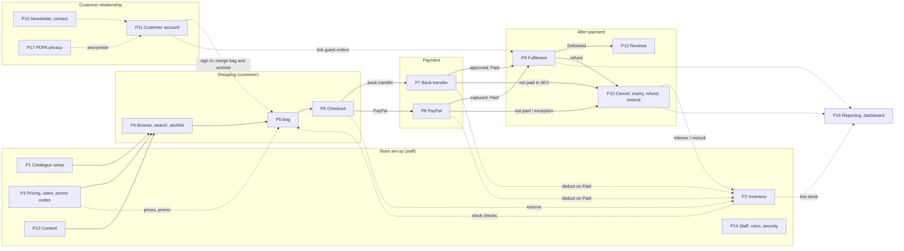
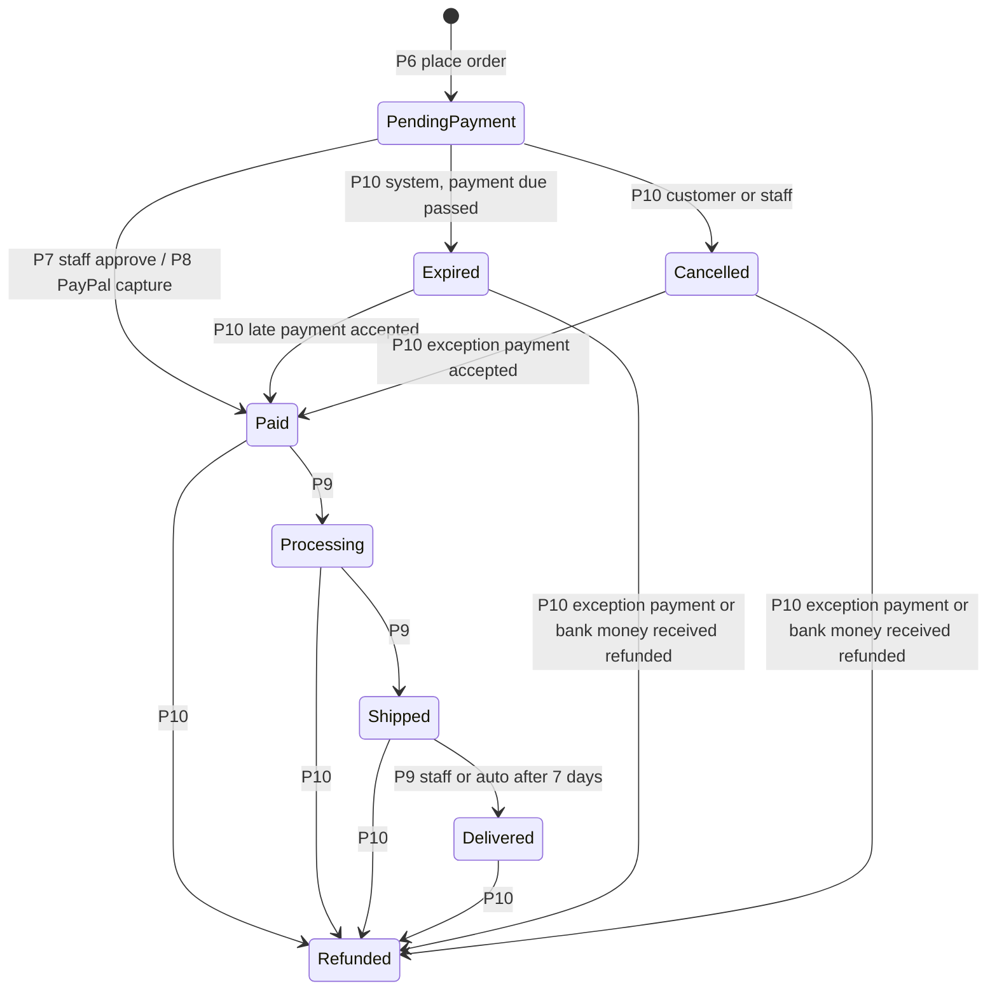
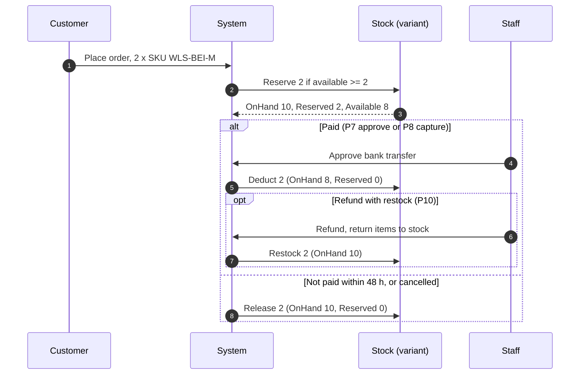
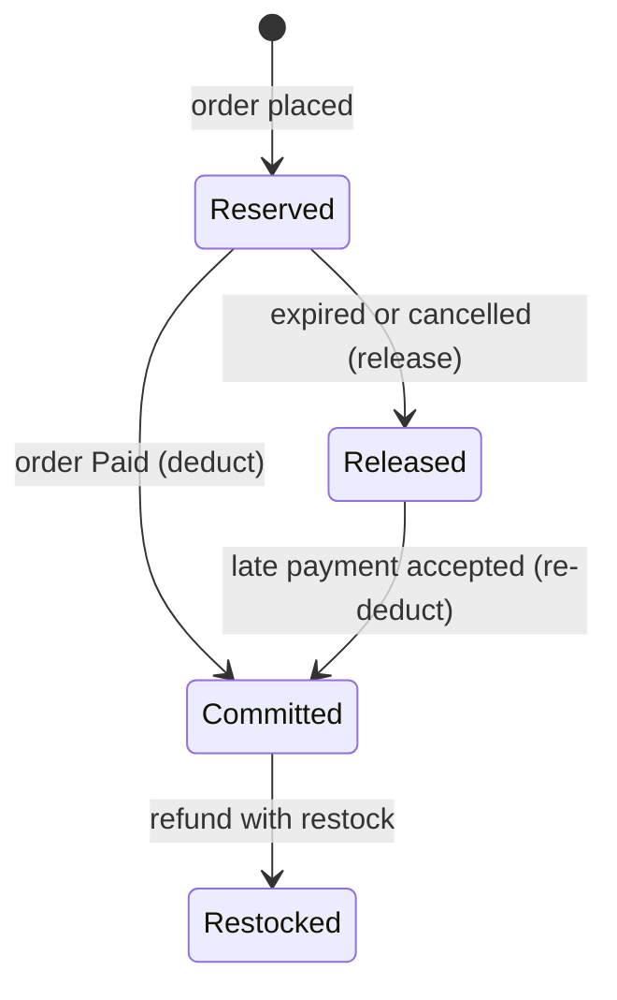
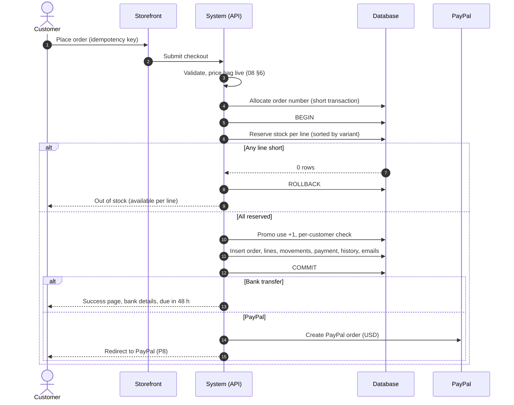
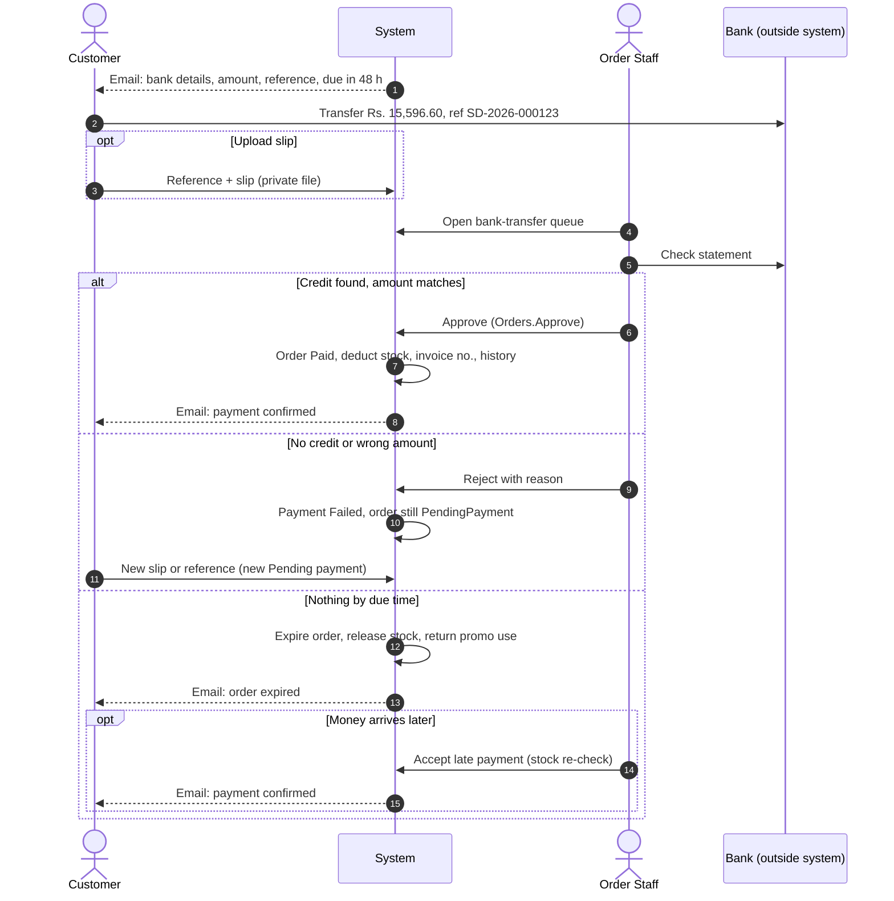
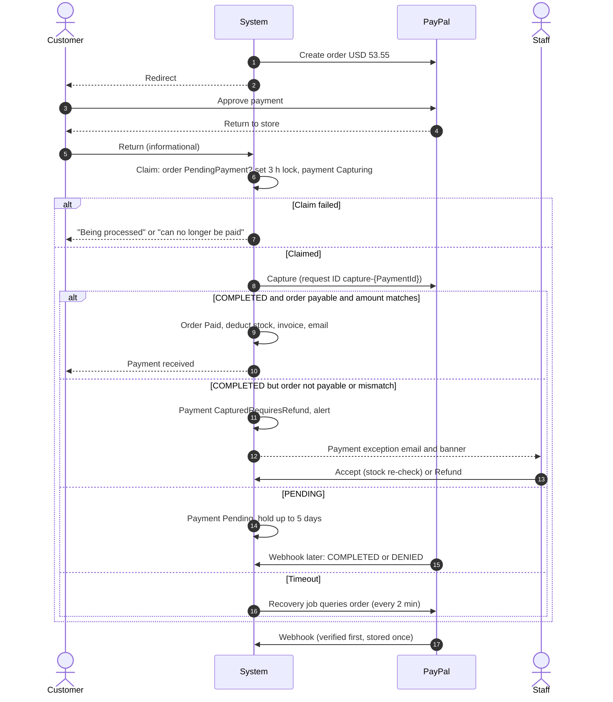
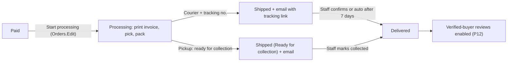
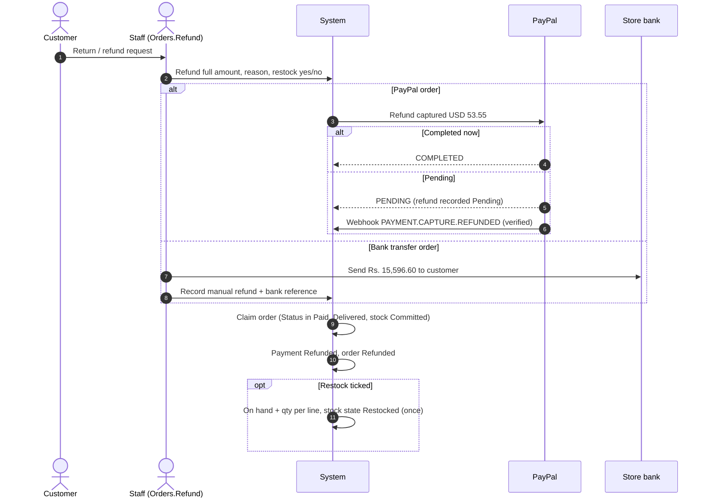

# 11 — Business Processes

Last updated: 2026-09-23 · Status: **Review round 1 applied** · Inputs: [01](01-project-understanding.md), [02](02-scope-baseline.md) (scope baseline v1.0), [03](03-architecture-and-tech-stack.md) §3a–§3c, [05](05-delivery-plan.md), [08](08-database-design.md) (revision 5, baselined).

This document describes **how the Spencer Denim store operates**: what customers, staff and the system do, in what order, under which rules. It is written for two audiences:

- **Developers and testers:** precise rules, status changes, stock effects and permissions, with references to doc 08 (written as "08 §4.1").
- **Store staff:** plain numbered steps and the daily checklist (§6).

It is a process document only. It adds no features: everything here traces to a feature ID in doc 02. Where the scope, doc 08 and normal e-commerce practice disagree or are silent, the point is listed in §7 and **the design is not changed here**.

**Reference practice.** WooCommerce is used as the benchmark for standard store operations. Each major process ends with a "WooCommerce comparison" note. **Where our design differs, our design wins**; the note says why. WooCommerce documentation is summarised, not copied, and the page is cited.

**Conventions**
- Amounts are in Sri Lankan rupees, written `Rs. 4,392.00`. PayPal amounts are in USD.
- Times are stored in UTC and shown in Colombo time (UTC+05:30).
- Default setting values are shown in brackets, e.g. bank-transfer expiry (48 h). Every one is admin-editable unless stated.
- Step labels: **[Customer]**, **[Staff]**, **[System]** (a background job or a verified payment-provider event), **[PayPal]**, **[Courier]**.
- Permissions are written `Module.Action` (e.g. `Orders.Approve`).

## Contents
1. Purpose, scope, actors and roles
2. Process map
3. Processes P1–P17
4. Notification matrix
5. Status reference
6. Daily and weekly operations checklist
7. Gaps and questions
8. Traceability table

## 1. Purpose, scope, actors and roles

### 1.1 Purpose
- Give the build team one agreed description of every store operation before week 3 (commerce) and week 4 (PayPal) are built.
- Give testers the rules to write acceptance tests against (every rule cites doc 08).
- Form the basis of the admin training and handover guide (OPS-04).

### 1.2 In scope
All features marked ✅ in doc 02: catalogue, inventory, pricing and promotions, storefront discovery, bag, checkout, bank transfer and PayPal payments, fulfilment, cancellations and refunds, customer accounts, reviews, content, staff and security, newsletter and contact, reporting, and PDPA privacy.

### 1.3 Out of scope (doc 02 §J and §I)
Cash on delivery, card payments outside PayPal, a second gateway, Koko/BNPL, newsletter email campaigns, loyalty, mobile apps, multi-currency pricing, courier API integrations, partial-refund UI (08 D6), credit notes (08 D2), URL redirects (08 Appendix A).

### 1.4 Actors

| Actor | Who | How they interact |
|---|---|---|
| **Guest customer** | A shopper who is not signed in | Browses, keeps a bag (cookie token) and a wishlist (browser storage), checks out with an email address, follows the order link in emails |
| **Registered customer** | A shopper with an account (`UserType = Customer`). Email confirmation is needed only to link earlier guest orders (P11, 08 D5) — an unconfirmed customer can still sign in, shop and check out (provisional default, §7 G-24) | Everything a guest can do, plus saved addresses, account bag and wishlist across devices, order history and tracking, reviews |
| **Staff user** | A person with an admin account (`UserType = Staff`) holding one or more roles | Uses the admin app. Sees only the menus and buttons their permissions allow; the API enforces the same rules (03 §3a) |
| **System jobs** | .NET background services with job leases (08 §3.8 `ops.JobLeases`) | `ExpireUnpaidOrders` (every 5 min), `AutoDeliverShipped` (daily), `SendEmails`, `RetryPaymentEvents`, `RecoverPayPalCaptures` (every 2 min), `RefreshCampaignPricing` (every 5 min), `NightlyStats` (00:30), `Retention` (01:30), `ReconcileStock` (nightly). They carry no staff permission and cannot be called from the admin API (08 §4) |
| **PayPal** | External payment provider | Hosts buyer approval, captures money, sends verified webhooks (08 §4.2) |
| **Courier** | Delivery company chosen by staff | No system integration. Staff record the courier and tracking number; the customer follows a tracking link built from the courier's URL template (08 §3.5 `Couriers`) |
| **Email (SMTP)** | The configured mail provider | Receives messages from the transactional outbox (08 §3.8 `ops.EmailOutbox`), retried with backoff 1/5/15/60/240 min |
| **Bank** | The store's bank account | Receives customer transfers. No integration: staff check the bank statement |

### 1.5 Staff roles (default, doc 02 §G and 08 §9)

Super Admin can edit these roles or create custom ones. Permissions are `Module × {View, Create, Edit, Delete, Approve, Export}` plus the special permissions below.

| Role | Can do | Cannot do |
|---|---|---|
| **Super Admin** (GrantsAll) | Everything, including Users & Roles, `Settings.Payments`, `Settings.Security`, acknowledging every alert. Must use 2FA | — |
| **Store Manager** | Every module and action except `Users.*`, `Settings.Payments`, `Settings.Security`. Includes `Orders.Refund`, `Settings.View/Edit`, `AuditLog.View`, `Customers.Delete` (PDPA) | Manage staff or roles; change bank/PayPal settings; change SMTP, login security or retention settings |
| **Order Staff** | `Dashboard.View`, `Orders.View/Edit/Approve` (fulfilment, cancel unpaid orders, approve/reject bank transfers, accept late payments), `Customers.View`, `Inventory.View` | Refund; adjust stock; edit products, promotions, content or settings |
| **Content Editor** | `Products.*`, `Categories.*`, `Content.*`, `Media.*`, `Reviews.View/Edit/Approve/Delete` | Orders, inventory changes, promotions, customers, reports, settings |

**Special permissions** (08 §3.1):
- `Orders.Refund`: every refund. Not held by Order Staff.
- `Settings.Payments`: bank details, payment providers, PayPal credentials and exchange rate.
- `Settings.Security`: SMTP, login security, invoice bill-to retention. It applies **only through the Super Admin role's `GrantsAll` flag**: it is never stored as a permission on any role, and `CK_RoleClaims_NoSecurity` rejects it at the database if anyone tries (08 §3.1). So it cannot be granted, copied into a custom role, or held by a user who is not a Super Admin.
- `Users.View`: read-only access to the staff list and staff user detail.
- `Users.Manage`: create and manage staff users — every change (subset rule, P14).

### 1.6 Key settings referred to in this document (08 §3.8)

| Setting | Default | Used in |
|---|---|---|
| `Orders.BankTransferExpiryHours` | 48 | P7 |
| `Orders.PayPalExpiryMinutes` | 60 | P8 |
| `Orders.AutoDeliverAfterDays` | 7 | P9, P12 |
| `Inventory.DefaultLowStockThreshold` | 5 | P2 |
| `Catalog.NewArrivalDays` / `BestSellerTopN` | 30 / 10 | P1, P4 |
| `Reviews.RequireApproval` | true | P12 |
| `Delivery.DefaultZone` | 3 IslandWide | P5, P6 |
| `Payments.PayPal.FxBufferPercent` / `RateMaxAgeDays` | 3.00 / 7 | P8 |
| `Payments.PayPal.CaptureLockHours` / `CaptureRecoveryMaxHours` / `PendingCaptureMaxDays` | 3 / 24 / 5 | P8 |
| `Security.StaffLockoutMaxFailures` / `StaffLockoutMinutes` | 5 / 15 | P14 |
| `Security.CustomerLockoutMaxFailures` / `CustomerLockoutMinutes` | 10 / 15 | P11 |
| `Privacy.RetainInvoiceBillTo` | true | P17 |

## 2. Process map

How the processes feed each other. Solid arrows are the main customer journey; dotted arrows are supporting flows.

P14 (staff, roles and security) is not drawn as arrows: its permissions govern every staff step in every process.

**Order lifecycle at a glance** (08 §4.1):

## 3. Processes

Every process uses the same headings. "08 §x" points to the baselined database design.

### P1 Catalogue setup

**Goal.** Put sellable products on the storefront with correct structure, variants, media, badges and SEO, so customers can find and buy them.

**Trigger.** New season or new stock arrives; a product needs correcting; a category structure changes.

**Actors.** Staff (Content Editor, Store Manager, Super Admin). System (derived data refresh).

**Preconditions.**
- Staff user holds `Categories.*` for the category tree and `Products.Create/Edit` for products.
- Reference data exists: departments Women / Men / Kids (seeded), age groups, attribute options (material, fit, occasion), colour families, size scales (08 §9).
- Images and video are uploaded to the media library (P13, `Media.Create`) or uploaded from the product form.

**Main flow**

*A. Categories (ADM-11)*
1. **[Staff]** Opens **Categories**, chooses a department. Departments cannot be created or deleted (nav is fixed, Q5); staff may only edit their description, hero image, sort order and SEO.
2. **[Staff]** Creates a category: name, slug, parent (optional), description, image, banner and banner link, age group (Kids), size guide, "show in mega menu" and menu column (1–4), SEO title and description.
3. **[System]** Validates depth (≤ 3 levels) and that the slug is unique among siblings; stores the materialised path.
4. **[Staff]** Reorders categories by drag and drop (sibling `SortOrder`), or moves a category under another parent. The move updates the path of the whole subtree in one transaction.
5. **[Staff]** Removes a category. **[System]** Blocks the removal while it has active products or child categories; otherwise it is soft-deleted and disappears from the menu and listings.

*B. Product (ADM-10)*
6. **[Staff]** Opens **Products → Add**. Enters product code, name, slug, department, primary category (same department) and any extra categories the product should also appear in, age group (required for Kids), short description, description, care instructions, material, fit, occasion.
7. **[Staff]** Enters **price** (`BasePrice`, e.g. Rs. 5,490.00) and optional **original price** (`CompareAtPrice`, e.g. Rs. 6,990.00; must be higher). The storefront shows the original crossed out and a discount of 21%.
8. **[Staff]** Adds **colours**: display name ("Floral Blue"), colour family for the filter (Blue), swatch hex or swatch image.
9. **[Staff]** Picks a **size scale** and ticks the sizes offered. **[System]** Generates one **variant per colour × size**. Staff enter each variant's **SKU** (unique across the store), optional barcode, and optional price and original-price overrides.
10. **[System]** Creates a stock record for every new variant with on-hand 0. Stock is added in P2 by a user with inventory rights.
11. **[Staff]** Adds media: gallery images (optionally tied to a colour), a hover image, and an optional product video (MP4 H.264, ≤ 50 MB, poster image required). Alt text is entered for each public image.
12. **[Staff]** Sets optional **badge** override (New, Sale, Online Exclusive, Best Seller), recommended rank (global pin), size guide override, related products, SEO title and description.
13. **[Staff]** Saves as unpublished (default). **[System]** In the same transaction: refreshes the product's price summary (min/max list and sale price, discount %), rebuilds the search text, sets the card and hover image, and writes an audit row.
14. **[Staff]** Clicks **Publish**. **[System]** Checks publish rules (alt text on public images; see §7 G-01 for the full checklist), sets `IsPublished = 1`, records `FirstPublishedAtUtc` once, and defaults "New until" to publish date + 30 days (`Catalog.NewArrivalDays`).
15. **[Staff]** **Unpublishes** to hide a product, or **removes** it (soft delete, `Products.Delete`).

**Business rules**
- Codes and slugs: `ProductCode` and `Slug` unique among non-deleted products; `Sku` unique for every variant ever created (08 §3.2).
- One variant per colour × size (`UX_ProductVariants_Colour_Size`). Variants that have been ordered are **deactivated, never deleted** (08 §3.2).
- Prices: `BasePrice > 0`; original price must be higher than price, at product and variant level. Where a variant override would make original < price, pricing uses `original = max(original, list)` so the discount is never negative (08 §3.2, §6 step 2).
- **Card badge, one shown** (08 §3.2): the staff override if set; otherwise Sale → Low Stock → Best Seller (top 10 by 30-day units in the department) → New.
- **Slug change after first publish** shows a "this breaks existing links" confirmation; redirects are not in v1 (08 Appendix A).
- Size guide: product override, else category, else nearest ancestor category (08 §3.2).
- Related products: staff pick; the product page tops up to 4 from the same category (08 §3.2).
- Media: file type checked by content, images converted to WebP renditions (thumb 160, card 600, large 1200, zoom 2000 px); video MP4 only, no conversion (03 §3b, 08 §3.3). A file in use cannot be deleted from the library.
- Soft delete keeps variants, colours, media links and order lines; the product disappears from storefront queries (08 §10.2).
- Category removal is blocked while active products or child categories exist (08 §3.2).
- Every save is audited with before/after values (ADM-03).

**Status changes.** Product: Unpublished ↔ Published → Deleted (soft). Variant: Active ↔ Inactive. Category: Active ↔ Inactive → Deleted (soft).

**Stock effects.** A new variant gets a stock row with on-hand 0. Its first stock entry in P2 is recorded as an `Initial` movement. Deactivating or unpublishing does not change stock or open reservations.

**Notifications.** None.

**Admin screens and permissions**

| Screen | Permission |
|---|---|
| Categories (tree, reorder, move, remove) | `Categories.View/Create/Edit/Delete` |
| Products list, add, edit, publish/unpublish | `Products.View/Create/Edit` |
| Remove product | `Products.Delete` |
| Media picker / upload | `Media.View/Create` |
| Departments (edit text, hero image) | `Categories.Edit` (see §7 G-02) |
| Attribute options, colour families, sizes, age groups | not named in doc 08 (see §7 G-02) |

**Exceptions and edge cases**
- Duplicate SKU or product code → save rejected with the conflicting item named.
- Two staff edit the same product → the second save is rejected (row version); the user reloads and re-applies (08 §1.5).
- Product unpublished or removed while in customers' bags → the bag shows the line as unavailable and checkout blocks it (P5).
- Price changed while in bags → the bag shows "price changed" using the price at add (P5). Placed orders keep their snapshot prices.
- Removing a variant that has orders → offered as "deactivate" instead.
- Deleting media still used by a product, category or content block → blocked with a "used in…" list.
- Moving a category changes listing URLs of its products' category pages; product URLs (`/p/{slug}`) are unaffected.

**WooCommerce comparison** ([managing products](https://woocommerce.com/document/managing-products/), [variable products](https://woocommerce.com/document/variable-product/))
- *Matches:* hierarchical categories, product gallery, variations that each carry SKU, price and stock, publish/unpublish, catalogue visibility.
- *Differs:* Woo lets any attributes form variations; we fix the axes to **colour × size**, because every fashion product in the demo uses them and it keeps filters and stock simple. Woo stores "regular price" and a scheduled "sale price" on each product; we store **price plus an optional original price** (markdown) and run time-limited discounts as **sale campaigns** across departments, categories or products (P3), which suits seasonal fashion sales. Woo has tags, and its product statuses are **Published, Pending review and Draft** — "Private" is a **visibility** option on a published product, not a status; we have published or not, and tags are deferred (08 Appendix A). **Product video:** WooCommerce **11.1** added product **gallery videos** to core, but as a **beta feature that is off by default**: video goes in the **gallery only** (it can never be the main image), there are **no variation galleries**, and it is **not covered by the CSV importer or the REST API**. Ours is a first-class product field from the start — one MP4 per product, imported and exposed like any other media (PDP-01).

**Feature IDs.** ADM-10, ADM-11, ADM-18, PDP-01, PDP-04, PDP-06, CARD-01, GLB-05, GLB-11, DEPT-01, DEPT-02.

---

### P2 Inventory management

**Goal.** Keep an accurate count of every variant so customers never buy stock that does not exist, and staff know what to reorder.

**Trigger.** Goods received; stock count; damage or loss; an order placed, paid, expired, cancelled or refunded; nightly reconciliation.

**Actors.** Staff (Store Manager, Super Admin; Order Staff view only). System (checkout, payments, expiry job, reconciliation job).

**Preconditions.** Variant exists (P1). Staff hold `Inventory.Edit` for changes, `Inventory.View` to look.

**Stock model** (08 §3.4, §5.1)

| Figure | Meaning for staff |
|---|---|
| **On hand** | Units physically in the store's stock |
| **Reserved** | Units held for orders placed but not yet paid |
| **Available** | On hand − reserved. What customers can buy |
| **Low-stock threshold** | Per variant; blank means the store default (5) |

**Main flow**

*A. Receive and adjust stock (manual)*
1. **[Staff]** Opens **Inventory**, filters by product, SKU, low stock or out of stock.
2. **[Staff]** Chooses an action on a variant:
   - **Receive** (+ units from a supplier or production);
   - **Adjust in / Adjust out** (+/− units) with a **reason** (e.g. "Damaged in store", "Found in count");
   - **Set count** (absolute number after a stock-take) with a reason.
3. **[System]** Applies the change with a guard: on hand may never fall below reserved. "Set count" also checks that on hand has not changed since the screen was loaded; if it has, staff are asked to re-confirm (08 §5.8).
4. **[System]** Writes an inventory movement (type, delta, resulting on hand and reserved, reason, user, time).
5. **[Staff]** Optionally sets the variant's **low-stock threshold**.

*B. Bulk update by CSV (ADM-12)*
6. **[Staff]** Downloads the current stock CSV (SKU, on hand, threshold), edits it, uploads it. The layout and the download itself are a proposed default, not yet in doc 08 (§7 G-04).
7. **[System]** Validates each row (known SKU, whole number, not below reserved), sorts by variant, applies up to 500 rows per transaction under one batch ID, and returns a **per-row result** (applied / rejected with reason). Rows already applied stay applied if a later row fails (08 §5.8).
8. **[Staff]** Downloads the result file and corrects rejected rows.

*C. Automatic movements (order lifecycle)*

| Event | Process | Change | Movement |
|---|---|---|---|
| Order placed | P6 | Reserved + qty (only if available ≥ qty) | Reserve |
| Order paid | P7 / P8 | On hand − qty, reserved − qty | Sale |
| Order expired or cancelled before payment | P10 | Reserved − qty | Release |
| Expired/cancelled order paid late and accepted | P10 | On hand − qty (only if available ≥ qty) | Sale |
| Refund with "return items to stock" ticked | P10 | On hand + qty | Restock |

*D. Low-stock monitoring*
9. **[System]** Shows variants with `0 < available ≤ threshold` on the dashboard **Low Stock** widget and shows the **Low Stock** badge on product cards when the product's total available is **above zero and** at or below the sum of its variants' thresholds (08 §3.2, §7.1). A product with zero available shows **Out of stock**, never Low Stock.
10. **[Staff]** Reviews the widget daily (§6) and arranges replenishment outside the system.

*E. Nightly reconciliation (alert-only)*
11. **[System]** `ReconcileStock` compares each variant's reserved figure with the sum of quantities on orders still holding stock. A mismatch is re-checked after 5 minutes (it may be an order in flight).
12. **[System]** A persistent mismatch raises a **Reconciliation drift** dashboard alert and email to Super Admins. The job **never corrects anything** (08 §5.9). The same check runs for promo code usage counts.
13. **[Staff: Super Admin]** Asks the technical team to run the manual correction runbook (08 §5.9), which writes a `CountCorrection` movement with a reason.

**Order stock state** (08 §3.5 `Orders.StockState`):

**Business rules**
- **Stock is not held in the bag**, only from order placement (08 §3.5).
- Reserve uses an atomic check: two customers buying the last unit → exactly one order succeeds; the other gets "out of stock" with the current available quantity (08 §5.2, §5.4).
- Every stock change for an order first claims the order's stock state, so the expiry job, a webhook and a staff member can never release or deduct twice (08 §3.4).
- On hand ≥ 0 and reserved ≤ on hand are enforced by the database; an oversell cannot be saved (08 §5.2).
- Reason is **required** for adjust and count corrections (08 §3.4).
- Restock happens only inside the refund transition and at most once per order (08 §5.7, N8).
- No backorders: a variant with available 0 cannot be ordered.
- The movement ledger is never deleted (08 §1.6).
- Low stock uses each variant's own threshold (08 §7.1, N11).
- Reconciliation is **alert-only in v1** (08 §5.9, Appendix A).

**Status changes.** Order `StockState`: Reserved → Committed / Released → Committed; Committed → Restocked.

**Stock effects.** As tables above.

**Notifications**
- `ReconciliationDrift` email + dashboard alert → Super Admins.
- No low-stock email (see §7 G-05).

**Admin screens and permissions**

| Screen | Permission |
|---|---|
| Inventory list, variant history (movements) | `Inventory.View` |
| Receive, adjust, set count, threshold, CSV upload | `Inventory.Edit` |
| Stock CSV download, inventory report | `Inventory.View` / `Reports.Export` |
| Dashboard low-stock widget | `Dashboard.View` |
| Reconciliation alert | Super Admin (sees and acknowledges) |

**Exceptions and edge cases**
- Adjust out more than available (would leave on hand < reserved) → rejected: "12 units are reserved for unpaid orders".
- Stock-take differs because orders were paid while counting → "Set count" detects the change and asks to re-confirm.
- Deduct at payment finds less reserved than expected (drift) → the payment transaction rolls back and an alert is raised (08 §5.5). Staff contact the technical team; the payment is not lost (bank: approval retried; PayPal: event retried).
- Late payment accepted but a line has no stock → acceptance is rejected listing the lines; staff refund instead (P10).
- CSV with duplicate SKUs → merged or rejected per row (build note §7 G-04).
- Variant deactivated while units are reserved → reservations stay until the orders are paid or released.

**WooCommerce comparison** ([inventory settings](https://woocommerce.com/document/configuring-woocommerce-settings/products/), [order statuses](https://woocommerce.com/document/managing-orders/order-statuses/))
- *Matches:* stock per variation, low-stock threshold, automatic reduction on payment, restore on cancel, optional restock on refund, unpaid-order stock hold that lapses after a time limit.
- *Differs:* Woo's "Hold stock (minutes)" is one store-wide timer; ours is **per payment method** (48 h bank transfer, 60 min PayPal, up to 5 days for PayPal PENDING), because bank transfers need days, not minutes. Woo does not keep a separate "reserved" figure or a movement ledger with reasons; we do, so staff can explain every unit and reconciliation can detect drift. Woo emails low-stock and out-of-stock notices and supports backorders; we show low stock on the dashboard and do not allow backorders (not in scope).

**Feature IDs.** ADM-12, ADM-08, ADM-19, CARD-01, PDP-02, CHK-01, PAY-01, PAY-02.

---

### P3 Pricing, sale campaigns and promo codes

**Goal.** Charge the right price every time, run time-limited sales, and offer promo codes without over-discounting or over-using a code.

**Trigger.** Merchandising plans a sale; marketing issues a code; a customer applies a code; any bag read or checkout.

**Actors.** Staff (Store Manager, Super Admin; `Promotions.*`). Customer. System (pricing, campaign refresh job).

**Preconditions.** Products have prices (P1). Delivery zone rates exist (P6 settings).

**Price layers** (08 §6, decision D10). Applied in this order, and never stacked within a layer:

| # | Layer | Source | Example |
|---|---|---|---|
| 1 | **Original price** | Variant or product "original price"; never below list | Rs. 6,990.00 |
| 2 | **List price** (markdown) | Variant override or product price | Rs. 5,490.00 |
| 3 | **Sale price** (campaign) | Best active campaign targeting the product; lowest resulting price wins; floor Rs. 1.00 | 20% off → Rs. 4,392.00 |
| 4 | **Promo code** | One code per order, on eligible lines | 10% of Rs. 16,274.00 = Rs. 1,627.40 |
| 5 | **Delivery** | Zone rate for the method; free above threshold, or free with a free-delivery code | Express Colombo Rs. 950.00 |

**Main flow**

*A. Create a sale campaign (ADM-14)*
1. **[Staff]** Opens **Promotions → Sale campaigns → Add**: name, description, type (percent up to 90%, or fixed amount off), start and end date-time, active, optional banner.
2. **[Staff]** Adds targets: departments, categories (with or without subcategories) or individual products.
3. **[System]** On save, recomputes the stored price summary for affected products in batches. At start and end times the `RefreshCampaignPricing` job (every 5 min) updates listings, so **listing prices and the Sale page may lag by up to 5 minutes at a campaign boundary**. Bag and checkout always price live (08 §7.4).
4. **[System]** Products whose sale price is below their original price show a discount %, the Sale badge and appear on the Sale page (DEPT-03) and in the Sale homepage block (HOME-07).
5. **[Staff]** Ends a campaign early by editing the end date or deactivating it; or removes it (soft delete).

*B. Create a promo code (ADM-13)*
6. **[Staff]** Opens **Promotions → Promo codes → Add**: code (stored upper-case, unique), description, type:
   - **Percent** (**above 0% and up to 100%**; 0% is rejected as meaningless, optional maximum discount, e.g. 10% capped at Rs. 2,000.00);
   - **Fixed amount** (e.g. Rs. 1,000.00 off, never more than the eligible items);
   - **Free delivery** (delivery fee discounted in full).
7. **[Staff]** Sets optional minimum spend, "exclude sale items", start (required) and end (optional), total usage limit, per-customer limit, active.
8. **[System]** Validates: end after start; per-customer limit ≤ total limit when both set.

*C. Customer applies a code (CART-01)*
9. **[Customer]** Enters the code in the bag or at checkout.
10. **[System]** Checks: code exists and is active; now is within start/end; total uses held < total limit; items subtotal (after sale prices) ≥ minimum spend; at least one eligible line. The per-customer limit is checked at placement, when the email is known.
11. **[System]** Calculates the discount on the eligible base and spreads it across eligible lines in proportion to their subtotal (remainder to the largest line). Shows the discount line and the new total.
12. **[System]** Re-validates the code on every bag read and again at placement (08 §3.5 `Carts.PromoCodeText`). A code that stops qualifying is shown as "no longer applies" with the reason and removed from the totals.

*D. Usage counting* (08 §3.6)

| Event | Effect on the code's use count |
|---|---|
| Order placed with the code | +1, only if under the total limit (otherwise "This code has been fully used") |
| Unpaid order expires or is cancelled | −1 (the use is given back) |
| Expired or cancelled order paid late and accepted | +1, even if the limit is now reached (the customer already paid) |
| Paid order refunded | no change (the use stays spent) |

**Worked example** (08 §6). Customer in Colombo, Express delivery, code `WELCOME10` (10%, cap Rs. 2,000.00, minimum spend Rs. 5,000.00), campaign "Linen Week" 20% off Women › Shirts & Blouses.

| Line | Original | List | Sale | Qty | Subtotal | Promo share | Line total |
|---|---|---|---|---|---|---|---|
| Relaxed Linen Blend Shirt, Beige / M | 6,990.00 | 5,490.00 | 4,392.00 (−37%) | 2 | 8,784.00 | 878.40 | 7,905.60 |
| High-Rise Slim Fit Jeans, Dark Blue / 30 | 7,490.00 | 7,490.00 | 7,490.00 | 1 | 7,490.00 | 749.00 | 6,741.00 |
| **Totals** | 21,470.00 | 18,470.00 | | 3 | **16,274.00** | **1,627.40** | 14,646.60 |

Grand total = 16,274.00 − 1,627.40 + 950.00 = **Rs. 15,596.60**. "You saved" = markdown 3,000.00 + campaign 2,196.00 + promo 1,627.40 = **Rs. 6,823.40**. With Standard delivery in Colombo (Rs. 400.00, free above Rs. 10,000.00) delivery is free and the total is Rs. 14,646.60.

**Business rules**
- Campaigns never stack; the lowest resulting price wins; percent campaigns ≤ 90% (08 §3.6, §6 step 3).
- Displayed discount % = `floor((original − sale) / original × 100)` (08 §6 step 4).
- Minimum spend compares with the **items subtotal after sale prices**, before promo and delivery (08 §6 step 7).
- "Exclude sale items" removes **lines priced by a campaign** from the eligible base (08 §6 step 7). Lines that only have a markdown (original price) are still eligible (see §7 G-07).
- Percent discount rounded to 2 dp and capped; fixed never exceeds the eligible base; a line's share never exceeds its subtotal, so no line total is negative (08 §6 steps 8–9).
- Free delivery above threshold: `items subtotal − promo ≥ FreeAboveAmount` of the zone rate (08 §6 step 10).
- **One promo code per order.**
- Per-customer limit counts uses held by orders with the same (normalised) email, serialised with a lock so two simultaneous checkouts cannot both pass (08 §3.6).
- Lowering a total limit below current uses is allowed with a warning; it blocks only new uses. Deactivating or ending a code does not affect placed orders (08 §3.6 DB19).
- **Minimum-total clamp (G-11):** if `items subtotal − promo + delivery fee − delivery discount` would fall below **Rs. 1.00**, the promo discount is reduced to `max(0, items subtotal + delivery fee − delivery discount − 1.00)` so the grand total is exactly Rs. 1.00, and the per-line allocation is re-run over the clamped amount. The customer sees "discount limited to the order total" (08 §6 step 11). No order can therefore reach checkout with a zero total.
- Prices and discounts are copied into the order at placement and never recomputed (08 §6).
- VAT: not VAT-registered; tax = 0, prices are final (08 D2).

**Status changes.** Campaign and promo code: Scheduled (start in future) → Live → Ended (by date) / Inactive (by staff) / Deleted (soft). These are derived from dates and flags, not stored statuses.

**Stock effects.** None.

**Notifications.** None.

**Admin screens and permissions**

| Screen | Permission |
|---|---|
| Sale campaigns list, add, edit, deactivate | `Promotions.View/Create/Edit` |
| Remove campaign or code | `Promotions.Delete` |
| Promo codes list, add, edit | `Promotions.View/Create/Edit` |
| Promo report (uses, discount given, revenue per code) | `Reports.View`, CSV `Reports.Export` |

**Exceptions and edge cases**
- Campaign starts while a customer's bag is open → next bag read shows the lower price; listing may show the old price for up to 5 minutes.
- Two campaigns target the same product (e.g. 20% department-wide and Rs. 1,500 off one product) → the one giving the lower price applies to that product; the order line records which campaign priced it.
- Last use of a code taken by two customers at once → one succeeds, the other is told the code is fully used and can place the order without it.
- Customer's unpaid order expires → the code use returns; the customer can use it again if their per-customer limit allows.
- Guest uses a per-customer code again with a different email → allowed by design (limit is per email).
- Fixed code larger than eligible items (Rs. 1,000 code on Rs. 800 of eligible items) → discount Rs. 800.00.
- Percent campaign rounding produces a price below Rs. 1.00 → floored at Rs. 1.00.

**WooCommerce comparison** ([coupon management](https://woocommerce.com/document/coupon-management/), [managing products](https://woocommerce.com/document/managing-products/))
- *Matches:* percent and fixed coupons, free-shipping coupons, minimum spend, expiry date, exclude sale items, usage limit per coupon and per user.
- *Differs:* Woo schedules a sale price per product; we run **campaigns across departments, categories or products**, which is how the client runs seasonal sales (ADM-14). Woo can combine several coupons unless "individual use only" is ticked; we allow **one code per order**, keeping the pricing rule simple (D10). Woo also offers fixed-per-product coupons, maximum spend, product/category/email restrictions and item-count limits; these are not in scope. Our use counting explicitly gives a use back when an unpaid order expires or is cancelled.

**Feature IDs.** ADM-13, ADM-14, CART-01, CHK-01, DEPT-03, HOME-07, CARD-01, PDP-02, ADM-19.

---

### P4 Browse, search and discovery

**Goal.** Help customers find products quickly on any device.

**Trigger.** Customer visits the storefront, opens a menu, searches, or returns to a product.

**Actors.** Customer (guest or registered). System. Staff indirectly (merchandising order, content).

**Preconditions.** Published products in active categories (P1); content blocks (P13).

**Main flow**

*A. Navigate and list*
1. **[Customer]** Opens Women, Men or Kids from the header (desktop mega menu with categories and a promo card; mobile slide-out accordion), or New Arrivals, or Sale.
2. **[System]** Shows the listing: breadcrumb, heading, description, promo banner, live product count, 24 products, **Load More** for the next 24.
3. **[Customer]** Applies filters: department, category, age group, price, size, colour, material, fit, occasion, rating, availability, discount. Filters show only values that have products (each filter's counts ignore its own selection). Active filters appear as chips with **Clear filters**.
4. **[Customer]** Sorts: Recommended, Newest, Best Selling, Price low–high, Price high–low, Highest Rated, Biggest Discount.
5. **[Customer]** Uses **Quick View** or opens the product page.

*B. Product page*
6. **[System]** Shows gallery (zoom, full screen, video), name, code, rating, price / original / discount, stock status of the selected variant, colour and size selectors, quantity, size guide, delivery estimate and methods for the chosen district, description, material, care, fit, returns information, related products, reviews.
7. **[Customer]** Selects colour and size. **Add to Bag** and **Buy Now** stay disabled until both are chosen. Out-of-stock sizes are shown as unavailable.
8. **[Customer]** Changes the delivery district from the header or product page; estimates and fees update (P6 rules).
9. **[System]** Adds the product to **recently viewed** in the browser (up to the display limit).

*C. Search*
10. **[Customer]** Opens the search overlay. **[System]** Shows popular searches (last 30 days, with results) and the customer's recent searches (browser).
11. **[Customer]** Types. **[System]** After a short pause, suggests up to 6 products and matching categories; keyboard navigation works.
12. **[Customer]** Submits. **[System]** Shows the results page with the same filters and sorts, or a no-results page with suggestions. Results require every word (up to 5) to match name, category, colour, material, fit, occasion, product code or SKU.
13. **[System]** Records the submitted search in daily search statistics (not individual keystrokes).

*D. Wishlist*
14. **[Customer]** Taps the heart on a card or product page. Guests' wishlists are kept in the browser; registered customers' in their account. Header count updates.
15. **[Customer]** On the wishlist page: remove, clear, or **move to bag** (size must be chosen first).
16. **[System]** On sign-in, merges the browser wishlist into the account without duplicates (P11).

**Business rules**
- Only products that are published, not removed, in an active category are shown (08 §7.1).
- **New Arrivals** = "new until" date in the future (publish date + 30 days by default, editable per product) (08 §3.2).
- **Sale page** = products with a discount (markdown or campaign) (08 §7.2).
- **Recommended** order: on a single-category page, the category's manual order first, then the global pin, then 30-day best sellers, then newest. Elsewhere: global pin, best sellers, newest (08 §7.3).
- Best Selling uses units sold in the last 30 days, **refreshed nightly** (08 §7.4).
- Availability filter and stock labels are **live**; out-of-stock products still appear unless "in stock" is filtered (08 §7.2).
- Listing and filter results are cached for **60 seconds**; campaign price changes reach listings within **5 minutes**. Product page price and stock, bag and checkout are never cached (08 §7.5).
- Stock message on the product page uses the selected variant: out of stock (available 0), low stock (available ≤ its threshold), in stock.
- Delivery estimate uses the selected district; before one is chosen, the signed-in customer's default district, else the most conservative zone (Island-wide), labelled "estimate for Island-wide, change district" (08 §3.5 R7).
- Search statistics drop queries that look like an email or phone number and keep 13 months (08 §3.8 DB25).
- Recently viewed, guest wishlist and recent searches are stored **only in the browser** (08 §1.7).
- Wishlist: one entry per product per customer, optional colour (08 §3.5).

**Status changes.** None.

**Stock effects.** None (read only).

**Notifications.** None.

**Admin screens and permissions**

| What staff control | Where | Permission |
|---|---|---|
| Category manual order of products, global recommended rank | Categories / Products | `Categories.Edit`, `Products.Edit` |
| Mega menu placement and promo cards | Categories / Content | `Categories.Edit`, `Content.Edit` |
| Popular searches source, top searches | Traffic | `Traffic.View` |
| New-arrival days, best-seller top N | Settings | `Settings.Edit` |

**Exceptions and edge cases**
- Filter combination returns nothing → "No products found" with Clear filters.
- Product unpublished while a customer is on its page → add to bag fails with "no longer available".
- Recently viewed product later removed → silently skipped.
- Wishlist item removed from sale → shown as unavailable; can be removed.
- Search for "SD-123" or a SKU → matches the product.
- Sinhala or Tamil names: sort and search behaviour verified in the week-0 spike (08 D11).

**WooCommerce comparison** ([WooCommerce blocks: filters and product collection](https://woocommerce.com/document/woocommerce-blocks/))
- *Matches:* category archives, attribute and price filters, sort by popularity, rating, newest and price.
- *Differs:* Woo core search is basic WordPress keyword search and wishlists and recently viewed need extensions; ours are built in (SRCH-01, WISH-01, PDP-07). We add Biggest Discount and a merchandised Recommended order, and delivery estimates by district on the product page.

**Feature IDs.** GLB-04, GLB-05, GLB-06, DEPT-01, DEPT-02, DEPT-03, PLP-01–07, CARD-01, QV-01, PDP-01–07, SRCH-01, SRCH-02, WISH-01.

---

### P5 Cart / bag

**Goal.** Let customers collect items, see the true total with discounts and delivery, and move smoothly to checkout.

**Trigger.** Customer taps Add to Bag, Buy Now, or Move to Bag.

**Actors.** Customer. System.

**Preconditions.** A variant (colour + size) is selected and is purchasable.

**Main flow**
1. **[Customer]** Adds a variant with a quantity.
2. **[System]** On the first add, creates a bag: for a guest, a secure cookie holding a random bag token (30-day sliding); for a signed-in customer, the account bag. No bag is created just by visiting.
3. **[System]** Adds the line or increases the quantity (max **10 per line**) and records the price at the time of adding. Opens the slide-out mini bag with the updated count.
4. **[Customer]** Opens the bag page: changes quantity, removes items, moves an item to the wishlist.
5. **[Customer]** Chooses or changes the delivery district and (optionally) delivery method to see the delivery fee.
6. **[Customer]** Applies a promo code (P3).
7. **[System]** On **every** bag read, re-prices and re-checks each line:
   - product unpublished, removed or variant inactive → line marked **unavailable**;
   - available stock below the quantity → "Only 2 left" warning;
   - price different from when added → "Price changed from Rs. 5,490.00 to Rs. 4,392.00";
   - promo code re-validated (P3 step 12).
8. **[System]** Shows subtotal, discounts (sale savings, promo), delivery (or "calculated at checkout" when no district), total.
9. **[Customer]** Signs in (P11). **[System]** Merges the guest bag into the account bag: matching lines add up, each line capped at 10 and at current available stock; the guest bag is deleted.
10. **[Customer]** Proceeds to checkout (P6). **Buy Now** adds the item and goes straight to checkout.

**Business rules**
- **Stock is not reserved in the bag** (08 §3.5). Availability is checked at every read and enforced only at placement (P6).
- Quantity per line 1–10 (08 §3.5 `CartItems`).
- One line per variant per bag.
- Guest bags are removed after 30 days of inactivity, account bags after 180 days (08 §3.5, §8.4).
- District and method chosen in the bag carry into checkout; the district also comes from the header selector (GLB-06).
- Checkout cannot start while any line is unavailable or over available stock (see §7 G-08 for whether quantities are reduced automatically).
- Delivery method is offered only if it is switched on and available for the district's zone (08 §3.5).

**Status changes.** None (bags have no status).

**Stock effects.** None.

**Notifications.** None (abandoned-bag emails are not in scope).

**Admin screens and permissions.** None; staff do not see bags. Delivery settings used by the bag are managed in P6.

**Exceptions and edge cases**
- Customer adds 8, then adds 5 more of the same variant → quantity 10 with a "maximum 10 per item" message.
- Same customer with bags on phone and laptop, signed in on both → one account bag; the last change wins for header fields.
- Guest bag cookie cleared → the bag is lost (acceptable; it purges after 30 days).
- Stock sells out between bag and checkout → P6 placement fails for that line with the current available quantity.
- A signed-in customer's merge would exceed available stock → the merged line is capped and a message shown.

**WooCommerce comparison** ([cart and checkout blocks](https://woocommerce.com/document/woocommerce-store-editing/customizing-cart-and-checkout/))
- *Matches:* session cart for guests, persistent cart for signed-in customers, coupon entry, shipping estimate in the cart.
- *Differs:* like Woo, we don't hold stock in the cart. We keep the bag **server-side** for guests too (so SSR can show the mini bag and prices are validated in one place), cap quantities at 10 per line, and show a price-changed notice.

**Feature IDs.** CART-01, CART-02, WISH-01, GLB-04, GLB-06, PDP-03, ACC-01.

---

### P6 Checkout

**Goal.** Turn a valid bag into an order with a guaranteed stock hold, correct totals, a delivery or pickup choice and a payment method.

**Trigger.** Customer clicks **Checkout** or **Buy Now**.

**Actors.** Customer (guest or registered). System. PayPal (redirect, P8).

**Preconditions**
- Bag has at least one purchasable line within available stock.
- At least one payment provider is enabled: Bank Transfer (enabled at launch); PayPal (only when enabled, credentials valid and the exchange rate is no older than 7 days) (08 §3.5, D1).
- At least one delivery method is available for the chosen district's zone. Store pickup needs at least one active pickup location (08 §9).

**Main flow**
1. **[Customer]** Starts checkout. A guest continues with an email address or signs in; a signed-in customer's name, email, phone and saved addresses are pre-filled.
2. **[Customer]** Enters contact details: first name, last name, email, phone.
3. **[Customer]** Chooses a delivery method from those offered for the district:
   - **Standard / Express:** picks a saved address or enters recipient name, phone, address line 1 and 2, city, **district** (one of 25), postal code, landmark. A signed-in customer may save it (up to 10 addresses).
   - **Store pickup:** picks a pickup location (name, address, hours). No delivery address is needed; the order's district is the pickup location's district.
4. **[System]** Shows the fee and estimated days from the zone rate, with a "free delivery above Rs. 10,000.00" message where a threshold applies.
5. **[Customer]** Applies or removes a promo code (P3).
6. **[Customer]** Chooses a payment method:
   - **Bank / online transfer:** shows that the order will wait for payment for 48 hours.
   - **PayPal:** shows the **USD amount** that will be charged (e.g. "USD 53.55, converted at Rs. 300.00 per USD plus 3%") before any redirect.
7. **[Customer]** Adds an optional note and clicks **Place order**.
8. **[System]** Validates all fields, re-prices the bag live (P3), and allocates the next **order number** (`SD-2026-000123`).
9. **[System]** In **one transaction**:
   1. reserves stock for every line (P2); any line short → the whole order is rolled back and the customer sees which items are short and how many are left;
   2. takes a promo use (total limit, then per-customer limit for this email);
   3. saves the order (status **PendingPayment**, stock **Reserved**, payment due time), the order lines as a snapshot (name, code, SKU, colour, size, image, prices, campaign), the reserve movements, the payment record (bank transfer: *Pending*; PayPal: *Initiated*), the status history (source Customer) and the queued emails.
10. **[System]** After commit:
    - **Bank transfer:** shows the success page with the order number, amount, bank details, reference to quote, due time and a link to upload a payment slip. Sends **Order placed** and **Bank transfer instructions** emails (P7).
    - **PayPal:** creates the PayPal order and redirects the customer to PayPal (P8). Sends **Order placed**.
11. **[Customer]** Receives the order link. Guests use the secure link in the email to view the order, upload a slip or retry payment.

**Business rules**
- **Guest checkout** is allowed (CHK-03). Guest orders are identified by email and a secret order link (`Orders.PublicId`).
- **Stock is reserved at placement** for every payment method (08 §5.4).
- **Double submit** (double click, network retry) with the same checkout key returns the same order, never a second one (08 §5.4).
- Order numbers use the Colombo calendar year and may have gaps (a failed checkout consumes a number). **Invoice numbers are gapless** and issued only when the order is paid (08 §3.5).
- Payment due time = placed time + 48 h (bank transfer) or + 60 min (PayPal) (08 §3.5 `PaymentDueAtUtc`).
- Delivery address is required unless the method is Store pickup; pickup requires a pickup location (08 §3.5 CKs).
- Delivery fee uses the address district's zone, or the pickup location's district zone (08 §3.5 R7). The district name and zone are copied into the order.
- Totals are copied into the order and must satisfy: grand total = items subtotal − promo + delivery fee − delivery discount, ≥ 0 (08 §3.5 `CK_Orders_Totals`). The database check is the outer guard; the rule the customer meets is the **Rs. 1.00 minimum**, applied by clamping the promo discount at checkout (08 §6 step 11, G-11).
- No VAT line (08 D2). No cash on delivery.
- Customer IP is stored with the order for fraud checks and deleted after 90 days (08 §8.4).
- A signed-in customer's order is linked to their account; a guest order is linked later only after the customer confirms the same email (P11, 08 D5).

**Status changes.** Order: — → **PendingPayment**. Payment: — → **Pending** (bank transfer) or **Initiated** (PayPal). History row, source Customer.

**Stock effects.** Reserved + qty per line; order stock state **Reserved**; Reserve movements.

**Notifications**
- `OrderPlaced` → customer (order number, items, totals, delivery, order link).
- `BankTransferInstructions` → customer (bank transfer only; P7).

**Admin screens and permissions**

| Setting used by checkout | Permission |
|---|---|
| Delivery methods on/off, zone rates (fee, free-above, days, available), district → zone, pickup locations | `Settings.Edit` |
| Payment providers on/off, bank details, PayPal credentials and exchange rate | `Settings.Payments` (Super Admin) |
| Payment expiry hours / minutes | `Settings.Edit` |
| New orders appear in **Orders** | `Orders.View` |

**Exceptions and edge cases**
- Item sold out between bag and **Place order** → rollback; message per line ("Relaxed Linen Blend Shirt, Beige / M: only 1 left"); the bag is updated.
- Promo code fully used or per-customer limit reached at placement → order not placed; customer removes the code and retries.
- **Promo code expires or is deactivated between the review step and Place order** (the customer left the page open, or staff ended the code) → the code is re-validated at placement, so the **order is not placed**. The customer is shown the totals **recalculated without the code** — the discount line gone, the new grand total highlighted — with the reason ("This code ended on 21 Sep") and must **confirm again** before the order is created. We never place an order at a total the customer has not seen: the alternative, honouring a code that has ended, would let an expired code be used indefinitely by anyone holding an open tab.
- Delivery method switched off or zone rate removed after the customer chose it → "This delivery option is no longer available, choose another."
- PayPal exchange rate becomes older than 7 days → PayPal is hidden; the customer uses bank transfer.
- Total at placement differs from the total displayed (a campaign ended in between) → see §7 G-10.
- Order total would fall to Rs. 0.00 (e.g. a fixed code covering every item with free delivery) → **cannot happen**: the promo discount is clamped so the grand total is exactly Rs. 1.00 and the order stays payable by bank transfer or PayPal (08 §6 step 11, G-11).
- Guest uses an email that belongs to a registered customer → allowed; the order is not linked automatically (P11 linking needs sign-in and confirmed email).
- Browser closed after commit but before redirect to PayPal → the order exists; the customer can pay from the order link until the 60-minute due time (P8).

**WooCommerce comparison** ([shipping zones](https://woocommerce.com/document/setting-up-shipping-zones/), [order statuses](https://woocommerce.com/document/managing-orders/order-statuses/))
- *Matches:* guest checkout, billing/shipping details, shipping zones with methods and free-above thresholds, local pickup, order created as "pending payment" before the gateway step.
- *Differs:* Woo zones are built from regions or postcodes; ours map each of the 25 **districts to a zone** (Colombo / Western / Island-wide) that staff can reassign (08 N4). Woo order numbers are internal IDs by default; ours are **year-based order numbers** plus a separate gapless invoice number issued at payment. We **always reserve stock at placement**, so a customer who pays is guaranteed the item. Woo allows account creation during checkout; we offer registration separately and link past guest orders after email confirmation.

**Feature IDs.** CHK-01, CHK-02, CHK-03, CHK-04, GLB-06, PAY-01, PAY-02, PAY-03, ACC-03, ADM-22.

---

### P7 Payment by bank transfer

**Goal.** Confirm that a customer's transfer has reached the store's bank account before the order is fulfilled, within a fixed time limit.

**Trigger.** Order placed with **Bank / online transfer** (P6).

**Actors.** Customer. Staff (Order Staff, Store Manager, Super Admin; `Orders.Approve`). System (expiry job, emails). Bank (outside the system).

**Preconditions.** Bank Transfer provider enabled; bank details set by a Super Admin (`Settings.Payments`); order PendingPayment with an open bank payment (*Pending*).

**Main flow**
1. **[System]** At placement, emails **Bank transfer instructions**: bank name, branch, account name, account number, exact amount (e.g. Rs. 15,596.60), **order number to quote as the reference**, due date and time (placed + 48 h), and the link to upload a payment slip.
2. **[Customer]** Transfers the exact amount (online banking, branch deposit, CDM) quoting the order number.
3. **[Customer]** Optionally opens the order (account order page or emailed link), enters the bank reference and uploads a slip (JPG, PNG, WebP or PDF, up to 5 MB). A new upload replaces the previous one.
4. **[Staff]** Opens **Orders → Bank transfers awaiting approval** (oldest first). Each row shows order number, customer, amount, reference, slip (if any) and time left before expiry.
5. **[Staff]** Checks the store's bank statement for a matching credit (amount and reference).
6. **[Staff]** Decides:
   - **a. Approve** (credit found, amount matches). Adds an optional note and confirms.
     **[System]** In one transaction: order **PendingPayment → Paid**; payment *Pending → Succeeded* and marked as the settling payment, with approver and time; stock deducted (reserved → sold); **invoice number** issued (e.g. `INV-2026-000045`) with the store's legal details; history (source Staff); **Payment confirmed** email queued. The order moves to the fulfilment queue (P9).
   - **b. Reject** (no credit, wrong amount, unreadable slip). Enters a reason.
     **[System]** Payment *Pending → Failed* with reviewer, time and note. The **order stays PendingPayment** until its due time. The customer may transfer again or upload a new slip, which creates a new *Pending* payment record.
   - **c. Wait** (credit not visible yet). No action; the order stays in the queue.
7. **[System]** If the order is not approved by its due time, the expiry job (every 5 min) **expires** it (P10): stock released, promo use returned, open payment *Expired*, **Order expired** email.
8. **[Staff]** If the money arrives **after expiry**, finds the order (status Expired) and chooses **Accept late payment** (`Orders.Approve`). **[System]** Re-checks stock for every line; if all are available, the order becomes **Paid** with the same effects as step 6a (the Expired payment becomes *Succeeded*, the promo use is restored, a new invoice number is issued, revenue dated today). If any line is out of stock, acceptance is refused with the list of short lines (see P10 and §7 G-13).

**Business rules**
- Expiry (48 h) is set in `Orders.BankTransferExpiryHours` and fixed on the order at placement (08 §3.5).
- Approval succeeds only if the order is still PendingPayment with stock Reserved. If the expiry job or another staff member acted first, the approver is told and the screen reloads (08 §4.1 conditional update).
- **At most one open payment per order** — *Initiated* **or** *Pending* (`UX_Payments_OneOpen` covers statuses 0 and 1, 08 §3.5). "Open" is not the same as "Pending": a PayPal *Initiated* row is open too, which is why a PayPal retry cancels the abandoned attempt before creating a new one (P8 step 9). While a bank payment is *Pending*, a new reference or slip **updates** that record; after a rejection a **new** record is created (08 §3.5 DB26, N7).
- Slips are **private** files: never publicly reachable, shown only to staff with `Orders.View`, excluded from the media library, one current file per payment, uploads rate-limited to **5 per hour per order and per IP address** (08 §3.3 N10) — the per-order limit stops one customer flooding their own order, the per-IP limit stops a script walking order links.
- Guests can upload only through the secret order link, and only while the order is PendingPayment with an open bank payment (08 §3.3).
- Invoice number is issued **inside** the approval transaction, so numbers are gapless (08 §3.5).
- Revenue is counted on the **paid date** (approval date), not the placed date (08 §8.1).
- Staff must approve only when the **full amount** is received; the system has no part-payment handling (see §7 G-12).
- Every approve and reject is audited and recorded in order history.

**Status changes**

| Action | Order | Payment |
|---|---|---|
| Placed | PendingPayment | Pending |
| Slip / reference added | PendingPayment | Pending (updated) |
| Approve | PendingPayment → Paid | Pending → Succeeded (settlement) |
| Reject | PendingPayment (unchanged) | Pending → Failed |
| Resubmit after reject | PendingPayment | new Pending |
| Due time passes | PendingPayment → Expired | Pending → Expired |
| Late payment accepted | Expired → Paid | Expired → Succeeded (or latest Pending → Succeeded) |
| Customer or staff cancels | PendingPayment → Cancelled | Pending → Cancelled |

**Stock effects.** Approve: deduct (Sale). Expire or cancel: release. Late acceptance: re-deduct if available.

**Notifications**
- `BankTransferInstructions` → customer at placement.
- `PaymentConfirmed` → customer on approval or late acceptance.
- `OrderExpired` → customer at expiry.
- No email on rejection, no reminder before expiry, no staff alert when a slip is uploaded (see §7 G-14, G-15).

**Admin screens and permissions**

| Screen / action | Permission |
|---|---|
| Bank-transfer queue, order detail, view slip | `Orders.View` |
| Approve, reject, accept late payment | `Orders.Approve` |
| Cancel an unpaid order | `Orders.Edit` |
| Bank details shown to customers | `Settings.Payments` (Super Admin) |
| Expiry hours | `Settings.Edit` |

**Exceptions and edge cases**
- Customer pays the wrong amount (short or over) → staff reject with a note, or accept and handle the difference outside the system; see §7 G-12.
- Customer quotes no reference → staff match by amount, name and date; approve only when certain.
- Two orders from the same customer with identical totals → match by reference or slip; if unclear, contact the customer.
- Slip uploaded 1 hour before expiry and not reviewed in time → the order expires; staff accept late payment if stock allows. Review the queue at least twice a day (§6).
- **Customer paid close to the deadline and the order expires before they can send evidence.** Once the order is Expired the customer's upload route is closed (an upload needs an open bank payment, 08 §3.3 N10), so they cannot send the slip or the reference for money they have genuinely transferred. Staff take the reference by phone, WhatsApp or email and **record it in the order's internal note**, which is audited and stays with the order; the order is then settled with **Accept late payment** if stock allows, or with a **refund of the money received** if it does not (G-13, 08 §4.3). Letting staff attach a slip or reference to a closed payment is **not** in v1: it would be a design change (§7 G-39).
- **The customer transfers twice for the same order** (a repeat because the first transfer went unnoticed, or a second one after approval) → the order is already Paid and doc 08 has no second bank payment row to refund against, so the duplicate is **returned outside the system** and recorded in the order's internal note with both bank references. A system path for this is not in v1 (§7 G-40).
- Staff approve at the same moment the expiry job runs → exactly one wins; if expiry won, use **Accept late payment**.
- Customer cancels their own unpaid order after transferring → money received for a Cancelled order; staff can **accept** it (Cancelled → Paid, stock re-check) or refund it outside the system (see §7 G-13).
- Bank details changed by a Super Admin → all Super Admins receive a security email and a dashboard banner (P14). Orders already placed keep the instructions they were emailed; the email shows the old details (see §7 G-16).

**WooCommerce comparison** ([Direct Bank Transfer (BACS)](https://woocommerce.com/document/bacs/), [order statuses](https://woocommerce.com/document/managing-orders/order-statuses/))
- *Matches:* bank details shown on the thank-you page and in the email; staff manually confirm the money arrived before fulfilment.
- *Differs:* Woo puts BACS orders **On hold** and reduces stock immediately, with no automatic time limit. We keep the order **PendingPayment** with stock **reserved**, and **expire it after 48 h** so unpaid orders do not lock stock indefinitely. We add slip upload, explicit approve/reject with reviewer and reason, resubmission, late-payment acceptance with a stock re-check, and a gapless invoice number issued at approval. Woo's staff step is "change status to Processing"; ours is an **Approve** action under a separate permission (`Orders.Approve`).

**Feature IDs.** PAY-01, PAY-03, ADM-09, ADM-22, ACC-02, ACC-03, CHK-04.

---

### P8 Payment by PayPal

**Goal.** Take card or PayPal-balance payments through PayPal, confirmed only by PayPal's server, without ever charging twice, losing a payment or selling stock that was released.

**Trigger.** Order placed with **PayPal** (P6), or a customer retries payment on a PendingPayment PayPal order.

**Actors.** Customer. PayPal. System (API, webhook handler, `RecoverPayPalCaptures` every 2 min, `RetryPaymentEvents`, expiry job). Staff (`Orders.Approve`, `Orders.Refund`) for exceptions.

**Preconditions**
- PayPal provider enabled by a Super Admin, with valid credentials, webhook ID, mode (sandbox or live), and an **LKR per USD rate updated within the last 7 days** (08 §3.5, D1).
- Order PendingPayment with a PayPal payment *Initiated*.

**Currency.** PayPal cannot charge in LKR. The USD amount is `round(order total ÷ LKR per USD × (1 + buffer%), 2)`. Example: Rs. 15,596.60 at Rs. 300.00 per USD with a 3% buffer = **USD 53.55**. The rate, buffer and USD amount are stored on the payment and shown before redirect; a refund returns the captured USD amount; exchange differences are borne by the store (08 D1).

**Main flow**
1. **[System]** After the order is committed (P6), creates a PayPal order for the USD amount and stores the PayPal order ID. Redirects the customer to PayPal.
2. **[Customer]** Signs in to PayPal or pays by card, and approves.
3. **[Customer]** Returns to the store. The return itself is **never treated as proof of payment** (08 §3.5 `PaymentEvents.EventSource = 3`).
4. **[System] Claim.** In one short transaction, only if the order is still PendingPayment and no other capture is in progress: sets a **capture lock** on the order for 3 h and moves the payment *Initiated → Capturing*.
   - Claim fails because another attempt is running → customer sees **"Your payment is being processed, please wait"** and the page checks the order status.
   - Claim fails for any other reason (expired, cancelled, paid) → **"This order can no longer be paid."** Nothing is captured; the approved PayPal order lapses.
5. **[System] Capture.** Calls PayPal capture with a fixed request ID per payment, so a repeat call cannot capture twice.
6. **[System] Apply the result** (the same logic runs for the API response, a verified webhook, or the recovery job):

   | PayPal result | What happens | Customer sees |
   |---|---|---|
   | **COMPLETED**, amount and currency match, order still payable | Order **Paid** (stock deducted, invoice number, paid time, lock cleared); payment *Succeeded* and settling; **Payment confirmed** email | Order success page, "Payment received" |
   | **COMPLETED**, but order no longer payable (expired, cancelled, already paid) | Payment *CapturedRequiresRefund*; **Payment exception** alert and email to staff; order unchanged | "We received your payment, our team will contact you" |
   | **COMPLETED**, amount or currency **mismatch** | As above with reason `AMOUNT_MISMATCH`; lock cleared; order stays PendingPayment if still payable; this payment can only be refunded | As above |
   | **PENDING** (e.g. eCheck, PayPal review) | Payment *Pending*; lock cleared; **hold extended** to placed time + 5 days; stock stays reserved | "Your payment is pending with PayPal" |
   | **DENIED / declined** | Payment *Failed*; lock cleared. If it was a PENDING capture, the extended hold is **cut back** to now + 60 min | "Payment declined, try again" (retry allowed until due) |
   | Timeout or network error | Payment stays *Capturing*, lock kept; recovery job takes over | "Your payment is being processed" |

7. **[PayPal → System] Webhooks.** For each webhook the system **verifies the signature first**. Verification error → HTTP 503 (PayPal resends, nothing stored). Invalid signature → HTTP 400, logged only. Verified → stored once per event (duplicates return 200 and are ignored), then applied as in step 6. Processing failures are retried by `RetryPaymentEvents`.
8. **[System] Recovery.** Every 2 min, for payments *Capturing* for more than 2 min, asks PayPal for the order state:

   | PayPal state | Action |
   |---|---|
   | Captured (COMPLETED) | Apply (step 6) |
   | Approved, not captured, order still payable | Renew the lock and capture again with the same request ID |
   | Approved, order not payable | Payment *Failed* (`ORDER_NOT_PAYABLE`), nothing captured |
   | Voided or not found | Payment *Failed* |
   | PayPal unreachable | Retry with backoff; after **24 h** payment *Failed* (`RECOVERY_TIMEOUT`), **Capture recovery failed** alert and email; staff check PayPal manually. A later verified COMPLETED webhook still applies step 6 |

9. **[Customer] Retry.** While the order is PendingPayment and no capture is in progress, the customer can pay again from the order link. The abandoned *Initiated* payment is cancelled and a new one is created at the **current** exchange rate — there is never more than one open payment on an order (P7 rules, 08 §3.5 `UX_Payments_OneOpen`).
   - **Exception — a PENDING capture blocks retry.** While the PayPal payment is *Pending* (an eCheck or a PayPal review), the payment is still **open**, so a new attempt cannot be created. Retry is unavailable until **PayPal resolves the capture** (COMPLETED → the order is paid; DENIED → the payment becomes *Failed* and retry reopens) **or the hold expires**. The customer sees **"Your payment is pending with PayPal"** with the date the hold runs out, and the **Pay again** button is hidden rather than shown failing.
10. **[System] Expiry.** When the due time passes (60 min, or the extended PENDING hold) and no capture lock is active, the order expires (P10).
11. **[Staff] Resolve an exception** (dashboard banner and email):
    - **Accept** (`Orders.Approve`): Expired or Cancelled order → Paid with a stock re-check; the exception payment becomes the settling payment. **Not allowed for `AMOUNT_MISMATCH`.**
    - **Refund** (`Orders.Refund`): refund the exception payment via PayPal (P10). An Expired or Cancelled order becomes Refunded; an order that is already Paid (duplicate capture) stays as it is.
    - **Acknowledge** the alert (audited). Acknowledging does not fix the payment.

**Business rules**
- **Only PayPal server responses and verified webhooks confirm payment**; the browser return never does (03 §3c, 08 §3.5).
- A capture is attempted only after a successful **claim** on the order; expiry and cancellation skip an order whose capture lock (3 h) is active (08 §4.2 step 1, §3.5 `CaptureLockedUntilUtc`).
- The PENDING hold is **up to 5 days from placement** (client choice, 08 D13) and is cut back to 60 minutes from now if PayPal later denies it (08 §4.2 R2).
- **Exactly one settling payment per order.** Any further capture becomes *CapturedRequiresRefund* with an alert, never a second settlement (08 §3.5 `UX_Payments_OneSettlement`, §4.2 step 3.4).
- A late COMPLETED on a *Failed* or *Cancelled* payment is **not** ignored: it pays the order if still payable, otherwise becomes an exception (08 §4.2 R1). When it pays the order, any newer open attempt is closed in the same transaction (08 Appendix B1).
- **Amount mismatch** payments can only be refunded, never accepted (08 §4.2 R9).
- A PendingPayment order with a PayPal **PENDING** payment can be cancelled **only** by a user with `Orders.Approve`, after a warning that a later capture will need a refund. Customers and `Orders.Edit` users are blocked (08 §4.1 R1).
- Webhook events are stored once per idempotency key and never before signature verification (08 §3.5 DB13).
- PayPal is hidden at checkout when its rate is older than 7 days (08 D1).
- Refunds made directly in the PayPal dashboard are recorded automatically from the refund webhook (08 §4.3).
- Credentials are encrypted; only `Settings.Payments` can change them, and every change alerts all Super Admins (P14).

**Status changes.** Order: PendingPayment → Paid / Expired / Cancelled; Expired or Cancelled → Paid (accept) or Refunded (refund exception). Payment: see 08 §4.3 and §5.2 of this document.

**Stock effects.** Paid: deduct. PENDING: reservation kept up to 5 days. Exception on an expired order: no stock effect until staff accept (re-deduct if available).

**Notifications**
- `PaymentConfirmed` → customer on Paid.
- `PaymentException` → email to Super Admins and all `Orders.Approve` / `Orders.Refund` holders, plus dashboard alert.
- `CaptureRecoveryFailed` → same recipients, plus dashboard alert.
- `OrderExpired` → customer if the order expires.
- No customer email for PENDING, DENIED or exception outcomes (see §7 G-14).

**Admin screens and permissions**

| Screen / action | Permission |
|---|---|
| Order detail: payments, USD amount, PayPal IDs, event log | `Orders.View` |
| Payment exception banner: see and acknowledge | Super Admin, `Orders.Approve`, `Orders.Refund` holders |
| Accept exception payment | `Orders.Approve` |
| Refund exception or normal payment | `Orders.Refund` |
| Cancel order with PayPal PENDING payment | `Orders.Approve` (with warning) |
| PayPal credentials, mode, rate, buffer, hold days, enable/disable | `Settings.Payments` (Super Admin) |

**Exceptions and edge cases**
- Customer approves at PayPal after the 60-minute due time and the order has expired → claim fails, nothing captured, "can no longer be paid". Customer places a new order.
- Customer approves 55 minutes in, capture times out → lock holds the order for 3 h; recovery completes it; expiry does not run meanwhile.
- PENDING capture completes on day 4 → order Paid. Completes on day 6 (after expiry) → exception, staff refund or accept.
- Customer pays twice in two tabs → PayPal rejects a second capture of the same PayPal order; a second PayPal order captured on an already-paid order → exception, refund the extra.
- Admin updates the rate while a customer is at PayPal → the stored USD amount on that payment is used; retries use the new rate.
- PayPal account restricted or payouts to Sri Lanka not possible (01 G1) → a Super Admin disables PayPal; bank transfer remains.
- Webhook arrives before the API response → both run the same apply logic; the second finds the payment already settled and is ignored.

**WooCommerce comparison** ([WooCommerce PayPal Payments](https://woocommerce.com/document/woocommerce-paypal-payments/), [order statuses](https://woocommerce.com/document/managing-orders/order-statuses/))
- *Matches:* PayPal-hosted approval, server-side capture, webhooks to update the order, card payments through PayPal, refunds from the order screen.
- *Differs:* **currency.** WooCommerce does not require the store currency to be one PayPal supports — the extension runs either way. The real constraint is PayPal itself: it **cannot settle in LKR**. So we **convert to USD at an admin rate plus a buffer** and show that amount before redirect (D1), rather than leaving the customer to discover a currency conversion at PayPal. **Delayed payments:** Woo moves an order to **On hold** when the payment mechanism defers settlement — an authorize-only (not capture) setting, an eCheck, or a currency mismatch needing conversion — not as a blanket rule for every PayPal order. We keep the order **PendingPayment** with stock held up to 5 days instead (D13), so one status means "money not confirmed" whatever the reason. We add an explicit **claim and lock**, a **recovery job** for stuck captures, and an exception status (*CapturedRequiresRefund*) with staff alerts for late, duplicate or mismatched captures, so no payment can silently settle an expired order.

**Feature IDs.** PAY-02, PAY-03, ADM-09, ADM-22, ADM-04, CHK-04, ACC-03.

---

### P9 Order fulfilment

**Goal.** Pick, pack and dispatch every paid order promptly and keep the customer informed until delivery or collection.

**Trigger.** Order becomes **Paid** (P7 or P8).

**Actors.** Staff (Order Staff, Store Manager, Super Admin; `Orders.Edit`). Courier. Customer. System (`AutoDeliverShipped`, daily).

**Preconditions.** Order Paid; active couriers with tracking URL templates exist (Settings); for pickup orders, the pickup location is active.

**Main flow (delivery)**
1. **[Staff]** Opens **Orders**, filter **Paid** (oldest first). Opens an order.
2. **[Staff]** Clicks **Start processing**. **[System]** Order **Paid → Processing**; history (source Staff).
3. **[Staff]** Prints the **invoice / packing copy** (ADM-09; invoice number issued at payment). Picks items by SKU, colour and size; checks quantity; packs.
4. **[Staff]** Books the courier. Selects the **courier** and enters the **tracking number**, then clicks **Mark as shipped**.
5. **[System]** Checks courier and tracking number are present; order **Processing → Shipped**; records shipped time; queues **Order shipped** email with the tracking link built from the courier's template (e.g. `https://courier.example.lk/track?no={trackingNumber}`).
6. **[Customer]** Follows the tracking link from the email, **My account → Orders**, or the guest order link. The order page shows a status timeline.
7. **[Courier]** Delivers the parcel.
8. **[Staff]** When the courier confirms delivery, clicks **Mark as delivered** → **Shipped → Delivered**. If staff do nothing, **[System]** marks it Delivered automatically **7 days** after shipping (`Orders.AutoDeliverAfterDays`).
9. **[System]** A Delivered order lets the customer write a **Verified buyer** review for its products (P12).

**Store pickup variant**
1. Steps 1–3 as above.
2. **[Staff]** Places the packed order at the pickup location and clicks **Ready for collection**. **[System]** Order **Processing → Shipped** (shown to staff and customer as "Ready for collection"); no courier or tracking number is needed; **Order shipped** email is sent with pickup wording, location and hours.
3. **[Customer]** Collects, showing the order number and ID.
4. **[Staff]** Clicks **Mark as collected** → **Delivered**. **Auto-delivery does not apply to pickup orders** (08 §4.1, G-18): an order nobody has collected stays "Ready for collection" until staff hand it over, so it is never silently recorded as delivered and never earns a "Verified buyer" badge for goods still on the shelf. Uncollected orders are chased from the daily checklist (§6.2 step 8).

**Business rules**
- Transitions are one step at a time: Paid → Processing → Shipped → Delivered; **orders never move backwards**. Mistakes are corrected with an internal note and a history note (08 §4.1).
- **Shipped** requires courier and tracking number unless the method is Store pickup (08 §4.1).
- **One dispatch per order. There is no split shipment in v1** (§7 G-38): an order has exactly one courier and one tracking number, and moving it to Shipped ships all of it. If part of an order cannot go out — an item is damaged or missing — staff do **not** send the rest and mark it Shipped. They either hold the whole order until it is complete, or agree a refund with the customer and place a separate new order for what can be sent (P10). Two parcels for one order would leave the second one with no tracking number anywhere in the system.
- **After placement, only three things are editable:** the **courier**, the **tracking number** and the **internal note**. Items, quantities, prices, the promo code, the delivery address and the delivery method **never change** on a placed order — the order lines are an immutable snapshot and the totals were fixed at placement (08 §3.5, §6). Anything else is handled by cancelling or refunding and placing a new order (§7 G-21).
- There is **no separate "Packed" status**: packing happens inside Processing (use the internal note if needed).
- Auto-delivery runs daily for orders shipped more than 7 days ago, **excluding Store pickup** (08 §4.1, D4, G-18).
- Tracking links are built from the courier's **current** template; editing a template changes the link on older orders too (08 §3.5 `Couriers`).
- Courier name is copied into the order when shipped.
- Every transition writes status history (who, when, source) and is audited.
- A paid order cannot be cancelled; it is refunded (P10).
- Invoice printing is available once the order is Paid (invoice number exists); it shows no VAT line (08 D2).

**Status changes.** Paid → Processing → Shipped → Delivered.

**Stock effects.** None (stock was deducted at payment).

**Notifications**
- `OrderShipped` → customer, with courier and tracking link, or pickup details.
- No email on Processing or Delivered (see §7 G-14).

**Admin screens and permissions**

| Screen / action | Permission |
|---|---|
| Orders list, filter, search, order detail, print invoice | `Orders.View` |
| Start processing, mark shipped / ready for collection, mark delivered, internal note, correct tracking number | `Orders.Edit` |
| Couriers and tracking templates, pickup locations, auto-deliver days | `Settings.Edit` |

**Exceptions and edge cases**
- Item found damaged while packing → no automatic path to swap or remove one item; staff contact the customer; if the order cannot be fulfilled, refund in full with restock of the good items handled by a stock adjustment (P10, §7 G-19).
- Wrong tracking number entered → staff correct it on the order (audited). **No second `OrderShipped` email is sent**, so the customer is still holding a tracking link that does not work: whoever corrects it **tells the customer by phone or WhatsApp** the same day and records that in the internal note. (A "tracking number corrected" email is not in v1; see §7 G-14.)
- Courier returns the parcel undelivered → no "returned" status; staff record an internal note and refund (P10) or re-ship outside the system (§7 G-20).
- Customer asks to change the delivery address after payment → not supported in the system; handle with the courier and record an internal note (§7 G-21).
- Customer never collects a pickup order → it stays **Shipped (Ready for collection)**; auto-delivery skips pickup (G-18). Staff chase the customer and, if it is never collected, agree a refund (P10) and return the items to stock.
- Staff forget to mark Shipped → the order stays Processing; the daily checklist (§6) catches it.

**WooCommerce comparison** ([order statuses](https://woocommerce.com/document/managing-orders/order-statuses/), [Shipment Tracking extension](https://woocommerce.com/document/shipment-tracking/))
- *Matches:* a paid order waits in a "to be fulfilled" state (Woo **Processing**, ours **Paid/Processing**); local pickup; invoice/packing printing via the order screen.
- *Differs:* Woo core has Processing → **Completed** only; tracking needs an extension. We split **Paid** (not started) from **Processing** (being packed) so the queue shows what nobody has touched yet, add **Shipped** with courier and tracking link, and **Delivered** with auto-delivery after 7 days, which drives verified-buyer reviews.

**Feature IDs.** ADM-09, ADM-22, ACC-02, ACC-03, CHK-02, PDP-08.

---

### P10 Cancellation, expiry, refunds and restock

**Goal.** Close orders that will not be paid, return money when needed, and put stock and promo uses back exactly once.

**Trigger.** Customer or staff cancels an unpaid order; payment due time passes; customer requests a refund or return; a payment exception occurs; a refund is made in the PayPal dashboard.

**Actors.** Customer. Staff (`Orders.Edit`, `Orders.Approve`, `Orders.Refund`). System (expiry job, webhooks). PayPal.

**Who can do what** (08 §4.1, §4.3)

| Action | Customer (own order) | `Orders.Edit` | `Orders.Approve` | `Orders.Refund` | System |
|---|---|---|---|---|---|
| Cancel unpaid order (bank transfer, PayPal Initiated) | ✔ | ✔ | — | — | — |
| Cancel unpaid order with PayPal **PENDING** payment | ✘ | ✘ | ✔ with warning | — | — |
| Expire unpaid order | — | — | — | — | ✔ |
| Accept late / exception payment (Expired or Cancelled → Paid) | — | — | ✔ | — | — |
| Refund a paid order (full) | — | — | — | ✔ | ✔ (PayPal dashboard refund webhook) |
| Refund an exception payment | — | — | — | ✔ | — |
| Refund bank money received on an Expired or Cancelled order (G-13) | — | — | — | ✔ | — |
| Cancel a paid order | ✘ (refund instead) | ✘ | ✘ | refund | — |

Default roles: Order Staff hold Edit and Approve but **not Refund**; Store Manager and Super Admin hold all three.

**Main flow**

*A. Cancel an unpaid order*
1. **[Customer]** Opens the order (account or order link) and clicks **Cancel order**, or **[Staff]** clicks **Cancel** and enters a reason.
2. **[System]** Checks: order PendingPayment, stock Reserved, no active capture lock, no settling payment; if a PayPal payment is PENDING, only `Orders.Approve` may continue after confirming the warning.
3. **[System]** In one transaction: order **→ Cancelled** with reason and closed time; open payment → *Cancelled*; stock **released**; promo use returned; history (source Customer or Staff).

*B. Expire an unpaid order*
4. **[System]** Every 5 min, takes up to 50 orders past their due time, one transaction each: order **→ Expired** (only if still PendingPayment, stock Reserved and no active capture lock); open payments → *Expired*; stock released; promo use returned; **Order expired** email.

*C. Refund a paid order (full refund, v1)*
5. **[Customer]** Requests a return or refund (contact form, WhatsApp, phone; per the Returns policy page).
6. **[Staff: `Orders.Refund`]** Opens the order (Paid, Processing, Shipped or Delivered) and clicks **Refund**. The form shows the full paid amount (e.g. Rs. 15,596.60, or USD 53.55 for PayPal), requires a **reason**, and offers **Return items to stock** (tick only when the items are back and sellable).
7. **[System]** By payment method:
   - **PayPal:** calls the PayPal refund API for the captured USD amount. A completed refund applies step 8 at once; a pending refund is recorded as *Pending* and step 8 runs when the refund webhook confirms it, using the restock choice saved on the refund.
   - **Bank transfer:** staff first send the money back from the store's bank account, then record the refund as **manual bank transfer** with the bank reference. Step 8 applies at once. **The customer's bank account details are collected out of band** — by phone, WhatsApp or email — used once at the bank, and **never entered into the system**: there is no field for them anywhere, and staff must not paste them into the refund reason or an internal note. The system records only the **outgoing bank reference**, which is enough to trace the payment. (Privacy: this keeps customer bank account numbers out of the database, out of backups and out of the audit log entirely, so a data request or a breach cannot expose them. If a customer sends account details through the contact form, the submission is deleted under `Customers.Delete`, 08 §3.7.)
8. **[System]** In one transaction, only if the order is still Paid/Processing/Shipped/Delivered with stock Committed: refund record *Completed*; settling payment → *Refunded*; order **→ Refunded**, refunded amount and closed time set; if **Return items to stock** was ticked, on hand is increased for every line and stock state becomes **Restocked**; history and audit. Promo use is **not** returned.

*D. Refund or accept an exception payment* (from P8)
9. **[Staff]** Opens the order from the **Payment exception** banner.
10. **[Staff: `Orders.Refund`]** **Refund** the exception payment → payment *Refunded*; if the order was Expired or Cancelled it becomes **Refunded**; if the order is Paid (duplicate capture) it stays Paid. No stock effect.
11. **[Staff: `Orders.Approve`]** or **Accept** it (not for amount mismatches) → Expired/Cancelled **→ Paid**, stock re-deducted if available for every line, promo use restored, new invoice number, **Payment confirmed** email.

*E. Refund made directly in PayPal*
12. **[PayPal → System]** Verified refund webhook (`PAYMENT.CAPTURE.REFUNDED`) → a refund record is created if none matches, with no staff user against it (system) and method **Manual other**, because the money was sent outside our admin (08 §3.5, §4.3). What happens next depends on the amount:
    - **Full refund of the settling payment** (refunded total = captured amount) → the payment becomes *Refunded* and the order runs the **normal Refunded transition** with **restock off**; a **Dashboard refund** alert tells staff to adjust stock by hand in P2 if the items came back.
    - **Partial refund** → the payment becomes *PartiallyRefunded*, the refunded amount is recorded, **the order is unchanged** (v1 has no partial-refund order state, 08 D6), and staff get the same alert. Later refunds that bring the total up to the captured amount are handled as the full case.
    - **Refund of an exception payment** (not the settlement) → the payment becomes *Refunded*; the order and its refunded amount are unchanged.

**Business rules**
- **Full refunds only** in v1; the schema supports partial refunds later (08 D6).
- **No customer bank account details are stored in the system.** Staff take them out of band for the one transfer and record only the outgoing bank reference (step 7, privacy point).
- **Money received for an order that was never paid can be refunded** (08 §4.1, §4.3, G-13): for an **Expired** or **Cancelled** order whose bank payment is *Expired* or *Pending*, `Orders.Refund` records a manual bank refund with a **mandatory reason** and the **bank reference**. The payment becomes *Refunded* and the order becomes **Refunded**. There is **no stock effect** (the items were released when the order closed) and the order's **refunded amount stays Rs. 0.00**, because that payment never settled the order — it must not appear as a refund of revenue in the reports.
- Refund requires `Orders.Refund` (08 §3.1 DB9); every refund is audited and never deleted.
- **Restock happens only inside the refund transition, once per order**. A repeated or duplicate refund request finds the order already Refunded and does nothing (08 §5.7 N8).
- Cancel and expiry skip orders with an active capture lock (08 §4.1).
- A paid order is never Cancelled; it is Refunded (08 §4.1).
- Expired vs Cancelled: **Expired** = nobody paid in time (system); **Cancelled** = a person decided (customer or staff).
- Promo use: returned on expiry/cancel of unpaid orders; **kept** on refund; restored (ignoring limits) when an Expired/Cancelled order is paid late (08 §3.6).
- Accepting a late payment re-checks stock line by line; if any line is short the whole acceptance fails (08 §5.7).
- PayPal refunds return the **captured USD amount**; the store bears exchange differences (08 D1).
- Refunded amount can never exceed the order total (08 §3.5 CK).
- Net revenue = gross revenue − completed refunds, dated by refund completion (08 §8.1).
- No credit notes in v1 (08 D2).

**Status changes**

| Flow | Order | Payment | Stock state |
|---|---|---|---|
| Cancel unpaid | PendingPayment → Cancelled | Pending/Initiated → Cancelled | Reserved → Released |
| Expire | PendingPayment → Expired | Pending/Initiated → Expired | Reserved → Released |
| Refund paid, restock | Paid…Delivered → Refunded | Succeeded → Refunded | Committed → Restocked |
| Refund paid, no restock | Paid…Delivered → Refunded | Succeeded → Refunded | Committed (unchanged) |
| Refund exception (order expired/cancelled) | Expired/Cancelled → Refunded | CapturedRequiresRefund → Refunded | Released (unchanged) |
| Refund bank money received on a never-paid order (G-13) | Expired/Cancelled → Refunded | Expired or Pending → Refunded | Released (unchanged) |
| Refund duplicate on paid order | unchanged | CapturedRequiresRefund → Refunded | unchanged |
| Accept late/exception payment | Expired/Cancelled → Paid | Expired/CapturedRequiresRefund → Succeeded | Released → Committed |

**Stock effects.** Release on cancel/expiry; restock on refund if ticked; re-deduct on late acceptance.

**Notifications**
- `OrderExpired` → customer.
- `PaymentConfirmed` → customer on late acceptance.
- No email on cancellation or refund (see §7 G-14).

**Admin screens and permissions**

| Screen / action | Permission |
|---|---|
| Cancel unpaid order | `Orders.Edit` (PayPal PENDING: `Orders.Approve`) |
| Accept late or exception payment | `Orders.Approve` |
| Refund (full), restock choice, record manual bank refund | `Orders.Refund` |
| Payment exception banner | Super Admin, `Orders.Approve`, `Orders.Refund` holders |

**Exceptions and edge cases**
- Customer returns one of three items → no partial refund in v1; staff either refund in full (if agreed) or handle outside the system (§7 G-19).
- Refund of a Delivered order where goods are not returned (e.g. goodwill) → untick restock.
- Items returned damaged → refund without restock, then record an adjust-out if needed (P2).
- PayPal refund fails (e.g. capture older than PayPal's refund window, or insufficient PayPal balance) → refund *Failed*, order unchanged; staff refund another way and record it as manual (§7 G-22).
- Money received by bank transfer for an **Expired** or **Cancelled** order where the stock is gone → acceptance fails the stock re-check, so staff **refund the money received** against that expired bank payment: reason plus bank reference, payment → *Refunded*, order → **Refunded**, no stock effect, refunded amount Rs. 0.00 (G-13, 08 §4.3). If the customer could not send the slip before expiry, an `Orders.Approve` holder attaches it first (P7 exceptions).
- Two staff click Refund together → one succeeds; the other sees the order is already Refunded; stock restocked once.
- Customer cancels while a PayPal capture is in progress → blocked ("payment is being processed").

**WooCommerce comparison** ([refunds](https://woocommerce.com/document/woocommerce-refunds/), [order statuses](https://woocommerce.com/document/managing-orders/order-statuses/), [inventory settings](https://woocommerce.com/document/configuring-woocommerce-settings/products/))
- *Matches:* automatic refund through the gateway (PayPal) or manual refund recording (bank transfer); optional "restock refunded items"; an order flips to **Refunded** only when the **full** amount has been refunded — a partial refund leaves the status alone. That is a useful way to explain our v1: because we refund in full or not at all, the order status and the money always agree, and the partial case Woo has to handle simply cannot arise (D6). Woo also restores stock when an order in *Pending payment* is auto-cancelled by the hold-stock setting.
- *Differs:* Woo supports **partial refunds** per line; v1 does **full refunds only** (D6). Woo uses **Cancelled** for both auto-cancelled and manually cancelled unpaid orders; we separate **Expired** (system) and **Cancelled** (person), which makes reports clearer. Woo's auto-cancel never touches an **On hold** bank-transfer order (§5.1), so our 48-hour expiry has no Woo equivalent at all. Woo lets any shop manager refund; we require a separate **`Orders.Refund`** permission. Our restock is guarded so it cannot happen twice, and late payments on closed orders go through an explicit accept-or-refund decision.

**Feature IDs.** ADM-09, PAY-01, PAY-02, PAY-03, ADM-12, ADM-13, ACC-02, ACC-03, GLB-10.

---

### P11 Customer account

**Goal.** Let customers register, sign in securely, manage their details and addresses, and track all their orders, including earlier guest orders.

**Trigger.** Customer clicks Sign in / Register, Forgot password, or opens My account.

**Actors.** Customer. System. Email. Staff (view customers).

**Preconditions.** SMTP configured (emails are sent through the outbox).

**Main flow**

*A. Register*
1. **[Customer]** Enters first name, last name, email and password (and optionally phone).
2. **[System]** Always shows the same message: "If this email can be used, we've sent you a link." If the email already has a customer account, the **Account exists** email is sent ("sign in or reset your password"); if it belongs to a staff account, nothing is sent (08 §3.1 DB10).
3. **[System]** For a new customer, creates the account and sends the **`EmailConfirmation`** link and the **`Welcome`** email (08 §3.8; G-03 resolved). The confirmation body is deleted from the outbox as soon as it is sent, because it carries a single-use token.
4. **[Customer]** Clicks the confirmation link. **[System]** Marks the email confirmed and **links past guest orders** placed with the same email that have no account yet; the linked order IDs are written to the audit log (08 §3.1 D5).

*B. Sign in and out*
5. **[Customer]** Enters email and password. **[System]** Signs in with the customer cookie (staff accounts are refused here). After 10 failed attempts the account is locked for 15 minutes.
6. **[System]** On sign-in: merges the guest bag into the account bag (P5) and the browser wishlist into the account wishlist (P4); records last sign-in time.
7. **[Customer]** Signs out; the cookie is removed. The browser's guest bag is not restored.

*C. Forgot password*
8. **[Customer]** Enters email. **[System]** Same generic message whatever the email; only a **customer** match receives the **Password reset** email (the email body is deleted from the outbox right after sending) (08 §3.8).
9. **[Customer]** Opens the link, sets a new password. **[System]** Invalidates existing sessions (security stamp) and signs the customer in or asks them to sign in.

*D. My account*
10. **[Customer]** **Profile:** edits name, phone, default delivery district; changes password; changes email (confirmation to the new address required).
11. **[Customer]** **Addresses:** adds, edits, removes up to **10** addresses; sets one default.
12. **[Customer]** **Orders:** list (newest first) with number, date, total, status. Detail: items, totals, delivery, payment method, status timeline, courier tracking link. Actions depending on status: upload bank slip or reference (P7), pay again with PayPal (P8), cancel an unpaid order (P10), write a review for delivered items (P12).
13. **[Customer]** **Wishlist** (P4).

*E. Guest order access*
14. **[Customer]** A guest uses the secure order link from the order emails to view status, tracking, upload a slip or retry payment. The link is the only guest access (see §7 G-26).
15. **[System]** The link carries the order's unguessable token (`Orders.PublicId`, a random GUID, 08 §1.3). It **never expires**: a customer who finds a two-year-old order email can still open that order, which is deliberate — the alternative is a customer locked out of their own order history with nobody to ask. Because it never expires, it is **rate-limited** as a build rule — 5 requests per hour per order and per IP, mirroring the slip-upload limit in 08 §3.3 N10, which doc 08 does not itself state for order links (§7 G-41): guessing a 122-bit token is infeasible, and the limit stops anyone trying at scale or walking a list of leaked links. The page shows the order only — never the customer's saved addresses, other orders or account settings, all of which need a sign-in.

*F. Staff view (ADM-15)*
16. **[Staff]** Opens **Customers**: list with search, district, order count, lifetime spend and last order (calculated live), detail with addresses and order history.

**Business rules**
- One account per email across customers and staff; a staff member who shops uses a different email (08 D7).
- All customer flows ignore staff accounts and give generic responses, so the site never reveals whether an email is registered (08 §3.1 DB10).
- Guest orders are linked **only after the email is confirmed**, only orders with no account, and the link is audited (08 D5).
- Customer lockout: 10 failures → 15 min (`Security.Customer*`, 08 §3.8).
- Customer statistics are computed live from orders; nothing is stored (08 §3.1).
- Up to 10 saved addresses, one default (08 §3.1).
- Default district drives delivery estimates before checkout (08 §3.5 R7).
- A customer who wants their account deleted asks the store (P17); there is no self-service delete.

**Status changes.** Account: Registered (unconfirmed) → Confirmed; Active ↔ Locked (temporary); Active → Anonymised (P17).

**Stock effects.** None (bag merge does not reserve stock).

**Notifications**
- `Welcome` → new customer.
- `EmailConfirmation` → new customer, and to the new address when a customer changes their email. Body deleted immediately after sending (08 §3.8).
- `AccountExists` → existing customer who tries to register again.
- `PasswordReset` → customer.

**Admin screens and permissions**

| Screen | Permission |
|---|---|
| Customers list and detail, order history, district | `Customers.View` |
| Export customers | `Customers.Export` / `Reports.Export` |
| Anonymise (PDPA) | `Customers.Delete` (P17) |
| Customer lockout settings | `Settings.Security` (Super Admin) |

**Exceptions and edge cases**
- Customer registers with the email used for 3 guest orders → after confirming, all 3 appear in My account.
- Customer never confirms → can sign in (see §7 G-24) but guest orders are not linked.
- Two guest orders from different emails → only the confirmed email's orders link.
- Customer changes email → orders placed under the old email stay linked (they already have the account ID); guest orders under the new email link after confirming it.
- Password reset requested for a staff email on the storefront → generic message, no email.
- Locked account → message "Too many attempts, try again in 15 minutes"; lock clears automatically.

**WooCommerce comparison** ([accounts and privacy settings](https://woocommerce.com/document/configuring-woocommerce-settings/accounts-and-privacy/))
- *Matches:* My Account with orders, addresses and account details; registration; lost-password flow; guest checkout.
- *Differs:* Woo allows account creation at checkout and does not link earlier guest orders by default; we link guest orders **after email confirmation**, with an audit record. We use generic responses to avoid revealing registered emails, and staff and customers are separated by account type and sign-in cookie.

**Feature IDs.** ACC-01, ACC-02, ACC-03, ADM-15, WISH-01, CART-01, GLB-04, GLB-06.

---

### P12 Reviews and moderation

**Goal.** Publish honest customer reviews and ratings, show which come from real buyers, and keep abuse off the site.

**Trigger.** A signed-in customer writes a review; staff moderate.

**Actors.** Customer (registered). Staff (Content Editor, Store Manager, Super Admin; `Reviews.*`). System.

**Preconditions.** Customer signed in. Product published.

**Main flow**
1. **[Customer]** On the product page (or from a delivered order), clicks **Write a review**: star rating 1–5 (required), title, review text. Display name defaults from the profile.
2. **[System]** Checks the customer has not already reviewed this product. Sets **Verified buyer** if the customer has a **Delivered** order containing the product, and links that order.
3. **[System]** Saves the review as **Pending** (because `Reviews.RequireApproval` is on by default) and tells the customer it will appear after moderation. If approval is switched off, it is **Approved** at once.
4. **[Staff]** Opens **Reviews** → Pending (oldest first). Reads the review, product and verified status.
5. **[Staff]** **Approves** or **Hides** it, with an optional moderation note. Can later hide an approved review or approve a hidden one.
6. **[System]** In the same transaction recalculates the product's average rating and count from **approved** reviews only; listings, cards and "Highest Rated" sort use the new figures.

**Business rules**
- Only signed-in customers can review; **one review per customer per product** (08 §3.2 `UX_ProductReviews_Product_Customer`).
- **Verified buyer** = a Delivered order of this customer contains the product (08 D4). Delivery is marked by staff or automatically 7 days after shipping (P9).
- Only approved reviews are shown and counted (08 §3.2, §7.4).
- Moderation records who, when and why (08 §3.2).
- The display name is a snapshot at submission.
- Reviews are deleted when the customer is anonymised (P17), and the rating is recalculated (08 §3.1).

**Status changes.** Review: Pending → Approved ↔ Hidden (or Pending → Hidden).

**Stock effects.** None.

**Notifications.** None (see §7 G-14).

**Admin screens and permissions**

| Screen / action | Permission |
|---|---|
| Reviews list and filter (pending, approved, hidden; verified) | `Reviews.View` |
| Approve, hide | `Reviews.Approve` / `Reviews.Edit` |
| Delete | `Reviews.Delete` |
| Require approval on/off | `Settings.Edit` |

**Exceptions and edge cases**
- Customer tries a second review of the same product → offered to edit the existing one (see §7 G-32 on re-moderation).
- Customer reviews before delivery → allowed but without the Verified buyer badge (flag set at submission).
- Order later refunded → review and badge remain (see §7 G-27).
- Offensive content or personal data in a review → staff hide it.
- Product removed → reviews stay stored but are not shown.

**WooCommerce comparison** ([product settings: reviews](https://woocommerce.com/document/configuring-woocommerce-settings/products/))
- *Matches:* star ratings, a "verified owner" label, an option to require manual approval, a moderation queue.
- *Differs:* Woo can restrict reviews to **verified owners** and show a "verified owner" label, with a setting for each; whether a given purchase counts is left to Woo's own rules and is not restated here. Ours is explicit: the badge requires **sign-in** and a **Delivered** order, and reviews cannot be left by guests at all, which the client chose to limit review abuse (01 G5, Q13).

**Feature IDs.** PDP-08, ADM-16, CARD-01, PLP-02, PLP-04.

---

### P13 Content management

**Goal.** Let staff change what the storefront says and shows (homepage, banners, menus, size guides, policy pages, media) without a developer.

**Trigger.** New campaign, season change, policy update, new imagery.

**Actors.** Staff (Content Editor, Store Manager, Super Admin; `Content.*`, `Media.*`). System (cache, image processing).

**Preconditions.** Media uploaded (or uploaded during editing).

**Main flow**

*A. Media library (ADM-18)*
1. **[Staff]** Opens **Media** → Upload. Images (JPG, PNG, WebP) or video (MP4 H.264, ≤ 50 MB, poster image required).
2. **[System]** Checks the real file type, stores the original, creates WebP sizes for images (thumb, card, large, zoom), and records who uploaded it. Status Processing → Ready (or Failed with a reason).
3. **[Staff]** Adds alt text and title. The **Used in** panel lists every product, category, block or setting using the file.
4. **[Staff]** Deletes an unused file (soft delete; the file is purged after 30 days). Files in use cannot be deleted.

*B. Homepage (ADM-17, HOME-01…10)*
5. **[Staff]** Opens **Content → Homepage**. The ten blocks appear in the proposal order: Hero video, Shop by Department, New Arrivals, Trending Items, Campaign banner, Activewear feature, Sale section, Social gallery, Benefits, Newsletter.
6. **[Staff]** For each block: enable/disable, title and subtitle, settings (e.g. automatic or hand-picked products, number of products, "view all" link, overlay, button), optional start and end dates.
7. **[Staff]** Edits block items: image, mobile image, video (hero), product, department tile, link (Trending Items link to a **filtered listing URL**), button label, icon (benefits), order, schedule.
8. **[Staff]** Saves. **[System]** Refreshes the homepage cache immediately (otherwise it refreshes every 5 minutes).

*C. Announcement bar (GLB-03)*
9. **[Staff]** Adds messages (up to 200 characters, optional link), orders them, schedules them. The bar rotates active messages.

*D. Mega menu promo cards (GLB-05)*
10. **[Staff]** Per department adds a promo card: image, title, subtitle, link, order, schedule. Category placement in the menu is set on the category (P1).

*E. Size guides (PDP-04)*
11. **[Staff]** Creates a size guide: name, intro, size table, measuring tips, image. Assigns it to categories or products (P1).

*F. Content pages (GLB-10)*
12. **[Staff]** Edits the six system pages (About, Contact, Returns, Shipping, Privacy, Terms) or creates extra pages: title, slug, body (rich text), SEO title and description, publish.
13. **[Staff]** Store name, contact details, opening hours, map, WhatsApp number, social links and the product-page returns/delivery snippets are edited in **Settings** (`Settings.Edit`).

**Business rules**
- A hero video block must also have a static image (shown on mobile and to reduced-motion users) (08 §3.7 CK).
- Scheduled blocks, items, messages and cards show only between their start and end times.
- Rich text is cleaned with an allow-list on save; scripts and unsafe HTML are removed (08 §3.7, §3.8).
- System pages cannot be deleted. They stay **unpublished until the client supplies the copy**; Privacy and Terms need a PDPA review (08 §9).
- Public images require alt text before the content that uses them is published (08 §3.3; accessibility GLB-12).
- Video: MP4 only, ≤ 50 MB, no server conversion (01 A2, 03 §3b).
- A file in use cannot be deleted; deleted files are purged after 30 days (08 §3.3).
- Payment slips are private and never appear in the media library (08 §3.3).
- Homepage output is cached 5 minutes and refreshed on save (08 §3.7).

**Status changes.** Media: Processing → Ready / Failed; Active → Deleted (soft) → Purged. Content page: Draft ↔ Published → Deleted (custom pages only). Blocks, items, messages, cards: Enabled ↔ Disabled; scheduled.

**Stock effects.** None.

**Notifications.** None.

**Admin screens and permissions**

| Screen | Permission |
|---|---|
| Homepage blocks, announcement bar, mega menu cards, size guides, content pages | `Content.View/Create/Edit/Delete` |
| Media library | `Media.View/Create/Edit/Delete` |
| Store, contact, social, PDP snippets | `Settings.Edit` |

**Exceptions and edge cases**
- Video over 50 MB or wrong codec → rejected with guidance to compress to MP4 H.264.
- Image processing fails → asset marked Failed; staff re-upload.
- Hand-picked product in a block is unpublished → it is skipped on the homepage.
- A Trending Items link points to a filter that returns no products → the listing shows "No products found"; staff should check links after catalogue changes.
- Two editors save the same page → the second is told it changed and must reload (row version).

**WooCommerce comparison** (WordPress media library and pages; [store notice in the Customizer](https://woocommerce.com/document/woocommerce-customizer/))
- *Matches:* a media library, editable pages, a site-wide store notice.
- *Differs:* WooCommerce relies on the WordPress theme and block editor for the homepage; we provide **fixed, structured homepage blocks** matching the signed proposal, so staff change content without breaking the Banana Republic–inspired layout. We add scheduling, a rotating announcement bar, per-category size guides and a usage-tracked media library.

**Feature IDs.** ADM-17, ADM-18, HOME-01–10, GLB-02, GLB-03, GLB-05, GLB-07, GLB-08, GLB-10, GLB-12, PDP-04, PDP-05.

---

### P14 Staff users, roles, security settings and audit

**Goal.** Give each staff member exactly the access their job needs, protect payment and security settings, and record who changed what.

**Trigger.** New staff member, role change, staff leaves, settings change, suspicious activity, periodic review.

**Actors.** Super Admin. Staff with `Users.Manage` (subset rule). Every staff user (sign-in). System (alerts, audit). Technical owner (break-glass CLI).

**Preconditions.** First Super Admin created at first start from the server's bootstrap values, forced to change password and enrol 2FA (08 §9).

**Main flow**

*A. Admin sign-in (ADM-01)*
1. **[Staff]** Opens `/admin`, enters email and password.
2. **[System]** An **unknown email**, a **customer account** and a **deactivated staff account** all get exactly the same reply: HTTP **401** with the generic message *"Invalid email or password."* The sign-in endpoint is therefore no use for discovering which addresses exist. After **5** failures the account is locked for **15 minutes** (applies to everyone, including the last Super Admin; it always expires) and the reply becomes HTTP **423 Locked** carrying the **lockout end time**, so the admin app can say when to try again (P14-BR12).
3. **[System]** Super Admins must pass **two-factor authentication**; a Super Admin who has not enrolled can only reach the 2FA enrolment page. A user flagged "must change password" must change it first. **Both are a later build slice — see the footnote under the business rules.**
4. **[System]** Loads permissions from the user's roles (never from the cookie) and shows only permitted menus and buttons; the API checks every action again. Permission changes take effect within 1 minute.
5. **[Staff]** Forgot password → `/admin/forgot-password` (staff accounts only), or asks a Super Admin to reset it.

*B. Create and manage staff (ADM-02)*
6. **[Super Admin or `Users.Manage`]** Opens **Users & Roles → Users → Add**: first name, last name, email, roles. **[System]** Sends the **Staff invite** email to set a password.
7. **[Actor]** Edits a staff user: roles, deactivate/reactivate, reset password, reset 2FA. Only a Super Admin can change a staff member's email; when a Super Admin's email changes, both old and new addresses are notified.
8. **[System]** Applies the **subset rule** for non-Super-Admin actors (see rules) and the **last Super Admin guard**, then writes a security audit entry (`RoleAssigned`, `StaffDeactivated`, `AdminPasswordReset`, `TwoFactorReset`, `EmailChanged`…).

*C. Roles (Super Admin only)*
9. **[Super Admin]** Creates or edits a role: name, description, tick permissions per module (View, Create, Edit, Delete, Approve, Export) plus special permissions (`Orders.Refund`, `Settings.Payments`, `Users.Manage`). `Settings.Security` cannot be ticked for any role.
10. **[System]** Records a `PermissionChange` audit entry with before/after lists and refreshes affected users' sessions.

*D. Settings (ADM-22)*
11. **[Staff]** Opens **Settings**. Groups are editable by permission:

| Group | Examples | Permission |
|---|---|---|
| Store, contact, social, content snippets | Store name, legal name, BR number, WhatsApp, social links | `Settings.Edit` |
| Orders, inventory, catalogue, reviews, delivery, traffic | Expiry hours (48), PayPal minutes (60), auto-deliver days (7), low-stock default (5), new-arrival days (30), review approval, default zone, district → zone, delivery methods and zone rates, couriers, pickup locations | `Settings.Edit` |
| Bank details, payment providers, PayPal | Bank name, account number; PayPal on/off, mode, credentials, LKR per USD, buffer, hold days | `Settings.Payments` |
| Email (SMTP), login security, invoice bill-to retention | SMTP host and password; lockout limits; `Privacy.RetainInvoiceBillTo` | `Settings.Security` (Super Admin only) |

12. **[System]** Audits every changed key (secret values logged only as "[secret changed]").
13. **[System]** For a **sensitive change** (bank, payments, payment providers, SMTP, security, retention): raises a **Sensitive settings changed** dashboard banner for all Super Admins until one acknowledges it, and emails every active Super Admin (keys, who, when, IP; never values). An SMTP change is announced through **both the new and the previous** mail settings.

*E. Alerts and audit review (ADM-03)*
14. **[Super Admin]** Reviews and acknowledges dashboard alerts (audited). Payment alerts can also be acknowledged by `Orders.Approve` / `Orders.Refund` holders.
15. **[Staff: `AuditLog.View`]** Searches the audit log by user, entity, action and date.

*F. Break-glass recovery*
16. **[Technical owner]** If every Super Admin is locked out or loses 2FA, runs the recovery command on the server with the database migration login (password entered interactively, never stored). **[System]** Unlocks or resets the account, forces a password change, writes a `BreakGlass` audit entry, raises an alert and emails all Super Admins.

**Business rules** (08 §3.1 DB4, N3, N14; 03 §3a)
- **Only Super Admins** create, edit or delete roles, change role permissions, or assign/unassign the Super Admin role.
- **Subset rule:** a `Users.Manage` holder who is not a Super Admin may assign a role only if they hold every permission in it, and may manage a staff user only if that user's permissions (before and after the change) are within their own. Super Admins can never be managed by them.
- Nobody can change their own roles.
- **Last Super Admin guard:** unassigning, deactivating or deleting the last active Super Admin is blocked.
- `Settings.Security` belongs only to the Super Admin role (database-enforced).
- Security alert emails cannot be cancelled or deleted, only retried (08 §3.8 R5).
- At least **two** Super Admin accounts (client owner and vendor), both with 2FA, before go-live (08 §9).
- Staff users are never deleted, only deactivated (08 §1.6).
- Audit log keeps 3 years (08 D9). Password hashes, security tokens and 2FA secrets are never logged (08 §3.8).
- **Every sign-in attempt is audited** (W1-01): a successful sign-in writes `Login`, a refused one writes `LoginFailed` (with the reason), and the attempt that trips the limit writes **both** `LoginFailed` **and** `Lockout`. Each row carries the **IP address and user agent**, plus the user ID and email where one was matched. So the audit log answers "who signed in, from where, and who is being attacked" without a separate security log.
- **No account enumeration at sign-in** (W1-01): an unknown email, a **customer** account and a **deactivated staff** account return the identical generic **401**, and each of those three paths runs the password hasher against a fixed **dummy hash** so it costs the same time as a real wrong-password check. Without that, response timing alone would reveal which addresses are real staff accounts.
- **Lockout is reported differently from the customer flow** (W1-01): staff get HTTP **423 Locked** with the lockout end time, because the admin app has a named audience who should be told exactly when they can try again and whether to call a Super Admin. The storefront deliberately stays vague (P11).
- **Read vs change on staff accounts:** `Users.View` gives read-only access to the staff list and a staff user's detail; **`Users.Manage`** is required for every change (create, edit, assign roles, deactivate, reset password or 2FA) and is still subject to the subset rule.

> **Not built yet (testers, please do not mark these verified).** Step 3's **two-factor authentication** and the **forced password change** are specified here but arrive in a later slice — tracked as issues **#16** (staff 2FA) and **#17** (forced password change on first sign-in). W1-01 delivered password sign-in, the lockout, the audit trail and permission loading only.

**Status changes.** Staff user: Invited → Active ↔ Deactivated; Active ↔ Locked (temporary). Alert: Open → Acknowledged.

**Stock effects.** None.

**Notifications**
- `StaffInvite` → new staff member.
- `SensitiveSettingsChanged` → all active Super Admins (+ dashboard banner).
- `StaffEmailChanged` → old and new address of a Super Admin.
- `BreakGlassUsed` → all Super Admins (+ banner).

**Admin screens and permissions**

| Screen | Permission |
|---|---|
| Users list and staff user detail (read-only) | `Users.View` |
| Users add, edit, assign roles, deactivate, reset password / 2FA | `Users.Manage` (subset rule) or Super Admin |
| Roles and permissions | Super Admin only |
| Settings by group | `Settings.View/Edit`, `Settings.Payments`, `Settings.Security` |
| Audit log | `AuditLog.View` |
| Alerts banner | Super Admin (all); payment alerts also `Orders.Approve` / `Orders.Refund` |

**Exceptions and edge cases**
- Store Manager tries to give Order Staff the `Orders.Refund` permission → cannot edit roles (Super Admin only).
- A user with `Users.Manage` but without `Orders.Refund` tries to assign the Store Manager role → blocked (role contains permissions they lack).
- Staff member leaves → deactivate immediately; sessions end within 1 minute.
- Super Admin loses phone → another Super Admin resets their 2FA; if none available, break-glass.
- Unexpected sensitive-settings email → treat as an incident: verify with the named actor, revert, review audit log.
- Staff member with a customer account on the same email → not possible; use a different email.

**WooCommerce comparison** ([roles and capabilities](https://woocommerce.com/document/roles-capabilities/))
- *Matches:* separate store-management and administrator roles.
- *Differs:* WooCommerce adds **three** roles on top of WordPress's own — an **Administrator** extended with the shop capabilities, **Shop Manager**, and **Customer** — and they are fixed; custom roles, 2FA and audit logs all need plugins. We provide **custom roles with per-module permissions**, a separate refund permission, protected payment and security settings, mandatory 2FA for Super Admins, and a built-in audit log, as required by ADM-02/03.

**Feature IDs.** ADM-01, ADM-02, ADM-03, ADM-04, ADM-22, OPS-04.

---

### P15 Newsletter and contact enquiries

**Goal.** Collect newsletter subscribers with recorded consent, and capture customer enquiries so none are missed.

**Trigger.** Visitor submits the newsletter form (footer or homepage) or the Contact form; taps the WhatsApp button.

**Actors.** Visitor or customer. Staff. System.

**Preconditions.** Contact page published; contact details and WhatsApp number set in Settings.

**Main flow**

*A. Newsletter (HOME-10, GLB-07, ADM-21)*
1. **[Visitor]** Enters an email and submits (consent wording shown next to the field).
2. **[System]** Normalises the email. New → **Subscribed**, recording consent time, source (footer or homepage) and IP. Previously unsubscribed → subscribed again with new consent. Already subscribed → no change. The same thank-you message is shown in every case.
3. **[Visitor]** Unsubscribes using a personal unsubscribe link (secret token) → **Unsubscribed** with time (see §7 G-25 for how the link reaches the subscriber).
4. **[Staff]** Opens **Newsletter subscribers**: list, filter by status and date, **export CSV** for use in an external email tool. The export is audited.

*B. Contact enquiry (GLB-10)*
5. **[Visitor]** Fills the Contact form: name, email, phone (optional), subject, message, order number (optional).
6. **[System]** Validates and saves the enquiry as **New** with IP (spam protection per build note §7 G-06). Shows a confirmation message.
7. **[Staff]** Opens the enquiries list (newest first), reads the enquiry (→ **Read**), replies by email or phone outside the system, marks **Replied** (records who and when), or marks **Spam**.
8. **[Visitor]** Alternatively taps the floating **WhatsApp** button, which opens a chat with the store's WhatsApp number (no data stored).

**Business rules**
- One subscriber row per email; no account needed; linked to the customer account if one exists (08 §3.6).
- Consent time, source and IP are recorded (PDPA) (08 §3.6).
- Newsletter **campaign sending is out of scope** (doc 02 §J); only collection and export.
- Enquiries keep 2 years, IP addresses 90 days (08 §3.7, §8.4).
- Anonymisation deletes the person's subscriber row and enquiries (P17).

**Status changes.** Subscriber: Subscribed ↔ Unsubscribed. Enquiry: New → Read → Replied, or → Spam.

**Stock effects.** None.

**Notifications.** None in v1 (no subscription confirmation, no enquiry acknowledgement, no staff alert; see §7 G-06, G-25).

**Admin screens and permissions**

| Screen | Permission |
|---|---|
| Newsletter subscribers list | `Newsletter.View` |
| Export subscribers | `Newsletter.Export` |
| Contact enquiries | `Customers.View` (list and read), `Customers.Edit` (status, assignment), `Customers.Delete` (08 §3.7) |
| Contact details, WhatsApp, social links | `Settings.Edit` |

**Exceptions and edge cases**
- Same email subscribes twice → one row, same message.
- Enquiry about an order → order number field lets staff find it quickly.
- Enquiry that is a PDPA deletion request → follow P17.
- Enquiry containing card or bank details → staff mark Spam or **delete** the submission — `Customers.Delete`, audited with the reason and **no copy of the message body** (08 §3.7).

**WooCommerce comparison.** WooCommerce has no built-in newsletter list or contact form; both come from extensions (e.g. MailPoet, form plugins). Ours are built in and deliberately limited to collection, export and an enquiry inbox.

**Feature IDs.** HOME-10, GLB-07, GLB-08, GLB-10, ADM-21.

---

### P16 Reporting and dashboard

**Goal.** Show staff how the store is performing, what needs attention now, and give exportable reports.

**Trigger.** Staff open the dashboard, Reports or Traffic; nightly aggregation.

**Actors.** Staff (`Dashboard.View`, `Reports.View/Export`, `Traffic.View`). System (live queries, `NightlyStats` at 00:30 Colombo).

**Preconditions.** Orders and traffic data exist.

**Main flow**
1. **[Staff]** Opens **Dashboard**, picks a period (e.g. last 30 days); KPIs compare with the same-length period immediately before.
2. **[Staff]** Reads the widgets; acts on **alert banners**, **Recent orders** and **Low stock**.
3. **[Staff]** Opens **Reports** → Sales, Inventory or Customers (and promo code usage), filters, **exports CSV** (audited).
4. **[Staff]** Opens **Traffic** → visits, sources, top pages, devices.
5. **[System]** Each night rebuilds daily traffic totals for the last 3 days and 30-day units sold per product, and checks stored price and rating summaries for drift (alert only).

**KPI and widget definitions** (08 §8.1, §8.2)

| KPI / widget | Meaning for staff | Rule |
|---|---|---|
| **Gross revenue** | Money from orders paid in the period, including delivery fees | Σ order total of orders by **paid date** (Colombo). Includes orders later refunded |
| **Net revenue** | Gross minus refunds completed in the period | Gross − completed settlement refunds by refund completion date |
| **Orders** | Orders placed in the period (paid or not) | Count by **placed date** |
| **Average order value (AOV)** | Typical paid order size | Gross revenue ÷ paid orders |
| **Conversion rate** | Share of visits that became paid orders | Paid orders ÷ human sessions |
| **Revenue & Orders trend** | 12 months, weekly or monthly | Grouped by ISO week or month of Colombo date |
| **Sales by department / Top categories / Top products** | What sells | Σ order-line totals (after promo, **excluding delivery**) on paid orders, using the category at purchase time |
| **Order status distribution** | Where orders are in the workflow | Live count by current status |
| **Payment methods** | Bank transfer vs PayPal | Paid orders by provider |
| **Traffic sources** | Where visitors come from | Direct, Organic, Social, Referral, Email, Paid, Other; bots excluded |
| **Recent orders** | Search by number, email, phone | Live |
| **Low stock** | Variants to replenish | Live: 0 < available ≤ threshold |
| **Customers by district** | Where buyers live | Distinct customer emails on paid orders by delivery district |
| **Alert banners** | Payment exceptions, capture recovery failures, sensitive settings changes, reconciliation drift, PayPal-dashboard refunds, failed emails | Open (unacknowledged) alerts |

**Data freshness**

| Data | Freshness |
|---|---|
| Sales, orders, status, payments, customers by district, recent orders, low stock | Live, dashboard response cached **5 min** |
| Traffic (sources, top pages, devices) | Daily tables built nightly for past days; **today is live** |
| Best Seller badge, Best Selling sort, 30-day units | **Nightly** (up to 1 day old) |
| Product sale prices on listings | Up to **5 min** after a campaign starts/ends |
| Alerts | Live |
| Reports CSV | Live at the time of export |

**Business rules**
- Colombo dates throughout (UTC+05:30, no daylight saving) (08 §1.4).
- Department and category figures exclude delivery fees, so they do not add up to gross revenue.
- Traffic counts no IP address and no persistent visitor ID; raw page views keep 90 days (bots 7) (08 §3.8, §8.4).
- Search statistics exclude emails and phone numbers (08 DB25).
- Every CSV export is audited (`Export`).

**Status changes.** None.

**Stock effects.** None.

**Notifications.** None (alerts are raised by P2, P8, P14).

**Admin screens and permissions**

| Screen | Permission |
|---|---|
| Dashboard | `Dashboard.View` |
| Reports | `Reports.View`; CSV `Reports.Export` |
| Traffic | `Traffic.View` |

**Exceptions and edge cases**
- A bank transfer approved late (accepted after expiry) → revenue appears on the **approval** date.
- An order paid in September and refunded in October → gross revenue in September, refund reduces October net revenue.
- Dashboard numbers change a few minutes after an action → 5-minute cache.
- Order Staff see the dashboard but not Reports or Traffic (default role).

**WooCommerce comparison** ([WooCommerce Analytics](https://woocommerce.com/document/woocommerce-analytics/))
- *Matches:* revenue, orders, products, categories, coupons and stock reports with period comparison and CSV export.
- *Differs:* Woo Analytics imports data into its own tables in the background and lets the store choose which statuses count; ours query **live orders** (small volume) with a 5-minute cache and fixed definitions (paid date for revenue, placed date for orders). Traffic sources and conversion come from our own privacy-friendly tracking instead of a separate analytics tool.

**Feature IDs.** ADM-04, ADM-05, ADM-06, ADM-07, ADM-08, ADM-19, ADM-20, ADM-13.

---

### P17 Customer data privacy (PDPA)

**Goal.** Meet Sri Lanka's Personal Data Protection Act (No. 9 of 2022): tell customers how data is used, keep data only as long as needed, and remove a person's data on request while keeping legally required financial records.

**Trigger.** Customer requests deletion; nightly retention purge; privacy policy update.

**Actors.** Customer. Staff (`Customers.Delete`; default Store Manager and Super Admin). Super Admin (retention setting). System (`Retention` job, 01:30 Colombo).

**Preconditions.** Privacy policy and cookie notice published (GLB-10). Retention periods confirmed by the client's accountant (08 D9, pending).

**Main flow**

*A. Deletion request*
1. **[Customer]** Asks for their data to be deleted (contact form, email, WhatsApp).
2. **[Staff]** **Verifies the request** comes from the account owner (e.g. reply from the registered email address). **The system refuses** the request while any order for that email is PendingPayment, Paid, Processing or Shipped, and the error names the blocking order numbers; staff complete, cancel or let those orders expire first. Delivered orders do not block (08 §3.1, G-30).
3. **[Staff: `Customers.Delete`]** Opens the customer and clicks **Anonymise**, confirming that it cannot be undone. For a **guest who never registered**, uses **Anonymise by email address** instead: the routine is keyed by `EmailNormalized`, so orders, enquiries and the newsletter subscription are anonymised even with no account row (08 §3.1, G-17b).
4. **[System]** In one transaction (08 §3.1):
   1. account: email replaced with `anon-{id}@anonymised.invalid`, name "Anonymised", phone, surname, password and default district removed, account disabled;
   2. deleted: saved addresses, bag, wishlist, newsletter subscription, contact enquiries, queued emails, reviews (ratings recalculated);
   3. orders: email, phone, note and IP scrubbed; unpaid orders' name and address replaced with placeholders; **paid (invoiced) orders keep the bill-to name and address** while `Privacy.RetainInvoiceBillTo` is on; amounts, items, SKUs, district, history, payments and refunds kept;
   4. bank slips: deleted for unpaid orders (after commit), kept for paid orders;
   5. PayPal event records: payer name and email scrubbed;
   6. earlier audit entries about this customer: personal fields scrubbed;
   7. one audit entry `Anonymise` holding only the user ID.
5. **[Staff]** Confirms completion to the customer, noting that backups keep data for up to 35 days before it expires.

*B. Automatic retention* (08 §8.4)
6. **[System]** Nightly purge (time-boxed, small batches):

| Data | Kept for |
|---|---|
| Raw page views (human / bot) | 90 / 7 days |
| Order IP address, enquiry IP address | 90 days |
| Guest / customer bags | 30 / 180 days inactive |
| Email bodies / email records | 30 days / 1 year |
| Search statistics | 13 months |
| Contact enquiries | 2 years |
| Audit log | 3 years |
| Acknowledged alerts | 1 year |
| Deleted unused media | 30 days |
| Orders, payments, refunds, payment events, stock ledger, invoices, paid-order slips | ≥ 7 years, no purge in v1 (pending accountant) |
| Backups (off-server) | 35 days |

**Business rules**
- Anonymisation is irreversible and uses set-based updates so **no copy of the old personal data is written to the audit log** (08 §3.1 R3).
- Financial records are never deleted; only personal fields are scrubbed (08 §1.6).
- Invoice bill-to retention is a Super-Admin-only setting (`Settings.Security`), default keep (08 R12).
- Placeholders keep order records valid (08 N5).
- Tester check: after anonymising a customer with paid and unpaid orders, a review, an address, a subscription, queued emails, PayPal events and audit rows, a search of every table for the original email, phone and name finds nothing except the retained invoice bill-to (08 §3.1 step 8).
- Traffic tracking stores no IP and no persistent visitor ID (08 §3.8).
- Request logs and backups also hold personal data for their retention period; the privacy policy says so (08 Appendix B2, B3).

**Status changes.** Customer account: Active → Anonymised.

**Stock effects.** None.

**Notifications.** None automatic (staff confirm to the customer manually).

**Admin screens and permissions**

| Screen / action | Permission |
|---|---|
| Customer detail → Anonymise | `Customers.Delete` |
| Customers → Anonymise by email address (guest-only data) | `Customers.Delete` |
| Retention of invoice bill-to | `Settings.Security` (Super Admin) |
| Traffic retention days | `Settings.Edit` |

**Exceptions and edge cases**
- Request from a guest who never registered → **Anonymise by email address**; the routine matches on `EmailNormalized`, so guest orders, enquiries and newsletter rows are covered without an account (08 §3.1, G-17b).
- Customer asks for a copy of their data → no export tool in v1 (see §7 G-17).
- Customer asks to be anonymised while an order is still open → the request is **refused** and names the blocking orders, so contact details can never disappear from an order that is still being fulfilled (08 §3.1, G-30).
- Customer later registers again with the same email → allowed; it is a new account with no history.

**WooCommerce comparison** ([accounts and privacy settings](https://woocommerce.com/document/configuring-woocommerce-settings/accounts-and-privacy/))
- *Matches:* erasing personal data on request while keeping order financial data; automatic retention periods.
- *Differs:* WordPress/WooCommerce provide **personal data export** and erasure tools and retention for inactive accounts and old orders by status; we provide **anonymisation with invoice bill-to retention** and purge periods for logs, bags and traffic, but no export tool and no inactive-account removal in v1 (§7 G-17).

**Feature IDs.** GLB-10, ADM-15, ADM-22, OPS-02 (backups), G10 (01 §2).

## 4. Notification matrix

All emails go through the transactional outbox: written in the same transaction as the business change, sent by `SendEmails`, retried at 1/5/15/60/240 min (08 §3.8). Template codes are those in 08 §3.8 `EmailOutbox.TemplateCode`.

**Emails that die need an owner (§7 G-37).** After the last retry an outbox row becomes **Dead** and nothing happens — nobody is told, and a customer who never received their bank details or their order link simply waits. So:
- One or more rows reaching **Dead** raises an **`EmailDeliveryFailed`** dashboard alert (severity Warning) naming the template, the recipient and the related order, **and** a failed-email count on the dashboard that links to the outbox list. Both are in v1, so a human sees it (§6.1 step 6).
- Staff can **retry** a dead email (it re-enters the queue) after fixing the cause, most often a wrong address or an SMTP outage.
- **Security alert emails** (`SensitiveSettingsChanged`, `BreakGlassUsed`, `StaffEmailChanged`) are the exception to any "clear the queue" action: they **can only be retried, never cancelled or deleted**, by anyone, through any screen or API (08 §3.8 R5). A Super Admin who can silence their own security alerts is not an audit trail.
- Retrying a dead `PasswordReset` or `EmailConfirmation` is rarely useful: by the time anyone notices, the token in the stored body has usually expired. Staff ask the customer to request a fresh link instead.

### 4.1 Customer emails

| Template | Trigger | Recipient | Content summary | Process |
|---|---|---|---|---|
| `Welcome` | Customer account created | Customer | Welcome, link to account, store benefits | P11 |
| `EmailConfirmation` | Registration; email change | Customer (new address) | Confirmation link; body deleted immediately after sending | P11 |
| `AccountExists` | Registration attempted with an existing customer email | Customer | "You already have an account: sign in or reset password" | P11 |
| `PasswordReset` | Forgot password (customer match only) | Customer | Reset link; body deleted after sending | P11 |
| `OrderPlaced` | Order placed (any method) | Order email | Order number, items (colour, size, qty), prices, discounts, delivery method and address or pickup location, total, payment method, order link | P6 |
| `BankTransferInstructions` | Order placed with bank transfer | Order email | Bank name, branch, account name and number, exact amount (Rs.), order number as reference, due date/time, slip upload link | P6, P7 |
| `PaymentConfirmed` | Order → Paid (approval, PayPal capture, late acceptance) | Order email | Payment received, amount (and USD for PayPal), invoice number, what happens next | P7, P8, P10 |
| `OrderShipped` | Order → Shipped | Order email | Courier, tracking number, tracking link; or pickup location, hours, "ready for collection" | P9 |
| `OrderExpired` | Order → Expired | Order email | Order not paid in time, items released, how to order again; what to do if already paid | P7, P8, P10 |

### 4.2 Staff emails

| Template | Trigger | Recipient | Content summary | Process |
|---|---|---|---|---|
| `StaffInvite` | Staff user created | New staff member | Set-password link, admin URL | P14 |
| `SensitiveSettingsChanged` | Change to bank, payments, payment providers, SMTP, security or retention settings | All active Super Admins (SMTP changes: sent via new **and** previous mail settings) | Keys changed, actor, time, IP; never values | P14 |
| `StaffEmailChanged` | A Super Admin's email changed | Old and new address | Change notice, actor, time | P14 |
| `BreakGlassUsed` | Recovery CLI used | All Super Admins | Account recovered, time | P14 |
| `PaymentException` | PayPal capture on a non-payable order, duplicate capture, amount mismatch | Super Admins, `Orders.Approve` and `Orders.Refund` holders | Order number, amount (USD/LKR), reason, action needed | P8, P10 |
| `CaptureRecoveryFailed` | Capture stuck 24 h and PayPal unreachable | Super Admins, `Orders.Approve` and `Orders.Refund` holders | Order and payment, check PayPal manually | P8 |
| `ReconciliationDrift` | Nightly stock or promo usage mismatch persists | Super Admins | Variants or codes with expected vs recorded figures | P2, P3 |

### 4.3 Dashboard alerts (banner until acknowledged)

| Alert type | Severity (suggested) | Visible to / can acknowledge | Process |
|---|---|---|---|
| `SensitiveSettingsChanged` | Critical | Super Admins | P14 |
| `BreakGlassUsed` | Critical | Super Admins | P14 |
| `PaymentException` | Warning | Super Admins, `Orders.Approve`, `Orders.Refund` | P8, P10 |
| `CaptureRecoveryFailed` | Warning | Super Admins, `Orders.Approve`, `Orders.Refund` | P8 |
| `ReconciliationDrift` | Warning | Super Admins | P2 |
| `DashboardRefund` | Warning | Super Admins (GrantsAll; 08 §3.8 R10) | P10 (§7 G-23) |
| `EmailDeliveryFailed` | Warning | Super Admins (GrantsAll; 08 §3.8 R10) | P7–P11, P14 (§7 G-37) |

### 4.4 Events with no notification in v1
Bank transfer rejected · order cancelled · order refunded · order processing · order delivered · PayPal PENDING / DENIED · payment due soon reminder · new order for staff · slip uploaded · low stock · review submitted or approved · newsletter subscription confirmation · contact enquiry received. These are raised in §7 G-05, G-06, G-14, G-15, G-25.

## 5. Status reference

### 5.1 Order status (08 §3.5 `Orders.Status`, §4.1)

| # | Status | Meaning for staff | What to do | Stock | WooCommerce equivalent |
|---|---|---|---|---|---|
| 0 | **PendingPayment** | Order placed, money not yet confirmed | Bank transfer: check bank and approve/reject. PayPal: nothing (system confirms) | Reserved | Pending payment (PayPal); **On hold** (bank transfer) |
| 1 | **Paid** | Money confirmed, invoice issued, not yet started | Start processing | Deducted | Processing |
| 2 | **Processing** | Being picked and packed | Pack, book courier, mark shipped | Deducted | Processing |
| 3 | **Shipped** | With the courier (or ready for collection for pickup) | Mark delivered when confirmed (auto after 7 days for courier orders; **never automatic for pickup**, G-18) | Deducted | No core status (extension "Shipped") |
| 4 | **Delivered** | Customer has the goods | None; reviews now verified | Deducted | Completed |
| 5 | **Cancelled** | Unpaid order cancelled by customer or staff | None, unless money arrives later (accept or refund) | Released | Cancelled |
| 6 | **Expired** | Unpaid order passed its due time | None, unless money arrives later (accept or refund) | Released | **No equivalent.** Woo's hold-stock setting auto-cancels only ***Pending payment*** orders; an **On hold** bank-transfer order is never auto-cancelled |
| 7 | **Refunded** | Money returned in full | None | Restocked if chosen, otherwise deducted | Refunded |

WooCommerce **Failed** has no order equivalent: a failed payment attempt is a *Failed* payment while the order stays PendingPayment and can be retried until it expires. WooCommerce **Draft** has no equivalent: our bag is not an order.

**Our 48-hour bank-transfer expiry is our own rule, not a WooCommerce behaviour.** Woo's "hold stock (minutes)" setting cancels an unpaid order and restores its stock, but it applies **only to orders in *Pending payment***. A bank-transfer (BACS) order in Woo goes to **On hold**, and Woo **never auto-cancels an On hold order**: it sits there, holding its reduced stock, until a human acts. That is precisely the problem `Orders.BankTransferExpiryHours` and the `ExpireUnpaidOrders` job exist to solve (P7, P10). Testers should not expect any Woo setting to reproduce it.

### 5.2 Payment status (08 §3.5 `Payments.Status`, §4.3)

| # | Status | Meaning for staff | Typical method |
|---|---|---|---|
| 0 | **Initiated** | PayPal checkout started, customer not yet approved | PayPal |
| 1 | **Pending** | Bank transfer awaiting staff review; or PayPal capture held by PayPal (up to 5 days) | Both |
| 2 | **Capturing** | System is capturing the PayPal payment right now | PayPal |
| 3 | **Succeeded** | Money received and settles the order | Both |
| 4 | **Failed** | Bank transfer rejected, PayPal declined, or capture could not complete | Both |
| 5 | **Cancelled** | Attempt abandoned or order cancelled | Both |
| 6 | **Expired** | Order expired before this payment completed | Both |
| 7 | **CapturedRequiresRefund** | **Action needed:** PayPal took money but it cannot settle the order (late, duplicate or wrong amount). Accept or refund | PayPal |
| 8 | **PartiallyRefunded** | Part of the payment returned (from the PayPal dashboard; no partial refund in the admin in v1) | PayPal |
| 9 | **Refunded** | Payment fully returned | Both |

### 5.3 Order stock state (08 §3.5 `Orders.StockState`)

| # | State | Meaning | Set by |
|---|---|---|---|
| 0 | **Reserved** | Items held for this unpaid order (counted in "reserved") | Placement |
| 1 | **Committed** | Items sold and removed from on hand | Paid, late acceptance |
| 2 | **Released** | Hold given back; items available to others | Expiry, cancellation |
| 3 | **Restocked** | Items returned to on hand after refund (once only) | Refund with restock |

WooCommerce has no per-order stock state; it notes stock changes on the order and relies on the order status.

### 5.4 Inventory movement types (08 §3.4)

| Type | When | Reason required |
|---|---|---|
| Initial | First stock for a new variant | No |
| Receive | Goods received | No |
| AdjustIn / AdjustOut | Manual correction (found, damaged, lost) | **Yes** |
| Reserve | Order placed | No (order linked) |
| Release | Order expired or cancelled | No (order linked) |
| Sale | Order paid | No (order linked) |
| Restock | Refund with restock | No (order linked) |
| CountCorrection | Technical correction of reserved figure (runbook) | **Yes** |

### 5.5 Other statuses

| Entity | Statuses |
|---|---|
| Refund | Pending → Completed / Failed |
| Review | Pending, Approved, Hidden |
| Newsletter subscriber | Subscribed, Unsubscribed |
| Contact enquiry | New, Read, Replied, Spam |
| Media asset | Processing, Ready, Failed |
| Email outbox | Pending, Sending, Sent, Failed, Dead, Cancelled |
| Product | Unpublished, Published (soft-deleted hidden) |

## 6. Daily and weekly operations checklist for store staff

Times are suggestions. Role in brackets is the default role that holds the permission.

### 6.1 Every morning (by 10:00)
1. **Dashboard alerts** (Super Admin; Store Manager/Order Staff for payment alerts): open every banner. Payment exception → accept or refund the same day (P8, P10). Sensitive settings change → confirm it was expected (P14). **Dashboard refund** → a refund was made in the PayPal dashboard: check whether the goods came back and adjust stock by hand, because nothing is restocked automatically (P10, P2). Reconciliation drift → report to the technical team (P2).
2. **Bank transfers awaiting approval** (Order Staff): check the bank statement; approve matches; reject with a clear reason where no credit is found. Look first at orders due to expire today (P7).
3. **Expired orders from the last 24 h** (Order Staff): compare with the bank statement; if money arrived, **Accept late payment** or escalate for refund (P10).
4. **Paid orders** (Order Staff): start processing every order, oldest first (P9).
5. **Contact enquiries and WhatsApp** (Store Manager): reply to new enquiries; forward order issues to Order Staff; PDPA requests to Store Manager (P15, P17).
6. **Failed emails** (Super Admin): open the **Email delivery failed** alert or the failed-email count. For each dead message, fix the cause (wrong address, SMTP outage) and **retry**; if it was a payment-slip or order email, phone or WhatsApp the customer the same morning so nobody is left waiting on an email that never arrived (§4, §7 G-37).

### 6.2 During the day
7. **Processing orders** (Order Staff): pack; book couriers; mark **Shipped** with courier and tracking number before the courier pick-up cut-off (P9).
8. **Pickup orders** (Order Staff): mark **Ready for collection** once at the location; mark **Collected** when handed over.
9. **Second bank-transfer check** (Order Staff), early afternoon (P7).

### 6.3 End of day
10. **Bank transfers** (Order Staff): final check, especially orders due to expire overnight.
11. **Shipped orders** (Order Staff): mark delivered where the courier has confirmed.
12. **Refund requests** (Store Manager): process agreed refunds; tick "return items to stock" only for items back and sellable (P10).

### 6.4 Weekly
13. **PayPal exchange rate** (Super Admin): update LKR per USD at least **every 7 days**; otherwise PayPal disappears from checkout (P8).
14. **Low stock** (Store Manager): review the low-stock widget and inventory report; plan replenishment; adjust thresholds (P2).
15. **Receive stock** (Store Manager): record deliveries and adjustments with reasons; run CSV bulk update after stock-takes (P2).
16. **Reviews** (Content Editor): moderate pending reviews (P12).
17. **Promotions** (Store Manager): check upcoming campaign dates and code limits; end expired codes (P3).
18. **Content** (Content Editor): check announcement messages, homepage blocks and Trending Items links for the coming week (P13).
19. **Stuck orders** (Store Manager): **orders auto-marked Delivered in the last week** — confirm with the courier that each one really was delivered, because nobody pressed the button (filter Delivered with no staff entry in the status history); **Processing for more than 2 days** (P9). *Shipped for more than 7 days is not a useful filter: the daily `AutoDeliverShipped` job moves those orders to Delivered, so the list is always empty — except for pickup orders, which the job now skips (08 §4.1, G-18) and which appear under step 8 instead.*
20. **Sales report** (Store Manager): review week vs previous week; export if needed (P16).

### 6.5 Monthly
21. **Staff access review** (Super Admin): deactivate leavers; check roles; confirm two Super Admins with 2FA (P14).
22. **Audit log spot check** (Super Admin): refunds, settings changes, permission changes (P14).
23. **Newsletter export** (Store Manager) for the external email tool (P15).
24. **Delivery settings** (Store Manager): fees, zones, couriers, pickup locations still correct (P6).
25. **Backups** (technical owner): confirm off-server backups are current; quarterly restore test (08 §8.5).
26. **Escalation cover** (Super Admin): confirm both Super Admin accounts are active, reachable and 2FA-enrolled, and that the technical owner still holds the break-glass procedure and the migration login. Record who covers for whom during leave.

**Escalation rules** (they apply every day, not monthly)
- **An alert nobody has acknowledged for more than 24 hours** is escalated: the Store Manager contacts a Super Admin directly (phone or WhatsApp, not email — a mail problem may be the alert). A `PaymentException` or `CaptureRecoveryFailed` left unacknowledged means real money is sitting unresolved, so it is escalated **the same day**, not after 24 hours.
- **The only available Super Admin is away or unreachable.** The store has two Super Admin accounts for exactly this reason (08 §9): the second one acts. If both are unavailable, the Store Manager raises it with the **technical owner**, who can run the audited break-glass recovery (P14 step 16) — the last resort, never a convenience.
- **Nothing is ever resolved by silencing it.** Acknowledging an alert records that a human saw it; it does not fix the underlying issue, and security alert emails cannot be cancelled at all (§4).
- Write the escalation contacts (Super Admins, Store Manager, technical owner) on the admin handover sheet (OPS-04) and keep them current at this monthly review.

### 6.6 A customer phones about an order

The most common unscheduled task, and the one the checklist above does not cover. Needs `Orders.View`.

1. **Find the order.** In **Orders**, search by **order number** (`SD-2026-000123`) if they have it; otherwise by **email**, **phone** or **customer name**. Confirm you have the right person before saying anything: read back the order date and the item, and let them confirm the amount — never read out the address first.
2. **Read the status** (§5.1) and answer from it:

   | Status | What to tell the customer |
   |---|---|
   | **PendingPayment** (bank) | "We haven't seen the payment yet. It's due by *{due time}*." Offer the bank details and the slip-upload link again; if they have already paid, take the **bank reference** and pass it to whoever approves (P7). |
   | **PendingPayment** (PayPal, *Pending*) | "PayPal is still holding your payment; they'll confirm within a few days. You can't pay again until then." (P8 step 9 exception.) |
   | **Paid** / **Processing** | "We have your payment; your order is being packed." Give the expected dispatch day, not a promise. |
   | **Shipped** | Read the **courier and tracking number**, and resend the tracking link. Pickup: give the location and opening hours. |
   | **Delivered** | Confirm the delivery date. If they say they did not receive it, check whether it was **auto-marked Delivered** (nobody pressed the button, §6.4) before telling them it arrived — then check with the courier. |
   | **Expired** / **Cancelled** | "The order closed because payment wasn't confirmed in time, and the items were released." If they insist they paid, take the reference and escalate: staff can still accept it, or refund the money (P7 step 8, P10). |
   | **Refunded** | State the amount and the date it was sent, plus the bank or PayPal reference. |

3. **Never** ask for or write down card numbers, CVVs, passwords or PayPal credentials, and never ask for their bank account details unless a refund has actually been agreed (P10).
4. **Record it.** Add an **internal note** to the order saying who called, what was asked and what was promised. The next person to open the order sees it; a WhatsApp thread in someone's phone does not count.
5. **Hand off, don't guess.** Anything involving money out — a refund, a disputed amount, a payment exception — goes to a `Orders.Refund` holder (Store Manager or Super Admin), not to the person who took the call.

## 7. Gaps and questions

Points where the scope (02), the database design (08) and normal e-commerce practice disagree or are silent. **Nothing here changes the design.** Each item needs a decision before or during the related build task.

Decision owner: **Client** = needs client decision · **Architect** = needs architect decision (design change or clarification in doc 08) · **Build** = build-time note for the developer and tester (no design change).

**Status.** A row marked **✅ Resolved (2026-09-22)** has been decided and the decision is already written into doc 08 revision 5 or into this document; it needs no further discussion, only building and testing. Every other row is still open.

| # | Topic | Observation | Resolution, or suggested default if still open | Owner | Process |
|---|---|---|---|---|---|
| G-01 | Product publish checklist | 08 only requires alt text on public images at publish. Standard practice also requires at least one active variant, a card image and a price | Block publish without ≥ 1 active variant, a card image and alt text | Build | P1 |
| G-02 | Permissions for departments and reference data | 08 lists no module for editing departments, attribute options, colour families, sizes and age groups. The same hole exists in sales reference data: `sales.Couriers`, `PickupLocations`, `DeliveryMethods` and `DeliveryMethodZoneRates` are tables with no permission named (08 §3.5), although this document assumes `Settings.Edit` for them | Departments under `Categories.Edit`; attribute lists, colours, sizes, age groups under `Products.Edit`; couriers, pickup locations, delivery methods and zone rates under `Settings.Edit`, to be named in doc 08 | Architect | P1, P6, P9 |
| G-03 | Email confirmation email | D5 requires email confirmation before linking guest orders, but no confirmation template is in the 08 template list; ACC-03 lists only "welcome" | **✅ Resolved (2026-09-22, 08 rev 5).** An `EmailConfirmation` template is in the outbox list and its body is deleted as soon as it is sent (08 §3.8); it goes out with `Welcome` at registration (P11) | Architect | P11 |
| G-04 | Stock CSV format | ADM-12 "bulk update" has no defined file layout, duplicate-SKU rule or download | Columns SKU, OnHand, LowStockThreshold, Reason; duplicates rejected per row; download of current stock provided | Build | P2 |
| G-05 | Low-stock email | WooCommerce emails low and out-of-stock notices; scope and 08 have dashboard widget only | Keep dashboard only in v1; client to confirm | Client | P2 |
| G-06 | Contact enquiries admin | 08 has `ContactSubmissions` with statuses, but no admin module/permission, no sidebar entry (doc 02 §G), no staff notification, no spam protection and no delete | **✅ Resolved (2026-09-22, 08 rev 5).** for the module: enquiries sit under Customers — `Customers.View` to read, `Customers.Edit` for status and assignment, `Customers.Delete` for a message holding card or bank details, audited with no copy of the body (08 §3.7). **Still open:** spam protection (rate limit + honeypot) is a build rule that doc 08 does not state (Build), and whether staff get a notification email (Client) | Architect + Client (notification) | P15 |
| G-07 | "Exclude sale items" vs markdowns | 08 §6 excludes only campaign-priced lines. A product with only an original price shows a Sale badge and is on the Sale page but still gets the promo | Client to confirm whether markdown-only lines count as sale items. **Default if unanswered:** markdown-only lines stay eligible for promo codes, as 08 §6 step 7 is written | Client | P3 |
| G-08 | Bag lines over available stock | 08 checks stock at placement; silent on whether the bag auto-reduces quantity or only warns | Warn and block checkout until the customer adjusts; do not change quantities silently | Build | P5 |
| G-09 | System cancel on PayPal DENIED | 08 §4.1 table lists "System (PayPal DENIED with no retry)" as a cancel actor, but §4.2/§4.3 leave a denied payment Failed and let the order **expire** | **✅ Resolved (2026-09-22, 08 rev 5).** Expiry only: the System never cancels an order. A DENIED capture shortens `PaymentDueAtUtc` and the order then expires (08 §4.1, §4.2 R2) | Architect | P8, P10 |
| G-10 | Total changed between review and placement | Prices are recomputed at placement (e.g. a campaign ended a minute earlier). 08 silent on whether the customer must re-confirm | Send the displayed total with the request; if the placed total differs, reject with "prices changed, please review" | Build | P6 |
| G-11 | Zero-total order | CK allows `GrandTotal = 0` (fixed code + free delivery). A bank transfer or PayPal payment of Rs. 0 makes no sense | **✅ Resolved (2026-09-22, 08 rev 5).** Forbidden: the promo discount is clamped so the grand total never falls below Rs. 1.00, and there is no zero-payment path (08 §6) | Client + Architect | P3, P6 |
| G-12 | Bank transfer part or over payment | No handling for short or excess transfers | Staff reject short payments with the shortfall; excess refunded outside the system; document in training | Client | P7 |
| G-13 | Bank money on an Expired/Cancelled order with no stock | Late acceptance fails when stock is gone; Expired/Cancelled → Refunded requires a *CapturedRequiresRefund* payment, which only PayPal creates. No way to record a bank refund for this order | **✅ Resolved (2026-09-22, 08 rev 5).** `Orders.Refund` records a manual bank refund against the Expired or Pending payment: order → Refunded, no stock effect, refunded amount stays Rs. 0.00 (08 §4.1, §4.3) | Architect | P7, P10 |
| G-14 | Missing customer emails | Scope ACC-03 and 08 have no email for: bank transfer rejected, payment due reminder, order cancelled, order refunded, delivered/collected, PayPal pending or declined, payment exception ("we will refund you"). WooCommerce sends cancelled, refunded and completed emails as standard | Recommend at least **Bank transfer rejected**, **Order cancelled**, **Order refunded**; client to decide (adds templates, small scope increase) | Client | P7–P10, P12 |
| G-15 | Staff notification of new orders and slip uploads | WooCommerce emails the store on every new order; ours relies on the admin queue | Optional "new order" and "slip uploaded" email to a store address setting | Client | P6, P7 |
| G-16 | Bank details changed with orders awaiting payment | Instructions already emailed show old details | Process rule: keep the old account able to receive funds for 48 h after a change | Build (training) | P7, P14 |
| G-17 | PDPA access/export and guest-only requests | PDPA gives a right of access; 08 has no data export. Anonymisation is per customer account; a guest who never registered has no account to anonymise | **Partly ✅ (2026-09-22, 08 rev 5):** anonymisation is keyed by `EmailNormalized`, so guest-only data can be anonymised (08 §3.1). **Still open (Client/legal):** whether a data export is required | Client + Architect | P17 |
| G-18 | Uncollected pickup orders | Auto-Delivered after 7 days also applies to pickup, so an uncollected order becomes Delivered and reviewable | **✅ Resolved (2026-09-22, 08 rev 5).** Auto-deliver skips PICKUP orders, so staff mark collection themselves (08 §4.1). **Still open (Client):** the collection-deadline policy | Client + Architect | P9 |
| G-19 | Partial returns and exchanges | Returns page exists (GLB-10) but v1 refunds only full orders (D6). Returning one item of three or exchanging a size has no system path | Client to confirm v1 policy. **Default if unanswered:** v1 refunds whole orders only; an exchange is a full refund plus a new order, and a partial return is settled outside the system | Client | P9, P10 |
| G-20 | Courier return to sender / failed delivery | No status for a parcel returned to the store | Confirm policy. **Default if unanswered:** internal note + full refund with restock; re-shipping is arranged with the customer outside the system | Client | P9 |
| G-21 | Order edits after placement | No way to change address, phone, delivery method or items after placement | Internal note only in v1; address changes agreed with courier | Client | P9 |
| G-22 | PayPal refund fails | 08 has refund status Failed and method "Manual other", but no defined flow for a failed provider refund (e.g. refund window passed) | Allow `Orders.Refund` to record a manual refund after a failed API refund | Build | P10 |
| G-23 | Refund made in PayPal dashboard | 08 creates a refund row from the webhook but does not state whether the order becomes Refunded, or how restock is chosen | **✅ Resolved (2026-09-22, 08 rev 5).** The order becomes Refunded when the full settlement amount is refunded, with no restock (staff adjust stock in P2) and a `DashboardRefund` alert (08 §4.3, §3.8) | Architect | P10 |
| G-24 | Sign-in before email confirmation | 08 requires confirmation only for guest order linking; silent on whether unconfirmed customers can sign in and check out | Allow sign-in and checkout; show a "confirm your email" banner | Build | P11 |
| G-25 | Newsletter consent and unsubscribe | No subscription confirmation (double opt-in), and no email in v1 carries the unsubscribe link; staff cannot mark someone unsubscribed | Single opt-in with consent text; staff action "Unsubscribe" on the list; link included when campaigns start | Client | P15 |
| G-26 | Guest order lookup | Guests reach orders only via the emailed link; no "track order by number + email" page, common in retail | Client to decide. **Default if unanswered:** no lookup page in v1 — customers use the emailed link or ask staff, who resend it | Client | P11 |
| G-27 | Verified buyer after refund | Badge is set when the review is written; a later refund does not remove it | Keep as is (simple); client may prefer removal | Client | P12 |
| G-28 | 2FA for other sensitive roles | 2FA is mandatory only for Super Admins; custom roles may hold `Orders.Refund` or `Users.Manage` | Recommend optional 2FA for all staff, required for `Orders.Refund` / `Users.Manage` holders | Architect | P14 |
| G-29 | Refunded orders in sales widgets | Department, category and top-product figures use paid orders (including later refunded); net revenue subtracts refunds only at total level | State clearly on screen, or exclude Refunded orders from product/category rankings | Architect | P16 |
| G-30 | Anonymisation with open orders | 08 does not block anonymising a customer who has unpaid or undelivered orders | **✅ Resolved (2026-09-22, 08 rev 5).** Anonymisation is blocked while the customer has PendingPayment, Paid, Processing or Shipped orders (08 §3.1) | Architect | P17 |
| G-31 | Terms and privacy acceptance | No recorded acceptance of Terms at checkout or registration | Show "By placing this order you agree to the Terms" text; no stored flag in v1 | Client | P6, P11 |
| G-32 | Editing a review | One review per customer per product, but no rule for edits or re-moderation | An edited approved review returns to Pending when approval is required | Build | P12 |
| G-33 | "Packed" step | Brief and warehouse practice often use a Packed step; 08 has none | Keep within Processing (internal note) | Client (confirm) | P9 |
| G-34 | Invoice/pro-forma for unpaid orders | Invoice number exists only after payment; business customers paying by bank transfer may ask for a pro-forma | Print an "order summary" (no invoice number) for unpaid orders | Build | P7, P9 |
| G-35 | Pickup location wording in `OrderShipped` | Same template for courier and pickup | Template variant by delivery method | Build | P9 |
| G-36 | Customer cancel with bank transfer already made | Customer can cancel an unpaid order after transferring money; staff then accept or refund | Show a warning on the cancel button: "Don't cancel if you've already paid" | Build | P7, P10 |
| G-37 | Nobody owns an email that dies | After the last retry an outbox row becomes Dead and nothing happens: a customer waiting for bank details or an order link simply waits | **✅ Resolved (2026-09-22, 08 rev 5).** An `EmailDeliveryFailed` alert is raised for **Super Admins** — the visibility rule in 08 §3.8 R10 gives no other role a path to it — together with a failed-email count on the dashboard; the daily routine retries dead messages and phones or WhatsApps the customer when it was a payment or order email (§4, §6.1 step 6). **Still open (Architect):** whether the Store Manager should see it too, which needs a doc 08 visibility change | Architect | P7–P11, P14 |
| G-38 | Split shipment | An order that cannot go out complete has nowhere to record a second parcel: one courier and one tracking number per order | **✅ Resolved (2026-09-22).** No split shipment in v1. Staff hold the whole order until it is complete, or agree a refund and place a separate order for what can be sent (P9, P10) | Architect | P9 |
| G-39 | Evidence for money paid after expiry | Once an order expires the bank payment is closed, so neither the customer nor staff can attach the slip or the reference for money that did arrive; doc 08 allows an upload only while the payment is open (08 §3.3 N10, §3.5 N7) | v1 records the reference in the order's internal note before **Accept late payment** or a refund (G-13). If the client wants staff to attach the slip itself, doc 08 must allow an upload against a closed payment | Architect | P7 |
| G-40 | Duplicate bank transfer on a paid order | A customer who transfers twice, or transfers again after approval, leaves money with no home: the order is Paid, and the only refund path for a Paid order is the settlement refund, which drags the order to Refunded (08 §4.1, §4.3). G-13 covers Expired and Cancelled orders only | v1 returns the duplicate outside the system and records both bank references in the internal note. A system path needs either a second bank payment row that can be refunded on its own, or a Paid-order refund that leaves the order status alone | Architect | P7, P10 |
| G-41 | Rate limit on the guest order link | The order link carries `Orders.PublicId` and never expires; doc 08 rate-limits slip uploads (5 per hour per order and per IP) but says nothing about opening the order page | Apply the same limit to order-link views and name it in doc 08 | Build | P11 |

## 8. Traceability table

### 8.1 Process → features → doc 08

| Process | Feature IDs (doc 02) | Doc 08 sections |
|---|---|---|
| P1 Catalogue setup | ADM-10, ADM-11, ADM-18, PDP-01, PDP-04, PDP-06, CARD-01, GLB-05, GLB-11, DEPT-01, DEPT-02 | §3.2 (Departments, Categories, AttributeOptions, ColourFamilies, Sizes, Products, ProductColours, ProductVariants, ProductMedia, RelatedProducts, SizeGuides), §3.3, §7.4, §10.2, Appendix A |
| P2 Inventory management | ADM-12, ADM-08, ADM-19, CARD-01, PDP-02, CHK-01, PAY-01, PAY-02 | §3.4, §5.1–§5.9, §7.1, §3.8 (Inventory settings, AdminAlerts) |
| P3 Pricing, campaigns, promo codes | ADM-13, ADM-14, CART-01, CHK-01, DEPT-03, HOME-07, CARD-01, PDP-02, ADM-19 | §3.6 (PromoCodes, SaleCampaigns, SaleCampaignTargets), §6, §7.4, D2, D10 |
| P4 Browse, search, discovery | GLB-04, GLB-05, GLB-06, DEPT-01–03, PLP-01–07, CARD-01, QV-01, PDP-01–07, SRCH-01, SRCH-02, WISH-01 | §1.7, §3.2, §3.5 (WishlistItems, DeliveryMethodZoneRates R7), §3.8 (SearchQueriesDaily), §7.1–§7.6 |
| P5 Cart / bag | CART-01, CART-02, WISH-01, GLB-04, GLB-06, PDP-03, ACC-01 | §3.5 (Carts, CartItems), §6, §8.4 |
| P6 Checkout | CHK-01–04, GLB-06, PAY-01–03, ACC-03, ADM-22 | §3.5 (DeliveryMethods, ZoneRates, PickupLocations, NumberSeries, Orders, OrderLines, Payments), §4.1, §5.4, §6, D1, D2, D8 |
| P7 Bank transfer | PAY-01, PAY-03, ADM-09, ADM-22, ACC-02, ACC-03, CHK-04 | §3.3 (private slips N10), §3.5 (Payments DB26/N7), §4.1, §4.3, §5.5–§5.7, §3.8 (Bank settings), D3 |
| P8 PayPal | PAY-02, PAY-03, ADM-09, ADM-22, ADM-04, CHK-04, ACC-03 | §3.5 (Payments, PaymentEvents DB13), §4.2, §4.3, §3.8 (Payments.PayPal, AdminAlerts), §5.9 tests, D1, D13, Appendix B1/B4/B8 |
| P9 Fulfilment | ADM-09, ADM-22, ACC-02, ACC-03, CHK-02, PDP-08 | §3.5 (Orders, OrderStatusHistory, Couriers, PickupLocations), §4.1, D4 |
| P10 Cancel, expiry, refunds, restock | ADM-09, PAY-01, PAY-02, PAY-03, ADM-12, ADM-13, ACC-02, ACC-03, GLB-10 | §3.5 (Refunds), §3.6 (usage model), §4.1–§4.3, §5.6, §5.7, §8.1, D6 |
| P11 Customer account | ACC-01, ACC-02, ACC-03, ADM-15, WISH-01, CART-01, GLB-04, GLB-06 | §3.1 (DB10, Users, CustomerAddresses, D5), §3.5 (cart merge), §3.8 (Security settings, EmailOutbox), D7 |
| P12 Reviews | PDP-08, ADM-16, CARD-01, PLP-02, PLP-04 | §3.2 (ProductReviews, ProductStats), §7.4, D4 |
| P13 Content management | ADM-17, ADM-18, HOME-01–10, GLB-02, GLB-03, GLB-05, GLB-07, GLB-08, GLB-10, GLB-12, PDP-04, PDP-05 | §3.3, §3.7, §3.8 (Store, Contact, Social, Content settings), §9 |
| P14 Staff, roles, security, audit | ADM-01, ADM-02, ADM-03, ADM-04, ADM-22, OPS-04 | §3.1 (Roles, RoleClaims, DB4, N3, N14), §3.8 (Settings DB2/N2, AuditLogs, AdminAlerts, EmailOutbox R5), §9, §10.4, D14, D15 |
| P15 Newsletter and contact | HOME-10, GLB-07, GLB-08, GLB-10, ADM-21 | §3.6 (NewsletterSubscribers), §3.7 (ContactSubmissions), §8.4 |
| P16 Reporting and dashboard | ADM-04–08, ADM-19, ADM-20, ADM-13 | §3.8 (PageViews, aggregates, AdminAlerts), §7.4, §8.1–§8.3 |
| P17 PDPA privacy | GLB-10, ADM-15, ADM-22, OPS-02 | §3.1 (PDPA anonymisation R3/N5), §8.4, §8.5, D9, Appendix B2/B3 |

### 8.2 Feature coverage check

Every in-scope feature in doc 02 is covered by at least one process, except these, which are non-functional or platform items with no business process:

| Feature | Why no process |
|---|---|
| GLB-01 Theme, GLB-09 Responsive | Design and quality requirements (doc 04, doc 06) |
| OPS-01 Hosting, OPS-03 Staging | Platform set-up (doc 03) |

OPS-02 (backups) is referenced in P17 and §6.5; OPS-04 (training and handover) uses this document as its basis.

### 8.3 WooCommerce references used
- Order statuses: https://woocommerce.com/document/managing-orders/order-statuses/
- Refunds: https://woocommerce.com/document/woocommerce-refunds/
- Coupons: https://woocommerce.com/document/coupon-management/
- Inventory and product settings (incl. reviews): https://woocommerce.com/document/configuring-woocommerce-settings/products/
- Managing products and variable products: https://woocommerce.com/document/managing-products/ · https://woocommerce.com/document/variable-product/
- Direct bank transfer: https://woocommerce.com/document/bacs/
- Shipping zones: https://woocommerce.com/document/setting-up-shipping-zones/
- PayPal Payments: https://woocommerce.com/document/woocommerce-paypal-payments/
- Accounts and privacy: https://woocommerce.com/document/configuring-woocommerce-settings/accounts-and-privacy/
- Analytics: https://woocommerce.com/document/woocommerce-analytics/
- Roles and capabilities: https://woocommerce.com/document/roles-capabilities/
- Shipment Tracking: https://woocommerce.com/document/shipment-tracking/
