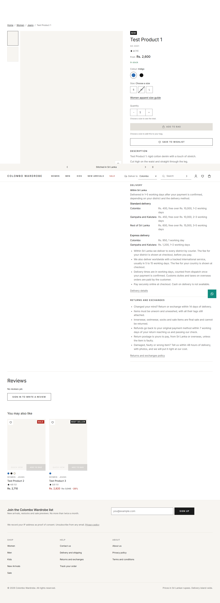
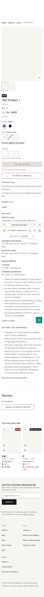
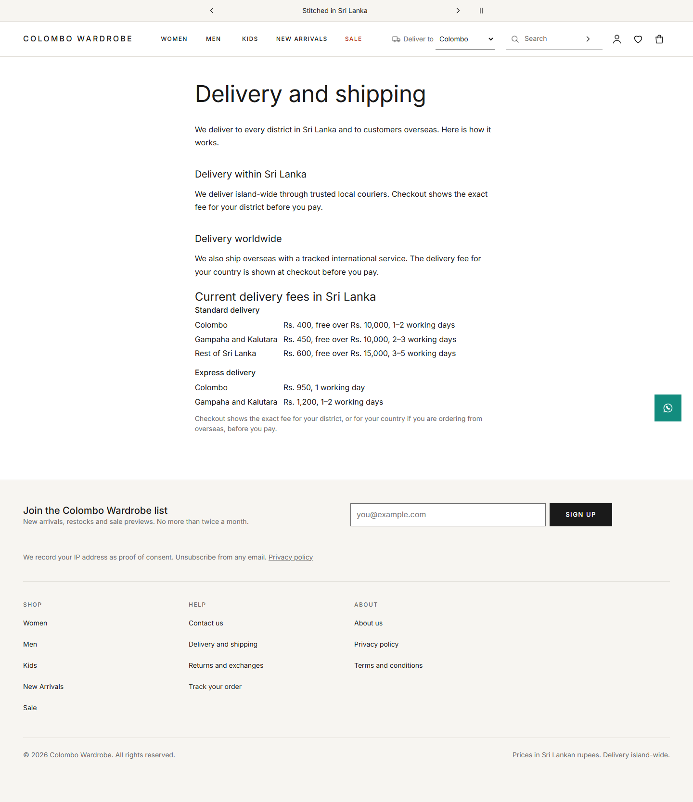
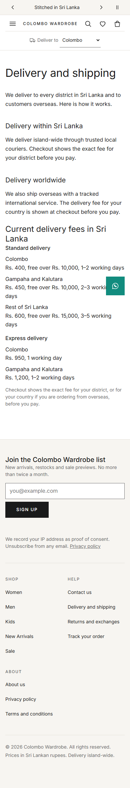
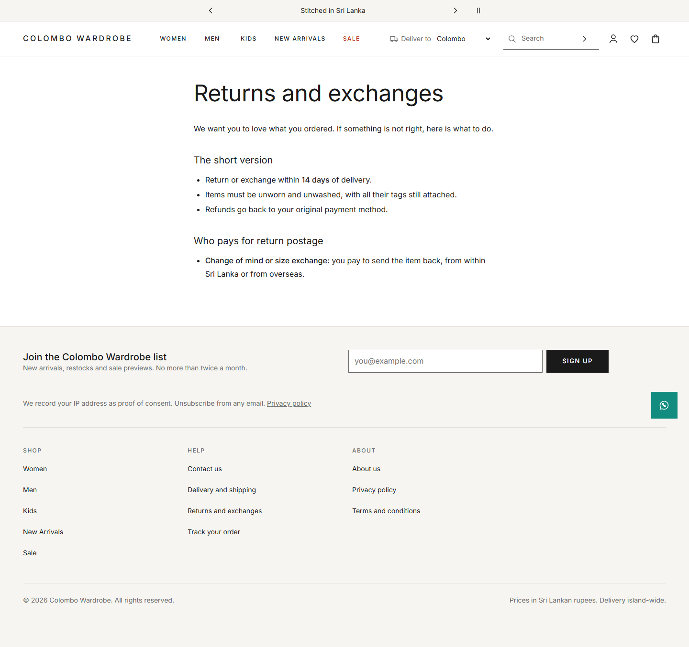
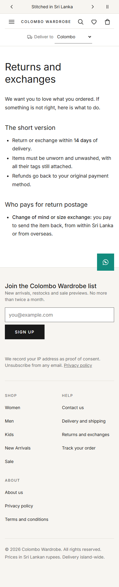
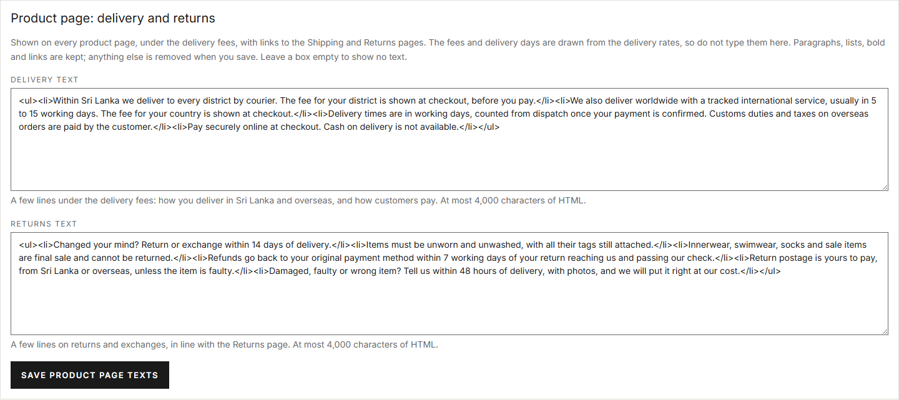
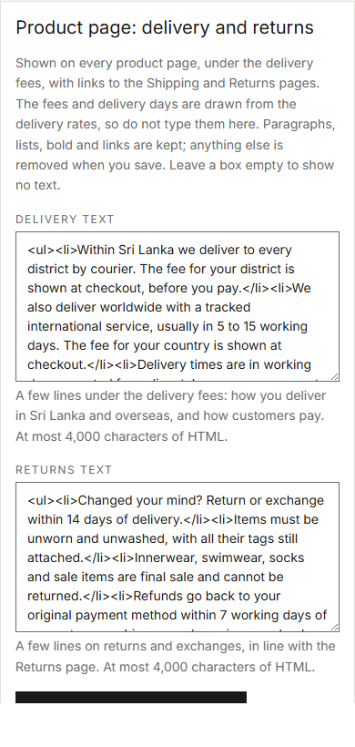

# 2026-10-21 — #33 PDP-05 delivery estimate, delivery methods and returns terms; Shipping and Returns pages; couriers (developer pass)

Branch `feature/33-delivery-returns` (worktree `worktrees/sd-delivery`), based on `main` 6cece38. **Not pushed. Not tester-passed, so not Done.** No migration.

Research, drafts and the courier verification: [`docs/research/2026-10-21-sri-lanka-delivery-returns-couriers.md`](../research/2026-10-21-sri-lanka-delivery-returns-couriers.md) (committed on this branch). The research doc says "drafts for owner approval"; the owner approved the approach on 2026-10-21 (below), and every text stays editable in admin.

## Owner instructions this pass implements
1. **2026-10-21 (brief):** base the shop's delivery and returns terms on the best Sri Lankan apparel sites, in our own words; put them on the product page and the store pages; seed the best Sri Lankan couriers; keep everything editable in admin. **This reverses the earlier "never seed couriers" rule** — `SaveCourierCommand`'s remarks now record the new decision.
2. **2026-10-21 (mid-task change from the coordinator):** the shop delivers to Sri Lanka **and worldwide**, and takes payment by **PayPal only** (bank transfer switched off by an admin switch, may return). Prices in LKR; PayPal charges the USD equivalent. Effect here:
   - wording covers overseas delivery (tracked international service, times as a range, fee at checkout for the customer's country); no "island-wide only";
   - overseas returns: customer pays return postage unless faulty; customs duties and taxes are the customer's;
   - refunds go "to your original payment method" (true for PayPal now and for bank transfer if it returns), not "by bank transfer";
   - the product-page panel keeps the Sri Lanka zone rates as built and carries the worldwide line in the editable delivery text; country fees are **not** built here (`feature/intl-delivery` owns them). The panel has an `[sdDeliveryRegion]` projection slot beside the "Within Sri Lanka" region so that branch can add "Delivery to {country}" without a rewrite;
   - couriers: the six Sri Lankan ones, plus **Sri Lanka Post EMS** and **DHL Express**, both switched off with **no tracking template** (see Couriers).

## What was built

### 1. Product page panel (PDP-05)
- **API** `GET /api/content/delivery-returns` (public, GET/HEAD) → `DeliveryReturnsDto { estimate, zones[], methods[], pickupPoints[], deliveryInfoHtml, returnsInfoHtml }`.
  - Read **through `ICheckoutReader`**, the reader checkout prices from: a method is listed only where checkout would offer it (enabled + available rate for the zone); zones only where an active district exists; labels built from the districts ("Colombo", "Gampaha and Kalutara", "Rest of Sri Lanka" for >3 districts, "All of Sri Lanka" when it is the only zone).
  - **Pickup** only when the pickup method is enabled **and** an active pickup location in an active district exists with an available rate for *its* zone (R7). Locations are not even queried when no pickup method is enabled.
  - **The same answer for every visitor** (no district, cart or account), so the SSR product page can be cached. Not cached server-side: a few small reads, and a changed fee or text shows on the next page view.
  - Texts are `Content.PdpDeliveryInfoHtml` / `Content.PdpReturnsInfoHtml`, **sanitised again on read** (rows written round the save handler); a value the sanitiser refuses is empty. A read-only port `IProductPageTextReader` (never a secret row, only `TextHtml` rows).
  - Pure logic in `DeliveryReturnsComposer` (unit-tested and mutation-tested).
- **Storefront**: `ProductDeliveryReturns` under the product details — two native `
` disclosures, **Delivery** and **Returns and exchanges** (keyboard-operable by definition, contents in the SSR HTML whether open or shut). Delivery: a "Within Sri Lanka" named region (estimate line + `DeliveryRates`: one definition list per method, zone → "Rs. 400, free over Rs. 10,000, 1–2 working days"; pickup points when listed), the extension slot, the owner's delivery text, and "Delivery details" → Shipping page. Returns: the owner's text and "Returns and exchanges policy" → Returns page. **Links appear only when the page is published**, found by system key (slug is editable). `DeliveryReturnsService`: SSR fetch + `ServerHandover`, 2 s timeout, shared per session, payload vetted (`toDeliveryReturns`); any failure = no panel, product page unaffected.
- **Settings**: the two keys join `SettingCatalog` (group `Content`, `TextHtml`, `Settings.Edit`, own save unit) via `ContentSettingDefinitions`, seeded on insert only with original wording; **removed from `DeferredSettingKeys`** (only those two lines touched there, for the `feature/22-settings-smtp-verify` merge). Doc 08 §3.8's Content row now names the decision; `SettingKeySpecificationTests` allows exactly these two seeded texts and requires the doc row to cite #33.
- **Admin editor**: `PUT /api/admin/settings/product-page-info` (`Settings.Edit`, antiforgery, presence-aware: absent = not written, null/blank = no text). `UpdateProductPageInfoCommandHandler`: sanitise with `IHtmlSanitiser` → refusal or > 4,000 cleaned chars is a 400 on that field → seeded → token (409) → per-row permission (403) → diff → **one audit row per changed key** (`SettingsAuditTrail`). Answers **200 `{ removed: [...] }`** (what the sanitiser took out), so the screen can say so; `SettingsWriteResult.Succeeded/Unchanged` gained an optional `Removed`. Admin Settings page: new panel "Product page: delivery and returns" with two labelled textareas, hints, field errors and a removed-markup notice.

### 2. Shipping and Returns pages (GLB-10)
- `PolicyPageContent` holds the full Shipping & Delivery and Returns & Exchanges copy (original wording, covering Sri Lanka + overseas, PayPal-era refunds). **No delivery fee and no Sri Lankan delivery day is written** ("checkout shows the exact fee for your district"); the Shipping page draws the **live fee list** under the copy (`ShippingRates`, same feed).
- `HomeContentSeeder.SeedPolicyPagesAsync`, **once per `Seed.PolicyPagesVersion`**: fills and **publishes** a page only while its body is empty (or exactly an earlier seed — none yet for v1). An admin's words, an emptied-after-seeding page, a soft-deleted page, titles, slugs and SEO fields are never touched. About, Privacy and Terms untouched.
- `SystemPageCopyTests` now allows exactly one non-empty body assignment (`PolicyPageContent.Bodies[...]`) and pins its keys to Shipping and Returns.

### 3. Couriers (ADM-22)
`SalesReferenceData.Couriers`, seeded by `SalesReferenceDataSeeder.SeedCouriersAsync` **once per `Seed.CouriersVersion`**, never over an existing name (case-insensitive, like the collation), so an admin's own row keeps its template/phone/switch and **a deleted courier is never re-created**.

| # | Name | Phone | Tracking template | Active |
|---|---|---|---|---|
| 1 | Domex | 011 7 759 759 | `https://www.domex.lk/Order-Details.php?wbno={trackingNumber}` | yes |
| 2 | Koombiyo Delivery | 011 7886786 | `https://koombiyodelivery.lk/Track/track_id?id={trackingNumber}&phone=` | yes |
| 3 | Citypak | +94 11 7697000 | `https://track.citypak.lk/track?tracking_number={trackingNumber}` | yes |
| 4 | Pronto Lanka | +94 112 102 700 | — (form-only) | no |
| 5 | Trans Express | 011 2999 888 | — (form-only) | no |
| 6 | Sri Lanka Post (Speed Post) | 011 2328112 | — (POST + CAPTCHA) | no |
| 7 | Sri Lanka Post EMS | — | — | no |
| 8 | DHL Express | — | — | no |

- **EMS**: SL Post tracking is a POST form with a CAPTCHA (research §3), so no template is possible; no EMS-specific phone was verified, so none is seeded.
- **DHL Express**: dhl.com refused every automated check (timeout / connection refused); the `tracking-express.html?submit=1&tracking-id=` pattern appears only in a 2022 community answer, not on DHL's site. **Not verified, so not seeded** — template and phone left empty for the owner, per "don't guess URLs".
- An empty template shows the number as **plain text**: verified in code and tests — `OrderTrackingLink.Build(null, n)` is null; the order page renders `order-page-tracking-number` text, and the shipped email says "Your courier does not offer online tracking…". Unit tests render each seeded template to a link (number URL-escaped) and each empty one to no link.
- Constraints checked by unit test for every row: `{trackingNumber}` present, absolute `https://`, ≤ 500; phone ≤ 20 printable ASCII; name ≤ 80, unique.
- The courier admin screen and validators were **not** touched (owned by `feature/22-settings-smtp-verify`).

## Owner decisions (safe defaults, all editable)
| Decision | Default | Where to change |
|---|---|---|
| Return / exchange window | 14 days from delivery | Returns page; product page returns text |
| Condition | unworn, unwashed, unaltered, all tags | same |
| Final sale | innerwear/lingerie, swimwear, socks/hosiery, pierced jewellery, Sale/Final-sale items | same |
| Refund | to the original payment method, within 7 working days of the return passing its check (was "manual bank transfer" in the brief; changed by the PayPal-only decision) | same |
| Return postage | customer pays for change of mind / size exchange, from Sri Lanka or overseas; shop pays when faulty, damaged or wrong | same |
| Damage report | within 48 hours of delivery, with photos | same |
| Exchange replacement | free when faulty; standard delivery fee for a size or change-of-mind exchange | Returns page |
| Customs duties and taxes | customer's responsibility, not refunded | Shipping and Returns pages |
| Overseas delivery time | "usually 5 to 15 working days" | Shipping page; delivery text |
| Cash on delivery | not offered (#55) | Shipping page; delivery text |
| Store pickup | hidden until a pickup location exists and PICKUP is enabled | data, not text |
| Couriers | only the three verified-link couriers active | Settings → Couriers |

Open for the owner: which couriers the shop actually books with; DHL Express / EMS account details; D8 zone fees (the panel and Shipping page render them).

## Tests
- **Unit (xUnit)**: 3,988 passed, 0 failed. New: `UpdateProductPageInfoCommandHandlerTests` (sanitise on save, removed report incl. on an unchanged save, empty → null, cap at 4,000 / 4,001, parser refusal, absent field not written, stale and missing token, permission, no user id, not seeded, save conflict), `DeliveryReturnsComposerTests` (rates from the table, a changed fee, unavailable/missing rates, zone without district, labels, estimate, pickup: none / disabled / no available rate / location zone rate / blank hours), `GetDeliveryReturnsQueryHandlerTests` (sanitised on read, refused → empty, one read per zone, locations read only with pickup), `DeliveryReturnsSeedDataTests` (seeded HTML is exactly the sanitiser's output, no rupee figure, owner defaults present, no bank-transfer refund wording, courier constraints, three active verified couriers, link vs plain-text tracking for every seeded courier, `IsUntouched`). Updated: catalogue/spec/save-unit/system-page-copy tests for the owner's decisions.
- **Integration (SQL Server, LocalDB, filtered)**: `DeliveryReturnsEndpointTests` 14/14 (public panel with seeded rates and texts; fee change shows; pickup hidden → shown → hidden with location off / method off; script round the handler sanitised on read; secret or retyped row never published; editor 401 anonymous, role matrix Store Manager 200 / Content Editor, Order Staff, Payments-only 403; sanitise + removed + audit per key + panel shows it + unchanged save writes no audit; stale 409; 4,000 cap 400; JSON number 400; antiforgery 400; admin read model shows the Content group), `DeliveryReturnsSeedTests` 6/6 (couriers once, deleted one stays deleted; existing names incl. different case untouched; policy pages written + published once, emptied page stays empty; admin draft never overwritten or published; soft-deleted page left alone; texts seeded into an existing DB once, owner value and null survive). Wider filtered run (content pages, home seeders, admin settings/traffic, fresh deployment, order endpoints, fulfilment, sales reference data, sitemap, reviews, order history): 324 run, 4 failures fixed (expected lists and a change-tracker clear in my own test), rerun green. Each run waited for no other `testhost` for 60 s, except one 14-test check where another session's 2 testhosts were running (noted; it passed).
- **Release build**: `SpencerDenim.sln` 0 warnings, 0 errors.
- **Vitest**: storefront 2,149, admin 866, shared 24 — all passing. `ng lint` clean.
- **Build sizes**: storefront initial **450.01 kB** (main 449.83 kB, +0.18 kB: the panel and its service are lazy, in the product-page and content-page chunks; the small delta is chunk-graph shuffling). Admin initial 316.22 kB.
- **Playwright** (ports 6650–6673, checked free; 6665–6669 are Chrome-unsafe and were skipped): new `delivery-returns.e2e.ts` (fees in the SSR HTML; keyboard open/close with Enter and Space; region and list names; axe on the open panel; the 8 widths with the panel open, no sideways scroll, 44 px summaries; pickup shown only when listed; changed fee; hostile text inert; failed feed leaves the page whole; no link to unpublished pages), additions to `content-pages.e2e.ts` (links land on the published pages; Shipping copy + live fees; Returns copy; both pages at the 8 widths; axe) and `admin-settings.e2e.ts` (seeded texts in labelled boxes, removed-markup notice, cap error on its box, axe, 8 widths; heading list updated). Targeted: 89/89. **Full suite: 1,284 passed, 6 failed, 4 skipped** — 1 real (`product-page.e2e` "description is rich text": the panel's texts used the `.rich` hook; fixed by scoping the styles under `:host ::ng-deep`), 5 timing failures under load in unrelated specs (account, refused-add focus, quick-view 390, search history, header CLS); all 6 rerun green with the panel spec (29/29).
- **Stubs** mirror the DTOs and are no more permissive than the validators: the admin stub's sanitiser keeps only the server's allow-list tags and only safe `href`s (stricter), enforces the 4,000 cap, the type check, presence and the Content token, and answers `{ removed }`.

### Mutation testing
38 hand-written mutants (`scratchpad/sd-delivery/mutate.py`), each applied, run against its narrowest suite, reverted. **36 killed, 2 survivors, both equivalent:**
- *Courier marker `>=` → `>`*: the per-seed `IntroducedIn > recorded` filter still offers nothing, so behaviour is unchanged (two guards, each sufficient).
- *Service hands over a failed (null) panel*: `ServerHandover.take` treats null as "nothing handed over", so the browser re-asks exactly as before.
Four mutants first failed to compile (`if (false)` is an error under warnings-as-errors) and were rewritten; two first survived and were killed by new tests (a secret/retyped text row is never published; the Sri Lanka section stays for store pickup alone).

| Area | Mutants | Result |
|---|---|---|
| Composer (labels, availability, pickup, zones, estimate, hours) | 10 | 10 killed (unit) |
| Query (sanitise on read, lazy location read) | 2 | 2 killed (unit) |
| Editor handler (cap, cleaned value, null, refusal, token, permission, removed, audit) | 8 | 8 killed (unit) |
| Public text reader (secret row) | 1 | killed (integration, new test) |
| Policy-page seeding (marker, overwrite, publish, untouched rule) | 4 | 4 killed |
| Courier seeding (marker, case, overwrite) | 3 | 2 killed, 1 equivalent |
| Storefront service / rates / panel / model | 8 | 7 killed, 1 equivalent |
| Admin page (removed notice, keys-only form) | 2 | 2 killed |

## Screenshots
Product page panel (both disclosures open), Shipping page with live fees, Returns page, admin editor — at 1440 and 390 px (`journal-33-screenshots.e2e.ts`, written only when `E2E_JOURNAL_SHOTS` is set):

| | 1440 | 390 |
|---|---|---|
| Product page |  |  |
| Shipping |  |  |
| Returns |  |  |
| Admin editor |  |  |

(The 390 px full-page shots show the sticky header mid-page; that is how a full-page capture draws a sticky element, not a layout fault.)

## Not done / for others
- Country fees and "Delivery to {country}": `feature/intl-delivery` (slot ready).
- Switching bank transfer off / PayPal-only checkout: not this branch.
- The storefront **footer still says "Delivery island-wide."** (shell copy, not part of #33's scope) — worth changing with the worldwide work.
- MEMORY.md / TASKS.md / client-progress not updated on this branch (coordinator's step after the tester pass).
